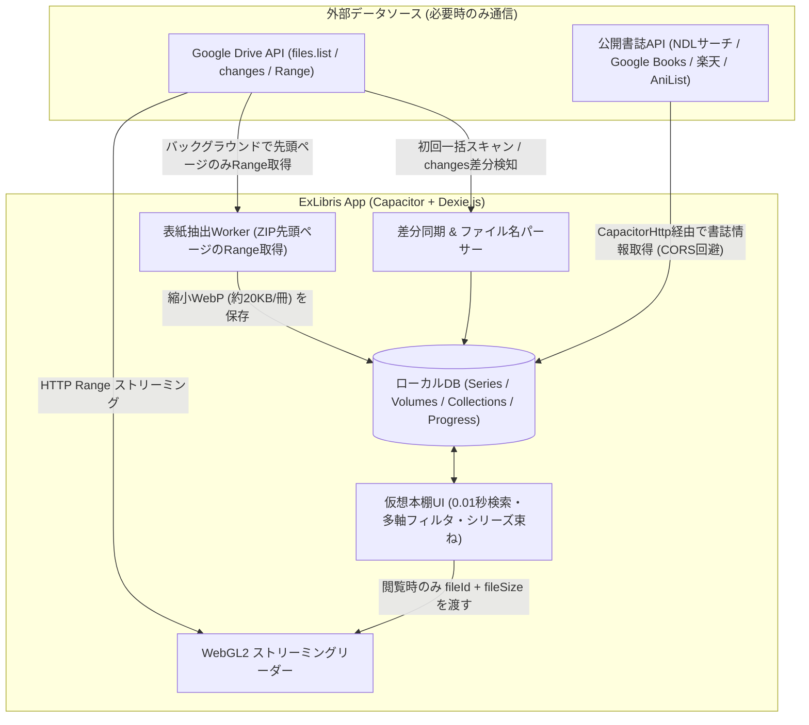

# ExLibris (`ex-libris`) — 初期構想・技術検証マスタードキュメント

**作成日:** 2026-11-18  
**プロジェクト名 / リポジトリ名:** `ExLibris` (`ex-libris`)  
**命名由来:** ラテン語 *Ex Libris*（蔵書票 / 「〜の蔵書より」「私の蔵書」）。クラウドストレージの物理フォルダ構成に縛られず、「自分だけの美しい蔵書ライブラリ（仮想本棚）」を構築し、ストレスゼロで読書を楽しむコンセプトを表す。  
**ステータス:** 初期構想・技術的実現性検証完了（GitHubリポジトリ立ち上げ時マスターインプット資料）

> [!IMPORTANT]
> **本ドキュメントの位置づけと今後の進め方**
> 本資料は、企画初期段階における構想・アーキテクチャ設計・技術的落とし穴の検証結果・理想機能のアイデアを**重要度にかかわらず漏れなく1枚に集約したマスターインプット資料**である。
> 各機能の詳細仕様の確定、MVP（最小実用製品）のスコープ切り出し、および具体的な実装順序・マイルストーンの策定は、`ex-libris` リポジトリへの移行後に本資料をベースとして整理・決定する。

---

## 1. プロジェクト背景・目的・前提条件

### 1.1 背景と課題意識
* **開発テーマとしての位置づけ:** Web小説リーダーアプリ（Capacitor + React + Vite）の開発が一段落したことを受け、次のステップとなる「少し難易度の高いAI駆動開発（TDD）テーマ」として選定。
* **ストレージ移行の課題:** 現在、自炊マンガデータは自宅の古いSMBサーバーに保管しているが、ハードウェア更新コストや維持管理の手間を考慮し、Googleドライブへの完全移行を検討している。
* **既存ビューアの限界:** 既存のAndroid向けマンガビューア（Perfect Viewer等）はGoogleドライブ連携時の速度や階層同期に課題（大容量ファイル全体の事前ダウンロード待ち、フォルダ移動時のAPI遅延、物理フォルダに依存した窮屈な蔵書管理など）があり、移行のボトルネックとなっていた。

### 1.2 プロジェクトゴール
1. **ゼロ待ち超高速ストリーミング:** Google Drive API（HTTP Rangeリクエスト）に完全特化し、100MB超〜数GB規模のZIP/CBZファイルでも**ダウンロード待ちゼロ（0.1〜1秒未満）で1ページ目が開く超高速ストリーミングビューア**を自作する。
2. **物理ストレージと分離された「仮想本棚」と高機能検索:** Googleドライブのディレクトリ構成とアプリ内の本棚構成を完全に分離する。公開情報から漫画の書誌情報（タイトル・作者・出版社・タグ等）を取得してローカルDBで管理し、ファイル参照（Google Driveの `fileId` / URL）のみを紐付けることで、0.01秒の高速・多軸検索を実現し、実際にリーダーで開くときだけGoogleドライブへアクセスする。
3. **AI駆動開発（TDD）による低レイヤー高速化実装:** 既存のCapacitor + React + TypeScriptの開発資産を活かしつつ、Web Workers・バイナリ解析・Zero-Copy転送・WebGL2シェーダー描画などの高速化技術をテスト駆動開発で構築する。

### 1.3 ターゲット環境と自炊データの前提条件（初期合意事項）
* **メインターゲット端末:** Androidタブレット・スマートフォン（Capacitorアプリ）
* **対応アーカイブ形式:** **ZIP / CBZ 形式に特化**（RAR/CBR、PDFは手持ち資産の前提から対象外）
* **想定する自炊データの特徴:**
  * 1ページ数MBに及ぶ**高解像度スキャン画像**が含まれる。
  * 画像フォーマットは JPEG / PNG に加え、**WebP / AVIF** が混在する可能性がある。
  * 数GB規模（4GB超・数千ページ規模）の**合本ZIP（ZIP64規格）**が含まれる。
  * Windows環境等で作成された **Shift_JIS（CP932）ファイル名**（UTF-8フラグ未設定）や、macOS由来の不要ファイル（`__MACOSX` 等）が混在する可能性がある。
* **初期段階での割り切り・決定事項:**
  * **描画エンジン:** Canvas 2Dは経由せず、最初から **生WebGL2** で実装する（モアレ除去および自炊画質補正のため）。
  * **L2キャッシュの永続化:** OPFS（Origin Private File System）を用いた圧縮チャンクのディスク永続化は**初期スコープには含めない**（オンメモリL2キャッシュとし、OPFS活用は将来拡張候補として保持）。
  * **合本ZIP内の巻またぎ:** 合本ZIP内部のサブフォルダ境界を「巻・チャプター」として分割認識する処理は**考慮しない**（1つのフラットなページ列としてソートして扱う）。

---

## 2. 技術選定の根拠と推奨技術スタック

### 2.1 なぜ「Capacitor（React + TypeScript）」を採用するのか
1. **ネイティブブリッジのボトルネックを完全回避できる:**
   ローカルファイルやSMBをCapacitorプラグイン経由で読むとBase64変換コストが発生するが、Google Drive API（HTTPS）であれば、WebView内のWeb Workerから直接 `fetch` でバイナリ（`ArrayBuffer`）を取得できるため、純ネイティブアプリと同等の通信・展開速度が出せる。
2. **`CapacitorHttp` による公開書誌APIのCORS制限突破:**
   通常のWebブラウザでは外部の公開書誌API（国立国会図書館サーチ等）を直接叩くとCORSエラーになるケースがあるが、CapacitorのネイティブHTTP通信機能を併用することで、バックエンドサーバーを別途立てることなくアプリ単体で直接書誌情報を取得できる。
3. **開発資産の流用:**
   既存のCapacitor環境、React UI、Google OAuth認証などの知見をそのまま流用し、コアエンジンと本棚UXの実装に集中できる。
4. **自宅サーバーとの両対応（過渡期対策）:**
   自宅サーバー側でSMB共有ディレクトリをHTTP配信（Nginx / Caddy / `rclone serve http` 等）すれば、Googleドライブと全く同じ `HTTP Range` インターフェースで自宅サーバー上のZIPも透過的にストリーミング閲覧できる。

### 2.2 推奨技術スタック
* **App Framework:** React + TypeScript + Vite + Capacitor (Androidメイン)
* **Rendering Engine:** 生WebGL2（約200行規模のカスタム板ポリゴン＋フラグメントシェーダー構成、Three.js等の大型ライブラリは不使用）
* **Thread Communication:** Comlink（Web WorkerのRPCラッパー）+ Transferable Objects（Zero-Copy転送）
* **ZIP Parsing / Decompression:** 自前Central Directory / Local Headerパーサー（ZIP64・Shift_JIS対応）+ Web標準 `DecompressionStream('deflate-raw')`（フォールバックとして `fflate`）
* **Local DB (Virtual Bookshelf & Cache):** Dexie.js (IndexedDB)
* **HTTP Client (Metadata API):** `@capacitor/core` (`CapacitorHttp`) / Web `fetch`
* **State Management:** Zustand
* **Testing (AI Harness):** Vitest（バイナリパーサー、キャッシュ制御、ファイル名クレンジング等の単体テスト駆動開発用）

---

## 3. コア・アーキテクチャ①：超高速ストリーミング＆WebGL2描画エンジン

UIのフレームドロップ（60fps割れ）、AVIF/高解像度画像のデコード詰まり、およびモバイル端末特有のVRAM枯渇（OOMクラッシュ）を防ぐため、責務をマルチスレッド＋2段階キャッシュに完全分離する。

### 3.1 スレッド分離とデータフロー全体像

```mermaid
flowchart LR
    subgraph Cloud["Storage Layer (HTTP Range)"]
        GD["Google Drive API / Home HTTP / Local"]
    end

    subgraph IOWorker["Coordinator Worker (I/O & L2 Cache)"]
        Reader["RandomAccessReader"]
        Parser["ZIP / ZIP64 Parser"]
        Prefetch["Adaptive Prefetcher"]
        L2["L2 Cache (Compressed Uint8Array: 60-100MB)"]
    end

    subgraph DecodePool["Decode Worker Pool (x2)"]
        Inflate["DecompressionStream / Store"]
        Bitmap["createImageBitmap"]
    end

    subgraph UIThread["UI Thread (React + WebGL2)"]
        L1["L1 Cache (ImageBitmap: 3-5 pages)"]
        GL["WebGL2 (Mipmap + Sharpness / Level Shader)"]
    end

    GD -->|"1. Tail 128KB / 2. Byte-Budgeted Range"| Reader
    Reader --> Prefetch
    Prefetch --> Parser
    Prefetch --> L2
    L2 -->|"Slice"| Inflate
    Inflate --> Bitmap
    Bitmap -->|"Zero-Copy Transfer"| L1
    L1 -->|"texImage2D"| GL
```

* **I/O Layer（`RandomAccessReader` 抽象化レイヤー）:**
  * `GoogleDriveRangeReader`: Google Drive API（`alt=media` + `Range: bytes=start-end`）による部分取得。
  * `HttpRangeReader`: 自宅サーバー（HTTP配信）からの部分取得。
  * `LocalFileReader`: 端末ローカルの `File.slice(start, end)` による部分取得。
* **Coordinator Worker:** Rangeリクエストのスケジューリング、ZIP構造解析、圧縮済みバイナリ（L2キャッシュ）のLRU保持、高速シーク時の `AbortController` による通信キャンセルを担当。
* **Decode Worker Pool（2ワーカー構成）:** 切り出されたチャンクの解凍（Deflate展開またはStore素通し）と `createImageBitmap` による画像デコードを担当。CPU負荷が高いAVIFや高解像度画像のデコード中もI/O制御をブロックさせない。生成した `ImageBitmap` は **Transferable Objects（Zero-Copy）** でUIスレッドへ所有権ごと転送する。
* **UI Thread（React + WebGL2）:** `` タグや `Blob URL`（メインスレッドデコードによるカクつきの原因）は一切使用せず、受け取った `ImageBitmap` のL1キャッシュ管理とWebGL2テクスチャ描画・ジェスチャー処理だけに専念する。

### 3.2 実装時に潰すべき「7つの技術的落とし穴」と解決設計

#### ① ZIP「Local File Header（LFH）」の可変長罠と1 RTT切り出し
* **問題:** Central Directory Header（CDH）が持つオフセットは画像データの先頭ではなく **Local File Header（固定30B＋可変長ファイル名＋可変長Extra Field）の先頭** である。CDH側とLFH側で `extraFieldLength` が異なるケース（7-Zip、Info-ZIP、macOS等）が多いため、LFH確認用とデータ取得用で通信を分けると2往復（2 RTT）になり初速が悪化する。
* **解決策:**
  * CDH解析時に全エントリを物理オフセット（`localHeaderOffset`）昇順で一度ソートし、次の物理エントリの開始位置を上限 `physicalEnd` として算出する。
  * Range取得時は `[localHeaderOffset, min(physicalEnd - 1, localHeaderOffset + 30 + fileNameBytes + compressedSize + 1024)]` を**1回のリクエスト**で取得し、Worker内でバッファ先頭26〜30バイト目の `lfhFileNameLen` / `lfhExtraLen` を読んで `Uint8Array.subarray()` で実データをゼロコピー切り出しする。
  * なお、ストリーミング生成ZIP（Bit 3 Data Descriptor有効）ではLFH内の `compressedSize` が `0` になるため、必ずCDH側の `compressedSize` を正として使用する。

#### ② 「論理ページ順」と「ZIP内の物理格納順」の不一致対策
* **問題:** アーカイブ作成環境によっては、ファイル名ソート順（論理ページ順）とZIP内の物理オフセット順が一致していない場合がある。
* **解決策:** 複数ページを一括取得するチャンク・アグリゲーション時は、「ページ番号が連続しているか」ではなく**「次ページの `localHeaderOffset` が現在ページ終端の直後（ギャップ64KB以内）かつ昇順にあるか」**を判定条件とし、離れている場合は個別Rangeリクエストに分割して無駄な中間領域のダウンロードを防ぐ。

#### ③ 数GB合本ZIP（ZIP64）と「末尾64KB溢れ」対策（最大2 RTT ＋ DB永続化）
* **問題:** 数千ページの合本ZIPではCentral Directory自体が300〜500KBに達し末尾64KBに収まらない。また4GB超では標準EOCDが `0xFFFFFFFF` に飽和しZIP64構造となる。
* **解決策:**
  * 本棚DBの同期時点で正確なファイルサイズ `size` は既知であるためHEADリクエストは不要。
  * **初回128KB取得:** まず末尾 **128KB**（`bytes=${size - 131072}-${size - 1}`）をRange取得する。通常の単行本（CDサイズ約15〜20KB）ならこの **1 RTT** だけでEOCD＋CD全体の取得が完了する。
  * **ZIP64対応:** EOCDの20B手前にある `ZIP64 EOCD Locator (0x07064b50)` を確認し、存在する場合は `ZIP64 EOCD (0x06064b50)` から64bitの `cdOffset` / `cdSize` を `DataView.getBigUint64(pos, true)` で取得する（JSの `Number.MAX_SAFE_INTEGER` は約9PBのため `Number` 変換で精度劣化なし）。
  * **不足分フォールバック:** 合本ZIP等で `cdOffset` が初回128KBより前にある場合のみ、不足区間 `[cdOffset, size - 131072 - 1]` を追加1 RTTで取得する。
  * **ZIP64 Extra Field (`0x0001`) の厳密パース:** 各CDH内の拡張フィールド `0x0001` には常に8B×3項目が入っているわけではなく、PKWARE仕様に基づき**「標準ヘッダ側が `0xFFFFFFFF`（または `0xFFFF`）に溢れた項目だけ」**が規定順（非圧縮サイズ→圧縮サイズ→LFHオフセット→ディスク番号）で格納されるため、飽和判定に応じて読み進める。
  * **目次キャッシュ:** 構築した目次情報は `fileId + md5Checksum` をキーとしてDexie.js（IndexedDB）へ保存し、2回目以降のオープン時は **0 RTT** で即座に1ページ目の取得へ入る。

#### ④ Shift_JIS（CP932）ファイル名と自然順ソート
* **文字コード判定:** General Purpose Bit Flag の Bit 11（`0x0800`）が `1` ならUTF-8確定。`0` の場合はUTF-8フラグ未設定ツールとWindowsのShift_JISの双方があり得るため、`new TextDecoder('utf-8', { fatal: true })` を試行し、例外発生時のみ `new TextDecoder('shift-jis')`（ChromiumではCP932拡張文字もデコード可）へフォールバックする。
* **ゴミ除外と自然順ソート:** ディレクトリ、`__MACOSX/`、`._*`、`Thumbs.db` 等を除外し、パスを `/` 区切りのセグメント単位で `Intl.Collator('ja', { numeric: true, sensitivity: 'base' })` 比較することで、`p2.jpg` → `p10.jpg` 等を正確に並べる。

#### ⑤ 高解像度画像のVRAM爆発（OOM）を防ぐ「L1/L2 2段階キャッシュ」
* **問題:** 高解像度スキャン（例：3000×4200px）を `createImageBitmap` で展開すると1枚あたり **約50MB** の非圧縮RGBAネイティブメモリを消費する。前後8ページすべてを `ImageBitmap` で保持すると400MBを超え、Android WebViewがOOMクラッシュする。
* **解決策:** キャッシュを2階層に分離する。
  * **L1キャッシュ（UI / GPU側：デコード済み `ImageBitmap`）:** 保持範囲を **`N-1` 〜 `N+2`（計3〜5ページ程度）** に厳格制限し、ウィンドウ外に出た瞬間に `bitmap.close()` を呼んでVRAM/RAMを即時解放する。
  * **L2キャッシュ（Worker RAM側：圧縮済み `Uint8Array`）:** Range取得して切り出した未デコード画像データ（1枚1〜5MB）を **60〜100MB分（約15〜50ページ分）** LRU保持する。L2にデータがあれば20〜40msで `ImageBitmap` 化できるため、ページを行き来しても再通信ゼロかつ省メモリを両立できる。

#### ⑥ アダプティブ・プリフェッチ（Fast-Path ＋ バイト予算制アグリゲーション）
* **問題:** 1ページごとのRangeリクエストはGoogle Drive APIのバースト制限や通信オーバーヘッドを招く一方、1ページ5MBの本で最初から5ページまとめ取り（25MB）すると1ページ目の表示（Time to First Page）が遅くなる。
* **解決策:**
  * **Fast-Path（初回・シーク直後）:** 結合を行わず、現在表示に必要な **1ページ（見開き時は2ページ）だけ** を最小Rangeで単独リクエストし、0.2〜0.5秒での最速描画を優先する。
  * **Warm Prefetch（後続先読み）:** 初回ページ描画直後から、「固定ページ数」ではなく**「1リクエストあたり合計 8MB〜12MB 上限（最低1ページ）」のバイト予算制**で物理連続ページを結合取得し、L2キャッシュへ格納する。軽量WebP本でも重厚JPEG本でも最適なチャンクサイズに自動調整される。

#### ⑦ スクリーントーンの「モアレ対策」とWebGL2自炊補正シェーダー
* **問題:** 4000px級のスキャン画像をタブレット画面（縮小率0.4倍前後）へCanvas 2Dで縮小描画すると、スクリーントーンに激しい格子状のモアレ（干渉縞）が発生する。一方 `createImageBitmap` のCPUリサイズオプションはデコード速度を大幅に悪化させ、ズーム時にぼやける。
* **解決策（生WebGL2パイプライン）:**
  * **ハードウェアMipmap:** `gl.texImage2D` 後に `gl.generateMipmap(gl.TEXTURE_2D)` と `gl.LINEAR_MIPMAP_LINEAR`（トリリニアフィルタ）を適用し、GPU上で1〜2msでモアレを完全除去する。
  * **自炊特化フラグメントシェーダー:** トリリニア補間によるペン線のわずかな眠さを解消する **LODバイアス調整（または軽量アンシャープマスク）** と、経年劣化した紙の黄ばみ・裏写りを飛ばしてインクを引き締める **リアルタイム白黒レベル・ガンマ補正** をシェーダー1パス（0.1ms）で処理する。
  * **`MAX_TEXTURE_SIZE` ガード:** 大判見開き画像（6000×4200px等）に対し、起動時に `gl.getParameter(gl.MAX_TEXTURE_SIZE)` を確認し、4096px上限の端末では左右2分割テクスチャまたは上限リサイズへ自動フォールバックさせて黒画面化を防ぐ。

---

## 4. コア・アーキテクチャ②：仮想本棚・同期・表紙抽出・公開書誌連携

### 4.1 物理フォルダ構成と「仮想本棚」の完全分離モデル

Google Drive上のディレクトリ階層とアプリ内の本棚構造を切り離し、**普段のブラウジング・検索・整理は100%ローカルDB（IndexedDB）上で完結**させる。

* **データモデルの基本概念:**
  * **Series（作品シリーズ）:** タイトル、読み仮名、作者（原作/作画）、出版社、レーベル、ジャンル・タグ、あらすじ、連載状況、既刊巻数、代表表紙などを保持。
  * **Volume（巻・実ファイル参照）:** 紐づく `seriesId`、巻数表示、ストレージ種別、Google Driveの不変IDである **`driveFileId`（またはHTTP URL）**、`fileSize`、`md5Checksum`、個別表紙WebP、読書進捗を保持。
  * Google Drive側でファイルを別フォルダへ移動しても `driveFileId` は不変なためリンク切れせず、Drive上が未整理でもアプリ上では美しいシリーズ本棚として機能する。

### 4.2 Google Driveインデックス同期設計
* **初回フルスキャン:** フォルダ階層を再帰的に辿るのではなく、`files.list` APIで `mimeType='application/zip'` 等のクエリと `pageSize=1000`、最小限の `fields(id, name, size, md5Checksum, parents)` を指定して一括取得する。数千冊規模でも数リクエスト（数秒）で全ファイル一覧を取り込める。
* **2回目以降の差分同期:** Google Drive `changes.list` API（`startPageToken` 保存方式）を利用し、アプリ起動時に前回以降に追加・変更・削除されたファイルのみを1リクエスト（約0.2秒）で検知してローカルDBを更新する。

### 4.3 表紙サムネイル生成方式（2026年時点の外部API制約と自己完結アプローチ）

> [!WARNING]
> **外部書影API・Drive標準サムネイルに依存できない理由**
> 1. Google Drive APIの `thumbnailLink` は大容量ZIP/CBZファイルに対して生成されない（汎用アイコンになる）。
> 2. 国立国会図書館（NDL）の「書影API」は2026年3月末で提供終了しており、openBDも書影収録範囲が大幅に縮小している。

* **採用方式（ZIP先頭ページからの自前Range抽出）：**
  * コアエンジンのZIP Rangeパーサーを流用し、**各ZIPの1ページ目をピンポイントでRange取得 → 長辺350px前後の軽量WebP（1冊約15〜25KB）に縮小してローカルDBへ永続保存**する。
  * 1,000冊分でも合計約20MBと非常に軽く、商業誌・絶版本・同人誌・合本を問わず **100%確実に表紙を表示** できる。
  * **レートリミット回避制御:** 初回取り込み時に数千冊一斉にRangeリクエストを飛ばすとGoogle Driveの制限（403 Rate Limit）に当たるため、**「現在画面に表示されている本棚枠（IntersectionObserver）を最優先で即時抽出」＋「残りはバックグラウンドで秒間2冊程度の低速キューで順次生成」**する2段スケジューリングを行う。

### 4.4 公開情報からの作品メタデータ取得とローカル高機能検索
`CapacitorHttp` によりCORS制限を回避しつつ、特性の異なる複数の公開データソースを組み合わせて補完する。

| 公開データソース | 認証・コスト | 取得できる主な強みデータ | 補完ポイント |
| :--- | :--- | :--- | :--- |
| **国立国会図書館サーチ API** (NDL OpenSearch) | 登録不要・無料 (オープンデータ) | **国内商業漫画の網羅率が最強**。正確なタイトル、**タイトル読み仮名（五十音ソート用）**、著者名、出版社、レーベル、発売年、ISBN | あらすじや細かいジャンルタグは持たない |
| **Google Books API / 楽天ブックス書籍検索API** | 無料枠 / 無料アプリID | **あらすじ（作品紹介）**、正確な発売日、JSON形式での扱いやすさ（楽天ブックスは日本の漫画レーベルに強い） | シリーズ名とレーベル名の混同などの表記揺れに注意 |
| **AniList GraphQL API** | 登録不要・無料 (90req/分) | 日本語タイトル検索対応。**ジャンル・詳細タグ（SF、バトル、日常等）、連載中/完結ステータス、総巻数**、原作/作画の役割分担 | 古いマイナー国内作品等は未登録の場合あり |

* **半自動名寄せワークフロー:**
  1. 自炊ファイル名（例：`[作者名] タイトル 第01巻.zip`）から正規表現パーサーで「推定タイトル」「作者」「巻数」を抽出し、自動で書誌APIを検索・紐付けする。
  2. 表記揺れによる誤マッチや同人誌・未登録本に備え、作品詳細画面から**「ワンタップで検索キーワードを変えて別候補を選び直すUI」および「手動メタデータ編集」**を提供する。
* **ミリ秒単位のローカル検索:** 数千〜1万冊の書誌テキストでも数MBに収まるため、ローカルDB上で「タイトル・読み仮名・作者・出版社・レーベル・ジャンルタグ・既読状況・完結状況」を組み合わせた複合検索・インクリメンタルサーチが0.01秒で動作する。

---

## 5. 機能アイデア全出しカタログ（検討項目の完全網羅）

リポジトリ移行後に優先度付けとマイルストーン策定を行うための全機能リスト。初期スコープ外とした項目も含め、検討した全要素を記録する。

### A. 仮想本棚・蔵書オーガナイズ機能
* **シリーズ自動グルーピング:** バラバラの単巻ZIPを「作品シリーズ単位の1枚のカード」に束ね、タップで巻一覧を展開する（合本ZIPも同一シリーズ内に混在登録可能）。
* **多軸ソート（正確な五十音順対応）:** 書誌情報から取得した「読み仮名」を用い、漢字タイトルも正確な五十音順でソート可能にする（他：最終読書日時順、追加順、発売日順、作者順、巻数順）。
* **カスタム本棚（コレクション）・自由タグ付け:** Google Driveのフォルダ構成に一切影響を与えず、「お気に入り」「積読」「殿堂入り」「後で読み返す」等の自由な棚・タグで多対多分類する。
* **スマートコレクション（検索条件の動的棚保存）:** 「未読巻がある作品」「完結済み×SF」「特定作者の作品」などの複合フィルタ条件を仮想タブとしてピン留めする。
* **欠巻・未所持新刊チェッカー:** 公開メタデータ側の既刊巻数とローカルDB内の所持巻番号を突き合わせ、「途中の巻が抜けている（スキャン・配置漏れ）」「未所持の最新刊が発売されている」をバッジ通知する。
* **重複アーカイブ検出:** 異なるフォルダに同一巻のZIPが重複保管されているケースをファイル名・巻数・MD5等から検出する。

### B. メタデータ・表紙アート管理機能
* **ファイル名スマートパーサー:** `[作者] 作品名 第01巻 (コミック).zip` や `作品名_v01.cbz` などの典型的な自炊命名規則から作者・タイトル・巻数を自動抽出する。
* **公開書誌APIからの自動取得＆候補再選択・手動編集UI:** NDLサーチ / Google Books / 楽天ブックス / AniList からのメタデータ取得と、手動での候補切り替え・フィールド編集・ロック機能。
* **ビューポート優先＋バックグラウンド表紙WebP自動抽出:** 表示中の本棚枠を最優先しつつ、アイドル時に全ZIPの先頭ページから軽量表紙サムネイルを生成する。
* **見開きカバー自動半裁クロップ＆表紙ページ変更:** 自炊スキャンで頻出する「1ページ目が表1＋背表紙＋表4の横長見開きカバー画像」だった場合に、表紙側（左半分または右半分）だけを自動/手動クロップして本棚の表紙サイズを揃える機能、および白紙・口絵対策として2〜3ページ目を表紙に指定できる機能。

### C. ストリーミング＆マルチストレージ連携機能
* **Google Driveゼロ待ちストリーミング（コア機能）:** 末尾128KB Central Directory解析（ZIP64/Shift_JIS対応）＋IndexedDB目次キャッシュ＋Fast-Path初速取得＋バイト予算制アグリゲーション先読み＋L1/L2 2段階メモリ管理。
* **Google OAuthトークンの透過リフレッシュ:** 1時間で失効するアクセストークンを、読書中の401検知や有効期限前チェックによりバックグラウンドで自動更新・リトライする。
* **自宅サーバーHTTP Rangeハイブリッド対応:** Google Drive移行過渡期に、自宅サーバー（Nginx / Caddy / `rclone serve http` 等）のURLも同じ仮想本棚に混在登録し、同一エンジンでストリーミング閲覧する。
* **端末ローカルファイル閲覧対応:** 端末内ストレージのZIP/CBZも `LocalFileReader` 経由で同一ビューアで開く。
* **[将来拡張候補・初期対象外] OPFSによるL2キャッシュ永続化＆一時オフライン持ち出し:** ブラウザの高速領域（OPFS）を活用し、アプリキル後のキャッシュ維持や、外出前に指定した未読数冊だけを事前ダウンロードして読了後に自動破棄するピン留め機能。

### D. WebGL2 描画・自炊画質補正機能
* **WebGL2 ミップマップ＋シャープネス補正（モアレ完全除去）:** 高解像度スキャン縮小表示時のスクリーントーン干渉縞を抑えつつ、LODバイアス/アンシャープマスクで文字と描線をくっきり保つ。
* **自炊スキャン補正シェーダー（黄ばみ飛ばし・裏写り軽減・コントラスト強調）:** 古い単行本の茶色い紙地肌を白く飛ばし、薄い裏写りを消し、インクの黒を引き締めるリアルタイム補正（全作品共通デフォルト＋作品別プリセット保存）。
* **余白自動トリミング（オートクロップ）:** スキャン時にページ周囲へ入った余白や断裁時の黒影を検知し、画面いっぱいに拡大表示する。
* **インテリジェント見開き制御＆「1ページずらし」ワンタップ補正:** タブレット横向き時の2ページ見開き表示、横長スキャン画像（見開き結合済み画像）の自動1枚単独表示、および表紙・中表紙の有無で左右ペアがずれた際にワンタップでペアリングを1ページずらす機能。
* **綴じ方向・読み方向切替:** 右開き（日本の漫画標準）／左開き（洋書・実用書等）／縦スクロール読みを切り替え、作品ごとに記憶する。

### E. リーダー操作体験・読書アシスト機能
* **60fps慣性スワイプ・ピンチズーム・ルーペ/ダブルタップ拡大:** 小さいルビや描き文字を素早く確認できる長押しルーペまたはダブルタップズーム。
* **タップ領域カスタマイズ＆ハードウェア入力対応:** 片手保持でもめくりやすいタップゾーン変更（例：画面左端タップでも次ページ送り）、音量ボタンやBluetoothページめくりリモコンへのキーバインド対応。
* **サムネイル付き高速シークバー＆ジャンプ元復帰（Undo Jump）:** シークバー移動後に、直前まで読んでいたページへ1タップで戻れる復帰ボタン。（※合本ZIP内のサブフォルダ単位チャプター認識は初期前提では非考慮）
* **連続巻またぎ読書（シームレス次巻遷移）:** 最終ページ到達時に本棚へ戻ることなく、そのまま「次の巻を読む」アクションで同一シリーズの次巻ZIPを即座に開く。

### F. しおり・読書記録・端末間バックアップ機能
* **自動レジューム・既読管理・名シーンしおり:** 巻ごとの現在ページ自動保存、未読／読書中／読了ステータス管理、一言メモ付きの複数ページブックマーク。
* **Google Drive `appDataFolder` によるサーバーレス自動バックアップ・複数端末同期:** ローカルDB（整理した作品メタデータ・カスタム本棚構成・読書進捗・画質設定）のスナップショットをGoogle Driveのアプリ専用隠し領域（`appDataFolder`）へ自動バックアップし、タブレット⇔スマホ間の進捗同期や機種変更時のワンタップ環境復元を実現する。
* **読書統計ビュー:** 月間読了冊数・ページ数、よく読む作者・出版社・ジャンルの集計グラフ表示。

---

## 6. リポジトリ移行後の検討アジェンダ（Next Steps）

GitHubリポジトリ `ex-libris` を作成した後、実装に入る前に以下の順で整理・決定を行う。

1. **マイルストーン（フェーズ分け）とMVPスコープの策定:**
   * セクション5の全機能カタログから「Phase 1（コアストリーミングリーダー検証）」「Phase 2（Google Drive同期＋最小仮想本棚＋表紙抽出）」「Phase 3（公開書誌API連携＋検索強化）」「Phase 4（画質補正・UX作り込み・`appDataFolder` 同期）」などの段階的な実装計画と優先順位を決定する。
2. **コアエンジンのTDD実装ステップ詳細化（初期構想メモの叩き台ベース）:**
   * Step 1: `RandomAccessReader` と ZIP/ZIP64バイナリパーサー＆1 RTT切り出しエンジンのVitestによるTDD実装
   * Step 2: Coordinator / Decode Worker分離 ＋ Comlink Zero-Copy転送 ＋ 生WebGL2最小描画パイプライン構築
   * Step 3: Fast-Path / バイト予算制アグリゲーション先読み ＋ L1/L2 2段階キャッシュ（`bitmap.close()` / `AbortController`）実装
   * Step 4: Google OAuth認証（透過リフレッシュ含む）＋ Dexie.js 仮想本棚DB・差分同期・表紙抽出キュー接続
   * Step 5: 公開書誌APIクライアント統合 ＋ マンガ専用UI/シェーダー補正機能の段階的追加
3. **ローカルDB（Dexie.js）スキーマとモジュール境界の定義:**
   * `Series` / `Volumes` / `Collections` / `ZipIndexCache` / `ReadingProgress` のテーブル設計およびインターフェース定義。
4. **利用する公開書誌APIの組み合わせ優先順位の確定:**
   * NDLサーチ単体から始めるか、初期からAniListやGoogle Books / 楽天ブックスを併用するか等の詳細仕様決定。
