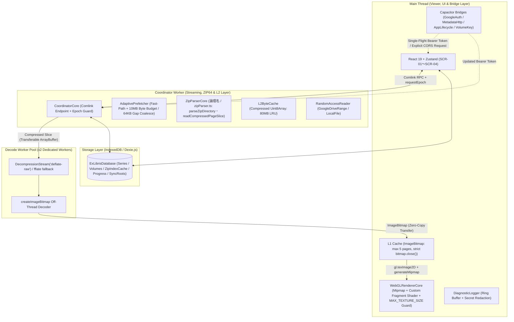

# ExLibris 4層＋マルチスレッドアーキテクチャと共通インターフェース契約

本ドキュメントは、ExLibris における 4層 × 3スレッド領域の責務分離、ディレクトリ構成規約、メモリ・ストリーミング制御定数、およびレイヤー間を結ぶ TypeScript コアインターフェース契約の正本（Single Source of Truth）です。

---

## 1. 4層 × 3スレッド領域のアーキテクチャ全体像

60fps の UI 応答性維持、高解像度スキャン画像（AVIF / JPEG / PNG / WebP）デコードによるメインスレッドブロックの根絶、および Android WebView 特有の VRAM 枯渇（OOM クラッシュ）防止のため、システムを以下の **4層 × 3スレッド領域** に厳格分離します。



### 1.1 標準ディレクトリ構成とレイヤー責務境界

| レイヤー                                  | 配置ディレクトリ                                                                                                                                                                                                                           | 責務と依存ルール                                                                                                                                                                                                                                                                                                                                                                                                                                                                                                                                                                                                                                                                                                                                                                                                               |
| :---------------------------------------- | :----------------------------------------------------------------------------------------------------------------------------------------------------------------------------------------------------------------------------------------- | :----------------------------------------------------------------------------------------------------------------------------------------------------------------------------------------------------------------------------------------------------------------------------------------------------------------------------------------------------------------------------------------------------------------------------------------------------------------------------------------------------------------------------------------------------------------------------------------------------------------------------------------------------------------------------------------------------------------------------------------------------------------------------------------------------------------------------- |
| **1. Streaming & Provider Layer**         | `src/engine/io/`<br>`src/providers/{gdrive,filename,metadata,sync}/`                                                                                                                                                                       | ・`RandomAccessReader` 実装（`GoogleDriveRangeReader`, `LocalFileReader`, 将来拡張用 `HttpRangeReader`）<br>・Drive フォルダ階層・メタデータ参照（`DriveFolderClient` / `parseDriveFolderInput`）、指定ルートフォルダ配下の Drive `files.list` / `changes.list` 同期、自炊ファイル名スマートパーサー、公開書誌 API クライアント（NDL / AniList / Google Books）、`appDataFolder` LWW 同期エンジン<br>・React / DOM / WebGL2 への依存を一切持たない純粋 TypeScript モジュールとする                                                                                                                                                                                                                                                                                                                                             |
| **2. Engine Worker Layer**                | `src/engine/zip/`<br>`src/engine/cache/`<br>`src/engine/prefetch/`<br>`src/engine/workers/`<br>`src/engine/cover/`                                                                                                                         | ・ZIP / ZIP64 / Shift_JIS 解析、LFH 可変長 1 RTT ゼロコピー切り出し、Fast-Path ＋ 10MB バイト予算先読み、80MB L2 LRU キャッシュ、Decode Worker プール（2 Worker ラウンドロビン/空き優先制御）、2段優先度表紙 WebP 抽出スケジューラ<br>・**ロジック本体は Worker グローバル（`self`）非依存の `*Core.ts` に分離して Vitest で 100% 単体検証し、`*.worker.ts` は数行の `Comlink.expose(...)` ブートストラップのみとする**                                                                                                                                                                                                                                                                                                                                                                                                        |
| **3. Storage Layer**                      | `src/storage/`<br>`src/storage/repositories/`                                                                                                                                                                                              | ・Dexie.js インスタンス（`ExLibrisDatabase`：`version(1)` `syncMeta` ＋ `v0.1` `version(2)` `zipIndexCache` / `readingProgress` ＋ `v0.2` `version(3)` `driveSyncRoots` / `series` / `volumes`）とドメイン別 Repository インターフェース実装（`ZipIndexCacheRepository`：最大 500 件 LRU・不正キャッシュ自動削除、`ReadingProgressRepository`：操作 FIFO 直列化・`local:*` 最大 100 件 LRU・`vol:*` 非退避保護・不正レコード自動削除、`ReaderSettingsRepository`：`syncMeta['defaultReaderSettingsJson']` 共通画質補正デフォルト保存・破損時安全フォールバック、`DriveSyncRootsRepository`：操作 FIFO 直列化・`deletedAt` Tombstone 論理削除・再登録復活）<br>・`resetTestDb()` により UT / Storybook / Playwright IT で 100% 決定論的に初期化可能とする                                                                       |
| **4. Viewer, Diagnostics & Bridge Layer** | `src/app/`（`ServiceProvider` / `serviceContext` / `coordinatorClient`）<br>`src/features/{bookshelf,series-detail,reader,settings}/`<br>`src/webgl/`<br>`src/bridges/{oauth,http,app,volume-key}/`<br>`src/diagnostics/`<br>`src/shared/` | ・アプリケーション DI コンテナ / Comlink Worker クライアント管理（`ServiceProvider` / `serviceContext` / `coordinatorClient`）<br>・画面別 Container / Presentational コンポーネント（`SCR-01`〜`SCR-04`、1対1 Story/UT・親子 `vi.spyOn` 完全分離）<br>・History API ベースのカスタムルーター（`src/shared/router/`）、`SCR-01` スクロール位置保持ストア、およびオンメモリローカル ZIP セッションストア（`src/features/reader/`）<br>・生 WebGL2 レンダラ（`WebGLRendererCore` 1パス画質補正シェーダーと `<ReaderCanvas>` の分離）および L1 `ImageBitmap` 管理（`L1PageCache`）<br>・Capacitor ネイティブブリッジの薄いアダプタ層（`GoogleAuthBridge` Single-Flight トークン管理・`AppBridge` 優先度付き戻る制御等、Web/テスト時はモック実装へ自動フォールバック）およびオンメモリ診断ロガー（`Bearer` / `ya29.*` マスク付き） |

---

## 2. ストリーミング・メモリ予算定数と Engine コア契約

### 2.1 システム基準定数（`ENGINE_BUDGETS`）

[requirements.md §3](requirements.md#3-非機能要件システムリソース基準nfr-xx) の合意値に基づき、以下の定数をエンジン全体の基準値とします。

| 定数名                       |       設定値        | 設計根拠・用途                                                                                                         |
| :--------------------------- | :-----------------: | :--------------------------------------------------------------------------------------------------------------------- |
| `INITIAL_TAIL_READ_BYTES`    |  `131_072` (128KB)  | 初回オープン時に ZIP 末尾から Range 取得するバイト数。標準単行本の EOCD + Central Directory 全体を 1 RTT で収める      |
| `LFH_EXTRA_MARGIN_BYTES`     |    `1_024` (1KB)    | CDH と LFH の `extraFieldLength` 差分を吸収し、LFH ヘッダ＋圧縮本体を 1 RTT で取得するための安全マージン               |
| `MAX_COALESCE_GAP_BYTES`     |   `65_536` (64KB)   | Warm Prefetch で隣接エントリを単一 Range リクエストに結合する際の最大許容物理ギャップ（超過時はリクエスト分割）        |
| `WARM_PREFETCH_BUDGET_BYTES` | `10_485_760` (10MB) | Warm Prefetch 1 リクエストあたりの最大合計バイト予算（最低 1 ページは許容）                                            |
| `L2_CACHE_MAX_BYTES`         | `83_886_080` (80MB) | Coordinator Worker 内で LRU 保持する未デコード圧縮画像（`Uint8Array`）の最大合計バイト数                               |
| `L1_MAX_PAGES`               |         `5`         | UI スレッド側で同時に保持するデコード済み `ImageBitmap` の最大枚数（現在表示 1〜2 枚 ＋ 進行方向 2 枚 ＋ 逆方向 1 枚） |
| `DECODE_WORKER_POOL_SIZE`    |         `2`         | `DecompressionStream` 解凍および `createImageBitmap` を並列処理する専用 Decode Worker 数                               |
| `COVER_BG_MAX_PER_SECOND`    |         `2`         | バックグラウンド低速表紙 WebP 抽出キューの最大処理レート（2 冊/秒）                                                    |

### 2.2 アーカイブ参照と `RandomAccessReader` 契約

Google Drive 上の永続巻と、端末ローカル選択の一時 ZIP セッションを単一のパイプラインで扱うため、以下のユニオン識別子と I/O 契約を採用します。

```ts
export type ArchiveSourceDescriptor =
  | {
      readonly kind: "gdrive";
      readonly volumeId: string;
      readonly driveFileId: string;
      readonly fileSize: number;
      readonly md5Checksum: string | null;
      /** `${"gdrive"}:${driveFileId}:${md5Checksum ?? fileSize}` */
      readonly indexCacheKey: string;
      /** `vol:${volumeId}` */
      readonly progressTargetKey: string;
    }
  | {
      readonly kind: "local-session";
      readonly file: File;
      readonly rawFileName: string;
      readonly fileSize: number;
      /** `local:${rawFileName}:${fileSize}` */
      readonly indexCacheKey: string;
      /** `local:${rawFileName}:${fileSize}` */
      readonly progressTargetKey: string;
    };

export interface RandomAccessReader {
  readonly sourceId: string;
  readonly totalSize: number;
  /**
   * 指定バイト範囲 [offset, offset + length - 1] を取得する。
   * 終端超過時は実ファイル末尾までにクランプした Uint8Array を返す。
   */
  readRange(
    offset: number,
    length: number,
    signal?: AbortSignal,
  ): Promise<Uint8Array>;
}
```

### 2.3 ZIP 論理ページ目次と Worker 間 RPC 契約

```ts
export type ZipCompressionMethod = 0 | 8; // 0: Store (無圧縮), 8: Deflate

export type ZipErrorCode =
  | "CORRUPT_ZIP"
  | "EMPTY_ARCHIVE"
  | "ENCRYPTED_ZIP"
  | "UNSUPPORTED_COMPRESSION"
  | "DECODE_FAILED"
  | "READ_ERROR";

export interface ZipPageEntry {
  /** ゴミ除外・自然順ソート後の 0 始まり論理ページ番号 */
  readonly pageIndex: number;
  /** UTF-8 または Shift_JIS デコード後のエントリパス */
  readonly entryName: string;
  /** CDH 記載の元ファイル名バイト長（LFH 1 RTT スライス長計算用） */
  readonly entryNameByteLength: number;
  readonly compressionMethod: ZipCompressionMethod;
  /** Central Directory 記載の正確な圧縮サイズ（Bit 3 有効時も信頼できる正値） */
  readonly compressedSize: number;
  readonly uncompressedSize: number;
  /** Local File Header 先頭の物理バイトオフセット（64bit 安全整数） */
  readonly localHeaderOffset: number;
  /** 次の物理エントリ先頭または Central Directory 開始オフセット（1 RTT 取得上限） */
  readonly physicalEnd: number;
  readonly crc32: number;
}

export type DecodedPageFrame =
  | {
      readonly status: "ready";
      readonly pageIndex: number;
      readonly epoch: number;
      readonly width: number;
      readonly height: number;
      /** Transferable Object として所有権ごと UI スレッドへ Zero-Copy 転送される */
      readonly bitmap: ImageBitmap;
    }
  | {
      readonly status: "error";
      readonly pageIndex: number;
      readonly epoch: number;
      readonly errorCode: ZipErrorCode;
      readonly message: string;
    };

export interface OpenArchiveResult {
  readonly pageCount: number;
  readonly entries: readonly ZipPageEntry[];
  readonly fromIndexCache: boolean;
}

export interface RequestVisiblePagesOptions {
  /**
   * L1 近傍プリデコードまたは L2 補充呼び出し（`pageIndices` が空配列の場合を含む）において、
   * 現在画面に表示中の論理ページ番号群を明示指定する（省略時は `pageIndices` を表示中とみなす）。
   * L2ByteCache の 80MB 超例外ページの一時保持ピン管理および `allowOversized` 判定に使用する。
   */
  readonly visiblePageIndices?: readonly number[];
}

export interface CoordinatorWorkerApi {
  /**
   * アーカイブを開き論理ページ配列を確定する。
   * UI スレッド（`ReaderPage` + `ZipIndexCacheRepository`）が有効な `cachedEntries` を渡した場合、
   * Coordinator 側でも空配列チェック・基本構造検証を通過したときのみ Central Directory I/O をスキップして
   * 0 RTT（`fromIndexCache: true`）で即座にオープンし、`null`・空配列・不正キャッシュ時は
   * `parseZipDirectory` へフォールバックする（`fromIndexCache: false`）。
   */
  openArchive(
    source: ArchiveSourceDescriptor,
    cachedEntries: readonly ZipPageEntry[] | null,
    epoch: number,
  ): Promise<OpenArchiveResult>;

  /**
   * `pageIndices` に指定されたページの `DecodedPageFrame[]`（成功時は `ready`＋Transferable `ImageBitmap`、
   * 個別ページ失敗時は `error`）を最優先で返却する。
   * - `L2ByteCache`（80MB LRU）ヒット時は `readRange` 0 回で即座に Decode Worker へ投入し、
   *   同世代の進行中 Warm Prefetch がある場合はページ単位 In-Flight 共有により重複 `readRange` を防止する。
   * - `pageIndices` の処理完了後（`pageIndices` が空配列の L2 補充呼び出し時を含む）、未中断かつ
   *   `prefetchIndices` が非空で当該 `epoch` 未実行の場合、閲覧優先順 10MB 予算・64KB ギャップ結合の
   *   Warm Prefetch（`AdaptivePrefetcher` → `L2ByteCache` 格納）をバックグラウンド非同期起動する。
   */
  requestVisiblePages(
    pageIndices: readonly number[],
    prefetchIndices: readonly number[],
    epoch: number,
    options?: RequestVisiblePagesOptions,
  ): Promise<DecodedPageFrame[]>;

  updateAccessToken(accessToken: string | null): void;
  setHostCallbacks(callbacks: CoordinatorHostCallbacks | null): void;
  cancelEpochBelow(minActiveEpoch: number): void;
  closeArchive(): Promise<void>;
}

export interface CoordinatorHostCallbacks {
  /**
   * Worker 内の GoogleDriveRangeReader が未保持または 401 応答を検知した際、
   * Comlink.proxy 経由で Main Thread の Single-Flight（Compare-and-Refresh 付き）トークン更新を呼び出す。
   */
  refreshAccessToken(options?: {
    readonly forceRefresh?: boolean;
    readonly failedToken?: string;
  }): Promise<string>;

  /**
   * Worker 内で発生した Google Drive Range 通信異常ログを Main Thread の diagnosticLogger へ転送する。
   */
  reportDiagnostic(
    level: "warn" | "error",
    scope: string,
    message: string,
    detail?: string,
  ): void;
}

export interface DecodeWorkerApi {
  decodePageSlice(
    compressedData: Uint8Array,
    compressionMethod: ZipCompressionMethod,
  ): Promise<{
    bitmap: ImageBitmap;
    width: number;
    height: number;
  }>;
}
```

---

## 3. 生 WebGL2 描画パイプライン＆L1 キャッシュ契約

### 3.1 見開き・読み方向・画質補正モデル

```ts
export type ReadingDirection = "rtl" | "ltr"; // rtl: 右開き（標準）, ltr: 左開き
export type SpreadMode = "auto" | "single" | "spread"; // auto: 画面向き連動, single: 単ページ, spread: 2ページ見開き
export type EffectiveSpreadMode = "single" | "spread";
export type SpreadPageOffset = 0 | 1;
export type SlotPosition = "center" | "left" | "right";

export interface ShaderCorrectionParams {
  /** 画面空間偏微分 5タップ軽量アンシャープマスク強度（0.00 = 無補正 〜 1.00 = 強） */
  readonly sharpness: number;
  /** 紙地肌の白飛ばし上限（0.80 〜 1.00、初期値 1.00、黄ばみ除去用） */
  readonly whitePoint: number;
  /** インク引き締め・裏写りカット下限（0.00 〜 0.25、初期値 0.00） */
  readonly blackPoint: number;
  /** 標準ガンマ補正 pow(rgb, 1.0 / gamma)（0.60 〜 1.60、初期値 1.00 = 線形、1.00 未満で薄墨濃化） */
  readonly gamma: number;
}
```

- **画質補正パラメータ初期値・正規化契約（`src/webgl/shaderParams.ts`）**:
  - `vite.config.ts` のカバレッジ除外対象（`src/**/types.ts`）に実行時ロジックを含めない規律に従い、`src/webgl/types.ts` には純粋な型定義（`ShaderCorrectionParams` 等）のみを置き、実行時定数・純関数群（`DEFAULT_SHADER_CORRECTION_PARAMS`, `SHADER_PARAM_RANGES`, `normalizeShaderCorrectionParams`, `isDefaultShaderParams`, `formatShaderParamsAttribute`）は `src/webgl/shaderParams.ts`（＋ 1対1 の `shaderParams.test.ts`）に分離する。
  - 初期ニュートラル定数 `DEFAULT_SHADER_CORRECTION_PARAMS = { sharpness: 0, whitePoint: 1, blackPoint: 0, gamma: 1 }`。
  - `normalizeShaderCorrectionParams(raw: unknown)` はプレーンオブジェクト（`typeof raw === "object" && raw !== null && !Array.isArray(raw)`）に対して `Object.prototype.hasOwnProperty.call` により自身のプロパティのみを抽出し、各有限数値を許容範囲へクランプ・小数第2位丸め（`Math.round(clamped * 100) / 100`）して返す（不正・欠落フィールドは個別に初期値へフォールバック）。

```ts
export interface ViewportSlot {
  readonly pageIndex: number;
  readonly position: SlotPosition;
}

export interface ViewportSlotLayout {
  /** 単ページ表示時は 1 要素、2ページ見開き表示時は左右 2 要素 */
  readonly slots: readonly ViewportSlot[];
}

export interface RenderSlotFrame {
  readonly slot: ViewportSlot;
  readonly frame: DecodedPageFrame | null;
}

export interface PageDimensions {
  readonly width: number;
  readonly height: number;
}
```

- **インテリジェント見開き判定・動的アンカーペアリングルール**:
  - `SpreadMode === "auto"`（初期値）時は、ビューポートが横長（`viewportWidth > viewportHeight`）の場合に実効 `"spread"`、縦長・正方形の場合に実効 `"single"` へ自動追従する（`"single"` / `"spread"` 明示選択時は画面向きに依存せず固定表示）。
  - 実効 `"spread"` 状態であっても、①表紙先頭ページ（`pageIndex === 0 && spreadPageOffset === 0`）、②自身またはペア候補の次ページが横長スキャン（`width > height`、厳密不等号）、または ③末尾単独ページのいずれかに該当する場合は自動的に **1枚単独中央表示（`position: "center"`）** とする。
  - 通常 2 ページ見開き時は `ReadingDirection` に従い、`rtl` は `[次: left, 現: right]`、`ltr` は `[現: left, 次: right]` に配置する。途中に横長画像（見開き結合済みスキャン等）が存在しても次頁へ `displayedSlots.length` 分だけ進行して後続ページから自動再ペアリングし、セッション内既知寸法＋遷移履歴（`spreadPageOffset` 変更・シークジャンプ・`effectiveSpreadMode === "single"` 遷移時にクリア）により前頁戻りも整合させる。
  - ユーザーが「1ページずらし」トグル（`spreadPageOffset: 0 | 1`）を切り替えた場合、`pageIndex === 0`（または `totalPages <= 1`）では基準 `0` を維持して `[0] ↔ [0, 1]` を切り替え、`pageIndex >= 1` では `nextOffset === 1` 時に原則 `+1`（最終頁時のみ `-1`）、`nextOffset === 0` 時に原則 `-1`（`pageIndex === 1` 時のみ 3 頁以上なら `2`、2 頁本なら `0`）へ基準ページをシフトして即座に再レイアウト・窓再同期を行う。

### 3.2 GPU テクスチャ・`MAX_TEXTURE_SIZE` ガード・L1 解放規律

1. **ハードウェア Mipmap と 1 パス補正シェーダー**:
   - 背景クリア色は純黒（`#000000`）とし、単ページ時は中央内接フィット、2ページ見開き時は高さを揃えた背表紙密着フィット描画（片側エラー/欠損時は有効側のみ半画面背表紙寄せ描画）を行う。
   - 各ページテクスチャは `gl.texImage2D` 転送直後に `gl.generateMipmap(gl.TEXTURE_2D)` と `gl.LINEAR_MIPMAP_LINEAR` を設定し、縮小表示時のスクリーントーン干渉縞（モアレ）を GPU で除去する。
   - 描画バッファ解像度は `ResizeObserver` とネイティブ `devicePixelRatio`（`gl.MAX_VIEWPORT_DIMS` 上限でクランプ）に追従する。
   - フラグメントシェーダー 1 パス内で `ShaderCorrectionParams` Uniform（`u_sharpness`, `u_whitePoint`, `u_blackPoint`, `u_gamma`）を適用する：`u_sharpness > 0.0` 時のみ画面空間偏微分 `max(vec2(abs(dFdx(v_texCoord.x)), abs(dFdy(v_texCoord.y))), 1.0 / vec2(textureSize(u_texture, 0)))` を用いた 5タップ軽量アンシャープマスクを実行し（Mipmap トリリニア補間を維持したまま縮小・等倍双方で輪郭強調）、続けて白黒レベル正規化 `clamp((rgb - vec3(u_blackPoint)) / max(u_whitePoint - u_blackPoint, 0.0001), 0.0, 1.0)` と標準ガンマ補正 `pow(rgb, vec3(1.0 / max(u_gamma, 0.0001)))` を実行する。パラメータ変更時はテクスチャ再転送や Worker 通信を行わず GPU Uniform 再描画のみで即時反映する。
   - `webglcontextlost` 発生時は `event.preventDefault()` を行い、`webglcontextrestored` 時に保持中の `shaderParams` と `L1PageCache` の `ImageBitmap` 群からテクスチャ・Mipmap・Uniform を自動再生成して描画復帰する。
2. **`MAX_TEXTURE_SIZE` 上限ガード**（`v0.1` で実装）:
   - WebGL2 初期化・復帰時に `gl.getParameter(gl.MAX_TEXTURE_SIZE)` を取得して保持する。
   - スロット画像の `bitmap.width > maxTextureSize || bitmap.height > maxTextureSize` を検知した場合、`diagnosticLogger.warn("webgl2", ...)` へ記録した上で、超過軸を `cols × rows` グリッド（最大 16 タイル）に `createImageBitmap(bitmap, sx, sy, sw, sh)` で非同期分割して複数 `WebGLTexture` へ転送・原寸描画する（16 タイル超過または分割失敗時は上限内安全リサイズ `createImageBitmap(..., { resizeWidth, resizeHeight })` へフォールバック）。一時生成したタイル用 `ImageBitmap` は `texImage2D` 転送直後（およびキャンセル/破棄時）に即 `close()` し、黒画面化・リーク双方を防ぐ。
3. **厳格な `ImageBitmap.close()` とテクスチャ破棄**:
   - L1 キャッシュが保持上限（`L1_MAX_PAGES = 5`）を超えて古いページを退避する際、古い `requestEpoch` のデコード結果が遅れて到着した際、および巻クローズ・コンポーネントアンマウント時には、対応する全タイル `WebGLTexture` の `gl.deleteTexture()` と **`bitmap.close()` を必ず即座に実行** する。

---

## 4. Capacitor 通信・認証・ネイティブブリッジ契約

### 4.1 `CapacitorHttp.enabled: false` の絶対維持（Zero-Copy 保護）

> [!CAUTION]
> **`capacitor.config.ts` で `plugins.CapacitorHttp.enabled: true` を絶対に有効化してはならない。**
> グローバルパッチを有効化すると WebView 内の `fetch` がネイティブブリッジ経由の Base64 文字列変換に置き換わり、大容量バイナリ（`ArrayBuffer`）ストリーミング性能が壊滅し Worker 内 `fetch` とも不整合を起こす。

- **バイナリストリーミング通信（Google Drive `alt=media` Range 取得 / Drive REST JSON API）**:
  WebView / Web Worker 標準の Chromium `fetch`（`Authorization: Bearer <token>` ヘッダー付き）を直接使用する。
- **CORS 制限のある公開書誌 API（NDL OpenSearch / AniList / Google Books）**:
  `MetadataHttpClient` アダプター内部でのみ明示的に `CapacitorHttp.request()`（Web ブラウザ・テスト実行時はモックまたは標準 `fetch` アダプター）を呼び出す。

### 4.2 Google OAuth スコープと Single-Flight トークン供給契約

- **要求スコープ（段階的最小権限要求）**:
  1. **`v0.2` 要求スコープ**: `https://www.googleapis.com/auth/drive.readonly` 単独（指定ルートフォルダ配下のスキャン・`changes.list` 差分検知・フォルダ階層参照・ZIP Range 読み取り専用）
  2. **`v1.0` 追加予定スコープ**: `https://www.googleapis.com/auth/drive.appdata`（アプリ専用隠し領域 `appDataFolder` バックアップ・端末間 LWW 同期用）
- **Single-Flight トークン透過リフレッシュ・セッション購読契約（詳細は [google-drive.md](providers/google-drive.md)）**:
  ```ts
  export interface GoogleAuthSession {
    readonly email: string;
    readonly accessToken: string;
    /** UNIX ms（GMS 取得時は取得時刻 + 3_600_000） */
    readonly expiresAt: number;
  }

  export interface GetAccessTokenOptions {
    readonly forceRefresh?: boolean;
    readonly failedToken?: string;
  }

  export type AuthSessionListener = (session: GoogleAuthSession | null) => void;

  export interface GoogleAuthBridge {
    getCachedSession(): GoogleAuthSession | null;
    getSession(): Promise<GoogleAuthSession | null>;
    signIn(): Promise<GoogleAuthSession>;
    signOut(): Promise<void>;
    getValidAccessToken(options?: GetAccessTokenOptions): Promise<string>;
    subscribeSession(listener: AuthSessionListener): () => void;
  }
  ```
  - Android ネイティブ環境では `GoogleAuthPlugin.java`（Play Services `Identity.getAuthorizationClient` ＋ `SharedPreferences` 連携フラグによる起動時サイレント復元・オフライン時の設定保持保護）、Web / Vitest / Storybook / Playwright IT では `MockGoogleAuthAdapter` へ自動フォールバックし、`NFR-05` のゼロコンフィグ動作を保証する。
  - アクセストークン有効期限の残り **5 分未満**（取得後 55 分経過時点）、または Google Drive API から **`401 Unauthorized`** が返却された際、複数の並列 Range リクエストやフォルダ参照が一斉または時差到着で重複リフレッシュ・新トークン破棄を起こさないよう、**`failedToken` 比較ガード（Compare-and-Refresh：既に別トークンへ更新済みなら `clearToken` をスキップして現トークンを即返却）＋ Single-Flight Promise（進行中の更新 Promise を共有）＋ 世代カウンタ `authEpoch`（`signOut` / 新規 `signIn` 時の古い更新結果破棄）** で 1 回だけネイティブ側 `clearToken` ＋ 再取得を実行する。
  - 通常時の Worker 内 `GoogleDriveRangeReader` は `CoordinatorCore` 保持の `accessToken` で IPC ゼロで通信し、未保持または `401` 発生時のみ `Comlink.proxy` 経由の `CoordinatorHostCallbacks.refreshAccessToken({ forceRefresh: true, failedToken })` を呼び出して新トークンを取得・`updateAccessToken()` 配信した上で 1 回だけ透過リトライする（通信異常ログも `reportDiagnostic` 経由で Main Thread `diagnosticLogger` へ `[REDACTED]` マスク付きで転送する）。

---

## 5. 非同期世代管理（`requestEpoch`）と優先度プリエンプション規約

1. **Epoch ID（世代カウンタ）による競合・無駄通信の遮断**:
   - 巻オープン・高速シーク・連続めくりによる対象窓更新のたびに単調増加する `requestEpoch` を発行する。
   - Coordinator Worker は古い世代に紐づく進行中 `fetch` の `AbortController.abort()` を即時呼び出し、Decode Worker から返却された古い世代の `ImageBitmap` は UI スレッドへ渡さずその場で `bitmap.close()` して破棄する。
2. **閲覧最優先のバックグラウンド・プリエンプション**:
   - 表紙 WebP 抽出スケジューラ（`CoverExtractionScheduler`）は `viewport-high`（現在 `SCR-01` に表示中のカード）と `background-low`（最大 2 冊/秒）の 2 段キューを持つ。
   - ユーザーがリーダー（`SCR-03`）へ遷移した瞬間、`CoverExtractionScheduler.pause()` を同期呼び出しして新規の表紙 Range リクエスト発行を完全に停止し、リーダー終了（`SCR-01` / `SCR-02` 復帰）時に再開する。

---

## 6. Android ビルド・署名・バージョン管理・リリース自動化契約（`AC-APK-01`〜`05`）

ExLibris の検証 APK（`.github/workflows/build-android.yml`）と正式リリース APK（`.github/workflows/release.yml`）間でアンインストール不要（アプリデータ・IndexedDB 保持）の上書きアップデートを保証し、かつ将来の `v0.2` Google OAuth（パッケージ名＋署名証明書 SHA-1 検証）の土台を維持するため、以下の 5 契約を定めます。

### 6.1 署名キーストア保管・Secrets 運用原則

- `PUBLIC` リポジトリ保護のため、キーストアファイル（`android/debug.keystore`, `*.keystore`, `*.jks`）およびパスワード・エイリアスはリポジトリへ直コミットせず、`.gitignore` 除外の上で GitHub Secrets（`ANDROID_KEYSTORE_BASE64`, `ANDROID_KEYSTORE_PASSWORD`, `ANDROID_KEY_ALIAS`, `ANDROID_KEY_PASSWORD`）として一元管理する。
- `build-android.yml`（`debug` / `release` 双方）と `release.yml` は同一の固定キーストアで署名し、`debug`・`release` 間の証明書不一致による上書き拒否を根絶する。ローカル `android/debug.keystore`（存在時）はローカル開発 `debug` ビルド専用とし、`release` や CI 強制固定署名ガード（`REQUIRE_FIXED_SIGNING=true`）では使用しない。
- PR / push 向け CI（`.github/workflows/ci.yml` の `android-compile` ジョブ）は `NFR-05` のゼロコンフィグ原則に基づき、Secrets 不在状態でも正常系 `./gradlew assembleDebug` が通過する構成を維持しつつ、ダミー入力による負系・境界 Gradle ガード検証もあわせて実行する。

### 6.2 受け入れ条件（`AC-APK-01` 〜 `AC-APK-05`）

|     契約 ID     | 項目                                                             | 必須要件・仕様                                                                                                                                                                                                                                                                                                                                                                                                                                                                                                                                                                                                                                                                                                                                                                                                                                                                                                                                                                                                 | 検証箇所                                                                                                                                   |
| :-------------: | :--------------------------------------------------------------- | :------------------------------------------------------------------------------------------------------------------------------------------------------------------------------------------------------------------------------------------------------------------------------------------------------------------------------------------------------------------------------------------------------------------------------------------------------------------------------------------------------------------------------------------------------------------------------------------------------------------------------------------------------------------------------------------------------------------------------------------------------------------------------------------------------------------------------------------------------------------------------------------------------------------------------------------------------------------------------------------------------------- | :----------------------------------------------------------------------------------------------------------------------------------------- |
| **`AC-APK-01`** | **固定署名キーストア ＆ 不完全設定早期検知**                     | `android/app/build.gradle` は `applicationId "com.highsoar.exlibris"` を固定保持する。`ANDROID_KEYSTORE_BASE64` / `ANDROID_KEYSTORE_PASSWORD` / `ANDROID_KEY_ALIAS` / `ANDROID_KEY_PASSWORD` のいずれか 1 つ以上が非空の場合、**4 変数すべてが非空であることを必須**とし、欠落・空文字・Base64 不正（空白・改行 `\s+` 除去後に `Base64.getDecoder().decode(...)` 失敗または 0 バイト）時は即 `GradleException` で停止する（`'android'` / `'androiddebugkey'` への暗黙フォールバック禁止）。4 変数すべてが有効な場合のみ `hasEnvKeystore = true` とし、`signingConfigs.debug` / `signingConfigs.release` 双方へ同一キーストアを設定する（ローカル `../debug.keystore` 存在時は `hasEnvKeystore == false` の `debug` ビルドのみ使用可とし、`signingConfigs.release` は定義しない）。また Release 系ビルド/パッケージ/署名タスク実行時または `REQUIRE_FIXED_SIGNING=true` 指定時に `!hasEnvKeystore` の場合、ランダム鍵・ローカル `../debug.keystore` へのフォールバックを行わず `GradleException` で即停止する。 | `android/app/build.gradle`, `scripts/android-build-config.test.ts`                                                                         |
| **`AC-APK-02`** | **`versionName` SSOT ＆ ワークフロー横断単調増加 `versionCode`** | `versionName` は `BUILD_NAME` → `-PversionName` → `../../package.json`（`JsonSlurper` 動的読込、`APP_VERSION` と SSOT 一致）の順で解決する。`versionCode` は `BUILD_NUMBER` → `-PversionCode` → `"1"` を整数解決し、`1 <= versionCode <= 2_100_000_000` 範囲外または非整数時は `GradleException` で停止する。`build-android.yml` と `release.yml` の双方でビルド直前に **`Math.floor(Date.now() / 1000) - 1_700_000_000`** を共通算出して `BUILD_NUMBER` へ注入し、かつ `build-android.yml` にも `concurrency`（`cancel-in-progress: false`）を設定してワークフロー横断の `versionCode` 単調増加（ダウングレード拒否回避）を保証する。                                                                                                                                                                                                                                                                                                                                                                         | `android/app/build.gradle`, `build-android.yml`, `release.yml`, `scripts/android-build-config.test.ts`, `src/shared/constants/app.test.ts` |
| **`AC-APK-03`** | **CI 署名必須ガード（Fail-Fast） ＆ 異常系検証**                 | `.github/workflows/build-android.yml`（`debug` / `release` 双方）および `.github/workflows/release.yml`（`steps.check_existing.outputs.exists == 'false'` 時）は、ビルド実行前に 4 つの Secrets が非空かつ `ANDROID_KEYSTORE_BASE64` が有効な Base64 であることを検証し、不備時は即 `exit 1` で停止する。また Gradle 実行時 `REQUIRE_FIXED_SIGNING: "true"` を渡す。一方 `ci.yml`（`android-compile`）は Secret 非依存で正常系 `./gradlew assembleDebug` を維持しつつ、ダミー値で部分設定・不正/空 Base64・`BUILD_NUMBER` 範囲外/非整数・`REQUIRE_FIXED_SIGNING=true` 無署名・無署名 `assembleRelease` がすべて非 0 停止することを検証する。                                                                                                                                                                                                                                                                                                                                                                   | `.github/workflows/build-android.yml`, `.github/workflows/release.yml`, `.github/workflows/ci.yml`, `scripts/android-build-config.test.ts` |
| **`AC-APK-04`** | **Step Summary 証明書フィンガープリント可視化**                  | `build-android.yml` および `release.yml`（APK ビルド実行時）は、生成 APK に対し `apksigner verify --print-certs`（`apksigner` バイナリ不在時のみ `keytool -printcert -jarfile` へフォールバック。`apksigner verify` 失敗時はフォールバックせず即 `exit 1`）を実行して署名証明書の `SHA-1` / `SHA-256` フィンガープリントを抽出し、**大文字コロン区切り 16 進表記（`AA:BB:CC:...`）** へ正規化する（いずれかが空抽出なら即 `exit 1`）。これらを `applicationId`・`buildType`・`versionName`・`versionCode`・署名方式と併せて `GITHUB_STEP_SUMMARY` へ出力し、Secret 値（Base64 本体・パスワード・エイリアス）は一切出力しない。                                                                                                                                                                                                                                                                                                                                                                                 | `.github/workflows/build-android.yml`, `.github/workflows/release.yml`, `scripts/android-build-config.test.ts`                             |
| **`AC-APK-05`** | **Git Tag ＆ 署名済み APK リリース自動発行**                     | `.github/workflows/release.yml` は `main` の `package.json` 更新プッシュおよび `workflow_dispatch`（`refs/heads/main` 必須）で起動し、`v0.0.0` または既存タグ/Release を安全スキップした上で、**既存 `v*.*.*` リリースタグに対する SemVer 単調増加（後退禁止）および対象 SHA に対する `ci.yml`（`Lint, Test & Quality Gates`）完了・成功を検証**後に `AC-APK-01`〜`04` 準拠の署名済み `ex-libris-${TAG}.apk` をビルドし、`gh release create` でタグ＋APK 添付 Release を自動発行する。また `PATCH === 0` のマイルストーンリリース時は `docs/quality/reports/v<major>.<minor>.md`（および `v<major>.<minor>-*.md`）を検出して Release ノート先頭へ品質分析レポート URL を自動付与する。                                                                                                                                                                                                                                                                                                                         | `.github/workflows/release.yml`, `scripts/android-build-config.test.ts`                                                                    |
