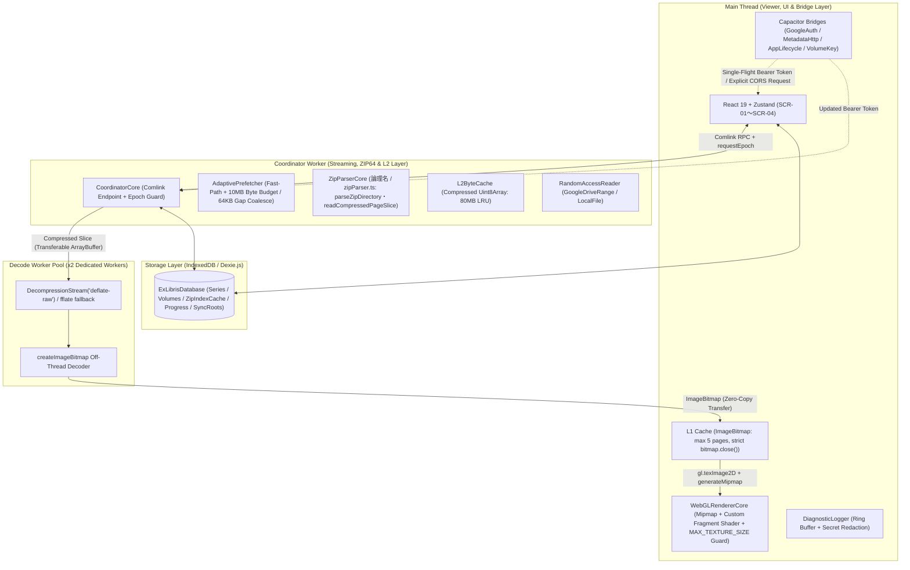

# ExLibris 4層＋マルチスレッドアーキテクチャと共通インターフェース契約

本ドキュメントは、ExLibris における 4層 × 3スレッド領域の責務分離、ディレクトリ構成規約、メモリ・ストリーミング制御定数、およびレイヤー間を結ぶ TypeScript コアインターフェース契約の正本（Single Source of Truth）です。

---

## 1. 4層 × 3スレッド領域のアーキテクチャ全体像

60fps の UI 応答性維持、高解像度スキャン画像（AVIF / JPEG / PNG / WebP）デコードによるメインスレッドブロックの根絶、および Android WebView 特有の VRAM 枯渇（OOM クラッシュ）防止のため、システムを以下の **4層 × 3スレッド領域** に厳格分離します。



### 1.1 標準ディレクトリ構成とレイヤー責務境界

| レイヤー                                  | 配置ディレクトリ                                                                                                                                                                                                                           | 責務と依存ルール                                                                                                                                                                                                                                                                                                                                                                                                                                                                                                                                                                                                                            |
| :---------------------------------------- | :----------------------------------------------------------------------------------------------------------------------------------------------------------------------------------------------------------------------------------------- | :------------------------------------------------------------------------------------------------------------------------------------------------------------------------------------------------------------------------------------------------------------------------------------------------------------------------------------------------------------------------------------------------------------------------------------------------------------------------------------------------------------------------------------------------------------------------------------------------------------------------------------------ |
| **1. Streaming & Provider Layer**         | `src/engine/io/`<br>`src/providers/{gdrive,filename,metadata,sync}/`                                                                                                                                                                       | ・`RandomAccessReader` 実装（`GoogleDriveRangeReader`, `LocalFileReader`, 将来拡張用 `HttpRangeReader`）<br>・指定ルートフォルダ配下の Drive `files.list` / `changes.list` 同期、自炊ファイル名スマートパーサー、公開書誌 API クライアント（NDL / AniList / Google Books）、`appDataFolder` LWW 同期エンジン<br>・React / DOM / WebGL2 への依存を一切持たない純粋 TypeScript モジュールとする                                                                                                                                                                                                                                               |
| **2. Engine Worker Layer**                | `src/engine/zip/`<br>`src/engine/cache/`<br>`src/engine/prefetch/`<br>`src/engine/workers/`<br>`src/engine/cover/`                                                                                                                         | ・ZIP / ZIP64 / Shift_JIS 解析、LFH 可変長 1 RTT ゼロコピー切り出し、Fast-Path ＋ 10MB バイト予算先読み、80MB L2 LRU キャッシュ、Decode Worker プール（2 Worker ラウンドロビン/空き優先制御）、2段優先度表紙 WebP 抽出スケジューラ<br>・**ロジック本体は Worker グローバル（`self`）非依存の `*Core.ts` に分離して Vitest で 100% 単体検証し、`*.worker.ts` は数行の `Comlink.expose(...)` ブートストラップのみとする**                                                                                                                                                                                                                     |
| **3. Storage Layer**                      | `src/storage/`<br>`src/storage/repositories/`                                                                                                                                                                                              | ・Dexie.js インスタンス（`ExLibrisDatabase`：`version(1)` `syncMeta` ＋ `v0.1` `version(2)` `zipIndexCache` / `readingProgress`）とドメイン別 Repository インターフェース実装（`ZipIndexCacheRepository`：最大 500 件 LRU・不正キャッシュ自動削除フォールバック）<br>・`resetTestDb()` により UT / Storybook / Playwright IT で 100% 決定論的に初期化可能とする                                                                                                                                                                                                                                                                             |
| **4. Viewer, Diagnostics & Bridge Layer** | `src/app/`（`ServiceProvider` / `serviceContext` / `coordinatorClient`）<br>`src/features/{bookshelf,series-detail,reader,settings}/`<br>`src/webgl/`<br>`src/bridges/{oauth,http,app,volume-key}/`<br>`src/diagnostics/`<br>`src/shared/` | ・アプリケーション DI コンテナ / Comlink Worker クライアント管理（`ServiceProvider` / `serviceContext` / `coordinatorClient`）<br>・画面別 Container / Presentational コンポーネント（1対1 Story/UT・親子 `vi.spyOn` 完全分離）<br>・History API ベースのカスタムルーター（`src/shared/router/`）およびオンメモリローカル ZIP セッションストア（`src/features/reader/`）<br>・生 WebGL2 レンダラ（`WebGLRendererCore` と `<ReaderCanvas>` の分離）および L1 `ImageBitmap` 管理（`L1PageCache`）<br>・Capacitor ネイティブブリッジの薄いアダプタ層（`AppBridge` 等、Web/テスト時はモック実装へ自動フォールバック）およびオンメモリ診断ロガー |

---

## 2. ストリーミング・メモリ予算定数と Engine コア契約

### 2.1 システム基準定数（`ENGINE_BUDGETS`）

[requirements.md §3](requirements.md#3-非機能要件システムリソース基準nfr-xx) の合意値に基づき、以下の定数をエンジン全体の基準値とします。

| 定数名                       |       設定値        | 設計根拠・用途                                                                                                         |
| :--------------------------- | :-----------------: | :--------------------------------------------------------------------------------------------------------------------- |
| `INITIAL_TAIL_READ_BYTES`    |  `131_072` (128KB)  | 初回オープン時に ZIP 末尾から Range 取得するバイト数。標準単行本の EOCD + Central Directory 全体を 1 RTT で収める      |
| `LFH_EXTRA_MARGIN_BYTES`     |    `1_024` (1KB)    | CDH と LFH の `extraFieldLength` 差分を吸収し、LFH ヘッダ＋圧縮本体を 1 RTT で取得するための安全マージン               |
| `MAX_COALESCE_GAP_BYTES`     |   `65_536` (64KB)   | Warm Prefetch で隣接エントリを単一 Range リクエストに結合する際の最大許容物理ギャップ（超過時はリクエスト分割）        |
| `WARM_PREFETCH_BUDGET_BYTES` | `10_485_760` (10MB) | Warm Prefetch 1 リクエストあたりの最大合計バイト予算（最低 1 ページは許容）                                            |
| `L2_CACHE_MAX_BYTES`         | `83_886_080` (80MB) | Coordinator Worker 内で LRU 保持する未デコード圧縮画像（`Uint8Array`）の最大合計バイト数                               |
| `L1_MAX_PAGES`               |         `5`         | UI スレッド側で同時に保持するデコード済み `ImageBitmap` の最大枚数（現在表示 1〜2 枚 ＋ 進行方向 2 枚 ＋ 逆方向 1 枚） |
| `DECODE_WORKER_POOL_SIZE`    |         `2`         | `DecompressionStream` 解凍および `createImageBitmap` を並列処理する専用 Decode Worker 数                               |
| `COVER_BG_MAX_PER_SECOND`    |         `2`         | バックグラウンド低速表紙 WebP 抽出キューの最大処理レート（2 冊/秒）                                                    |

### 2.2 アーカイブ参照と `RandomAccessReader` 契約

Google Drive 上の永続巻と、端末ローカル選択の一時 ZIP セッションを単一のパイプラインで扱うため、以下のユニオン識別子と I/O 契約を採用します。

```ts
export type ArchiveSourceDescriptor =
  | {
      readonly kind: "gdrive";
      readonly volumeId: string;
      readonly driveFileId: string;
      readonly fileSize: number;
      readonly md5Checksum: string | null;
      /** `${"gdrive"}:${driveFileId}:${md5Checksum ?? fileSize}` */
      readonly indexCacheKey: string;
      /** `vol:${volumeId}` */
      readonly progressTargetKey: string;
    }
  | {
      readonly kind: "local-session";
      readonly file: File;
      readonly rawFileName: string;
      readonly fileSize: number;
      /** `local:${rawFileName}:${fileSize}` */
      readonly indexCacheKey: string;
      /** `local:${rawFileName}:${fileSize}` */
      readonly progressTargetKey: string;
    };

export interface RandomAccessReader {
  readonly sourceId: string;
  readonly totalSize: number;
  /**
   * 指定バイト範囲 [offset, offset + length - 1] を取得する。
   * 終端超過時は実ファイル末尾までにクランプした Uint8Array を返す。
   */
  readRange(
    offset: number,
    length: number,
    signal?: AbortSignal,
  ): Promise<Uint8Array>;
}
```

### 2.3 ZIP 論理ページ目次と Worker 間 RPC 契約

```ts
export type ZipCompressionMethod = 0 | 8; // 0: Store (無圧縮), 8: Deflate

export type ZipErrorCode =
  | "CORRUPT_ZIP"
  | "EMPTY_ARCHIVE"
  | "ENCRYPTED_ZIP"
  | "UNSUPPORTED_COMPRESSION"
  | "DECODE_FAILED"
  | "READ_ERROR";

export interface ZipPageEntry {
  /** ゴミ除外・自然順ソート後の 0 始まり論理ページ番号 */
  readonly pageIndex: number;
  /** UTF-8 または Shift_JIS デコード後のエントリパス */
  readonly entryName: string;
  /** CDH 記載の元ファイル名バイト長（LFH 1 RTT スライス長計算用） */
  readonly entryNameByteLength: number;
  readonly compressionMethod: ZipCompressionMethod;
  /** Central Directory 記載の正確な圧縮サイズ（Bit 3 有効時も信頼できる正値） */
  readonly compressedSize: number;
  readonly uncompressedSize: number;
  /** Local File Header 先頭の物理バイトオフセット（64bit 安全整数） */
  readonly localHeaderOffset: number;
  /** 次の物理エントリ先頭または Central Directory 開始オフセット（1 RTT 取得上限） */
  readonly physicalEnd: number;
  readonly crc32: number;
}

export type DecodedPageFrame =
  | {
      readonly status: "ready";
      readonly pageIndex: number;
      readonly epoch: number;
      readonly width: number;
      readonly height: number;
      /** Transferable Object として所有権ごと UI スレッドへ Zero-Copy 転送される */
      readonly bitmap: ImageBitmap;
    }
  | {
      readonly status: "error";
      readonly pageIndex: number;
      readonly epoch: number;
      readonly errorCode: ZipErrorCode;
      readonly message: string;
    };

export interface OpenArchiveResult {
  readonly pageCount: number;
  readonly entries: readonly ZipPageEntry[];
  readonly fromIndexCache: boolean;
}

export interface CoordinatorWorkerApi {
  /**
   * アーカイブを開き論理ページ配列を確定する。
   * UI スレッド（`ReaderPage` + `ZipIndexCacheRepository`）が有効な `cachedEntries` を渡した場合、
   * Coordinator 側でも空配列チェック・基本構造検証を通過したときのみ Central Directory I/O をスキップして
   * 0 RTT（`fromIndexCache: true`）で即座にオープンし、`null`・空配列・不正キャッシュ時は
   * `parseZipDirectory` へフォールバックする（`fromIndexCache: false`）。
   */
  openArchive(
    source: ArchiveSourceDescriptor,
    cachedEntries: readonly ZipPageEntry[] | null,
    epoch: number,
  ): Promise<OpenArchiveResult>;

  /**
   * `pageIndices` に指定されたページの `DecodedPageFrame[]`（成功時は `ready`＋Transferable `ImageBitmap`、
   * 個別ページ失敗時は `error`）を最優先で返却する。
   * Phase 3 では UI スレッド側が Fast-Path として `requestVisiblePages([N], [], epoch)` を先に呼び出し、
   * 完了後に L1 窓用の近傍ページ単位 `[N+1]`, `[N+2]`, `[N-1]` をバックグラウンド呼び出しする。
   * v0.1 以降は `prefetchIndices` に基づく 10MB 予算 Warm Prefetch（Worker L2 格納）も非同期スケジュールする。
   */
  requestVisiblePages(
    pageIndices: readonly number[],
    prefetchIndices: readonly number[],
    epoch: number,
  ): Promise<DecodedPageFrame[]>;

  updateAccessToken(accessToken: string | null): void;
  cancelEpochBelow(minActiveEpoch: number): void;
  closeArchive(): Promise<void>;
}

export interface DecodeWorkerApi {
  decodePageSlice(
    compressedData: Uint8Array,
    compressionMethod: ZipCompressionMethod,
  ): Promise<{
    bitmap: ImageBitmap;
    width: number;
    height: number;
  }>;
}
```

---

## 3. 生 WebGL2 描画パイプライン＆L1 キャッシュ契約

### 3.1 見開き・読み方向・画質補正モデル

```ts
export type ReadingDirection = "rtl" | "ltr"; // rtl: 右開き（標準）, ltr: 左開き
export type SpreadMode = "single" | "spread"; // single: 単ページ, spread: 2ページ見開き

export interface ShaderCorrectionParams {
  /** LOD バイアス / アンシャープマスク強度（0.0 = 無補正 〜 1.0 = 強） */
  readonly sharpness: number;
  /** 紙地肌の白飛ばし上限（0.80 〜 1.00、黄ばみ除去用） */
  readonly whitePoint: number;
  /** インク引き締め・裏写りカット下限（0.00 〜 0.25） */
  readonly blackPoint: number;
  /** 中間調ガンマ補正（0.60 〜 1.60、1.00 = 線形） */
  readonly gamma: number;
}

export interface ViewportSlotLayout {
  /** 単ページ表示時は 1 要素、2ページ見開き表示時は左右 2 要素 */
  readonly slots: readonly {
    readonly pageIndex: number;
    readonly position: "center" | "left" | "right";
  }[];
}
```

- **インテリジェント見開き判定ルール**:
  - `SpreadMode === "spread"`（主にタブレット横向き）であっても、①表紙先頭ページ（`pageIndex === 0` かつ `spreadPageOffset === 0`）、または ②元画像自体が横長スキャン（`width > height`）であるページ（またはペア候補の次ページが横長である場合）は、自動的に **1枚単独中央表示（`position: "center"`）** とする。
  - ユーザーが「1ページずらし」トグル（`spreadPageOffset: 0 | 1`）を切り替えた場合、ペアリング基準を即座に 1 ページシフトして再レイアウトする。

### 3.2 GPU テクスチャ・`MAX_TEXTURE_SIZE` ガード・L1 解放規律

1. **ハードウェア Mipmap と 1 パス補正シェーダー**:
   - 背景クリア色は純黒（`#000000`）とし、画像アスペクト比を維持した中央内接フィット描画を行う。
   - 各ページテクスチャは `gl.texImage2D` 転送直後に `gl.generateMipmap(gl.TEXTURE_2D)` と `gl.LINEAR_MIPMAP_LINEAR` を設定し、縮小表示時のスクリーントーン干渉縞（モアレ）を GPU で除去する。
   - 描画バッファ解像度は `ResizeObserver` とネイティブ `devicePixelRatio`（`gl.MAX_VIEWPORT_DIMS` 上限でクランプ）に追従する。
   - フラグメントシェーダー 1 パス内で `ShaderCorrectionParams` Uniform に基づくシャープネスおよび白黒レベル・ガンマ補正を実行する（Phase 3 PoC では等倍パススルー、補正パラメータは `v0.1` で追加）。
   - `webglcontextlost` 発生時は `event.preventDefault()` を行い、`webglcontextrestored` 時に `L1PageCache` に保持中の `ImageBitmap` からテクスチャと Mipmap を自動再生成して描画復帰する。
2. **`MAX_TEXTURE_SIZE` 上限ガード**（`v0.1` で実装）:
   - WebGL2 初期化時に `gl.getParameter(gl.MAX_TEXTURE_SIZE)` を取得して保持する。
   - 大判見開き画像等で `bitmap.width > maxTextureSize` または `bitmap.height > maxTextureSize` を検知した場合、左右2分割テクスチャまたは上限内リサイズへ自動フォールバックし、診断ロガー（`diagnosticLogger.warn("webgl2", ...)`）へ記録して黒画面化を防ぐ。
3. **厳格な `ImageBitmap.close()` とテクスチャ破棄**:
   - L1 キャッシュが保持上限（`L1_MAX_PAGES = 5`）を超えて古いページを退避する際、古い `requestEpoch` のデコード結果が遅れて到着した際、および巻クローズ・コンポーネントアンマウント時には、対応する `WebGLTexture` の `gl.deleteTexture()` と **`bitmap.close()` を必ず即座に実行** する。

---

## 4. Capacitor 通信・認証・ネイティブブリッジ契約

### 4.1 `CapacitorHttp.enabled: false` の絶対維持（Zero-Copy 保護）

> [!CAUTION]
> **`capacitor.config.ts` で `plugins.CapacitorHttp.enabled: true` を絶対に有効化してはならない。**
> グローバルパッチを有効化すると WebView 内の `fetch` がネイティブブリッジ経由の Base64 文字列変換に置き換わり、大容量バイナリ（`ArrayBuffer`）ストリーミング性能が壊滅し Worker 内 `fetch` とも不整合を起こす。

- **バイナリストリーミング通信（Google Drive `alt=media` Range 取得 / Drive REST JSON API）**:
  WebView / Web Worker 標準の Chromium `fetch`（`Authorization: Bearer <token>` ヘッダー付き）を直接使用する。
- **CORS 制限のある公開書誌 API（NDL OpenSearch / AniList / Google Books）**:
  `MetadataHttpClient` アダプター内部でのみ明示的に `CapacitorHttp.request()`（Web ブラウザ・テスト実行時はモックまたは標準 `fetch` アダプター）を呼び出す。

### 4.2 Google OAuth スコープと Single-Flight トークン供給契約

- **要求スコープ**:
  1. `https://www.googleapis.com/auth/drive.readonly`（指定ルートフォルダ配下のスキャン・`changes.list` 差分検知・ZIP Range 読み取り専用）
  2. `https://www.googleapis.com/auth/drive.appdata`（`v1.0` のアプリ専用隠し領域 `appDataFolder` バックアップ・端末間同期用）
- **Single-Flight トークン透過リフレッシュ**:
  ```ts
  export interface GoogleAuthSession {
    readonly email: string;
    readonly accessToken: string;
    /** UNIX ms */
    readonly expiresAt: number;
  }

  export interface GoogleAuthBridge {
    signIn(): Promise<GoogleAuthSession>;
    signOut(): Promise<void>;
    getValidAccessToken(options?: { forceRefresh?: boolean }): Promise<string>;
  }
  ```
  - アクセストークン有効期限の残り **5 分未満**、または Google Drive API から **`401 Unauthorized`** が返却された際、複数の並列 Range リクエストや同期処理が一斉にリフレッシュを走らせないよう、**Single-Flight Promise（進行中の更新 Promise を共有）** で 1 回だけネイティブ側 `clearToken` ＋ 再取得を実行し、新しいトークンを `CoordinatorWorkerApi.updateAccessToken()` へ配信して失敗リクエストを 1 回透過リトライする。

---

## 5. 非同期世代管理（`requestEpoch`）と優先度プリエンプション規約

1. **Epoch ID（世代カウンタ）による競合・無駄通信の遮断**:
   - 巻オープン・高速シーク・連続めくりによる対象窓更新のたびに単調増加する `requestEpoch` を発行する。
   - Coordinator Worker は古い世代に紐づく進行中 `fetch` の `AbortController.abort()` を即時呼び出し、Decode Worker から返却された古い世代の `ImageBitmap` は UI スレッドへ渡さずその場で `bitmap.close()` して破棄する。
2. **閲覧最優先のバックグラウンド・プリエンプション**:
   - 表紙 WebP 抽出スケジューラ（`CoverExtractionScheduler`）は `viewport-high`（現在 `SCR-01` に表示中のカード）と `background-low`（最大 2 冊/秒）の 2 段キューを持つ。
   - ユーザーがリーダー（`SCR-03`）へ遷移した瞬間、`CoverExtractionScheduler.pause()` を同期呼び出しして新規の表紙 Range リクエスト発行を完全に停止し、リーダー終了（`SCR-01` / `SCR-02` 復帰）時に再開する。

---

## 6. Android ビルド・署名・バージョン管理・リリース自動化契約（`AC-APK-01`〜`05`）

ExLibris の検証 APK（`.github/workflows/build-android.yml`）と正式リリース APK（`.github/workflows/release.yml`）間でアンインストール不要（アプリデータ・IndexedDB 保持）の上書きアップデートを保証し、かつ将来の `v0.2` Google OAuth（パッケージ名＋署名証明書 SHA-1 検証）の土台を維持するため、以下の 5 契約を定めます。

### 6.1 署名キーストア保管・Secrets 運用原則

- `PUBLIC` リポジトリ保護のため、キーストアファイル（`android/debug.keystore`, `*.keystore`, `*.jks`）およびパスワード・エイリアスはリポジトリへ直コミットせず、`.gitignore` 除外の上で GitHub Secrets（`ANDROID_KEYSTORE_BASE64`, `ANDROID_KEYSTORE_PASSWORD`, `ANDROID_KEY_ALIAS`, `ANDROID_KEY_PASSWORD`）として一元管理する。
- `build-android.yml`（`debug` / `release` 双方）と `release.yml` は同一の固定キーストアで署名し、`debug`・`release` 間の証明書不一致による上書き拒否を根絶する。ローカル `android/debug.keystore`（存在時）はローカル開発 `debug` ビルド専用とし、`release` や CI 強制固定署名ガード（`REQUIRE_FIXED_SIGNING=true`）では使用しない。
- PR / push 向け CI（`.github/workflows/ci.yml` の `android-compile` ジョブ）は `NFR-05` のゼロコンフィグ原則に基づき、Secrets 不在状態でも正常系 `./gradlew assembleDebug` が通過する構成を維持しつつ、ダミー入力による負系・境界 Gradle ガード検証もあわせて実行する。

### 6.2 受け入れ条件（`AC-APK-01` 〜 `AC-APK-05`）

|     契約 ID     | 項目                                                             | 必須要件・仕様                                                                                                                                                                                                                                                                                                                                                                                                                                                                                                                                                                                                                                                                                                                                                                                                                                                                                                                                                                                                 | 検証箇所                                                                                                                                   |
| :-------------: | :--------------------------------------------------------------- | :------------------------------------------------------------------------------------------------------------------------------------------------------------------------------------------------------------------------------------------------------------------------------------------------------------------------------------------------------------------------------------------------------------------------------------------------------------------------------------------------------------------------------------------------------------------------------------------------------------------------------------------------------------------------------------------------------------------------------------------------------------------------------------------------------------------------------------------------------------------------------------------------------------------------------------------------------------------------------------------------------------- | :----------------------------------------------------------------------------------------------------------------------------------------- |
| **`AC-APK-01`** | **固定署名キーストア ＆ 不完全設定早期検知**                     | `android/app/build.gradle` は `applicationId "com.highsoar.exlibris"` を固定保持する。`ANDROID_KEYSTORE_BASE64` / `ANDROID_KEYSTORE_PASSWORD` / `ANDROID_KEY_ALIAS` / `ANDROID_KEY_PASSWORD` のいずれか 1 つ以上が非空の場合、**4 変数すべてが非空であることを必須**とし、欠落・空文字・Base64 不正（空白・改行 `\s+` 除去後に `Base64.getDecoder().decode(...)` 失敗または 0 バイト）時は即 `GradleException` で停止する（`'android'` / `'androiddebugkey'` への暗黙フォールバック禁止）。4 変数すべてが有効な場合のみ `hasEnvKeystore = true` とし、`signingConfigs.debug` / `signingConfigs.release` 双方へ同一キーストアを設定する（ローカル `../debug.keystore` 存在時は `hasEnvKeystore == false` の `debug` ビルドのみ使用可とし、`signingConfigs.release` は定義しない）。また Release 系ビルド/パッケージ/署名タスク実行時または `REQUIRE_FIXED_SIGNING=true` 指定時に `!hasEnvKeystore` の場合、ランダム鍵・ローカル `../debug.keystore` へのフォールバックを行わず `GradleException` で即停止する。 | `android/app/build.gradle`, `scripts/android-build-config.test.ts`                                                                         |
| **`AC-APK-02`** | **`versionName` SSOT ＆ ワークフロー横断単調増加 `versionCode`** | `versionName` は `BUILD_NAME` → `-PversionName` → `../../package.json`（`JsonSlurper` 動的読込、`APP_VERSION` と SSOT 一致）の順で解決する。`versionCode` は `BUILD_NUMBER` → `-PversionCode` → `"1"` を整数解決し、`1 <= versionCode <= 2_100_000_000` 範囲外または非整数時は `GradleException` で停止する。`build-android.yml` と `release.yml` の双方でビルド直前に **`Math.floor(Date.now() / 1000) - 1_700_000_000`** を共通算出して `BUILD_NUMBER` へ注入し、かつ `build-android.yml` にも `concurrency`（`cancel-in-progress: false`）を設定してワークフロー横断の `versionCode` 単調増加（ダウングレード拒否回避）を保証する。                                                                                                                                                                                                                                                                                                                                                                         | `android/app/build.gradle`, `build-android.yml`, `release.yml`, `scripts/android-build-config.test.ts`, `src/shared/constants/app.test.ts` |
| **`AC-APK-03`** | **CI 署名必須ガード（Fail-Fast） ＆ 異常系検証**                 | `.github/workflows/build-android.yml`（`debug` / `release` 双方）および `.github/workflows/release.yml`（`steps.check_existing.outputs.exists == 'false'` 時）は、ビルド実行前に 4 つの Secrets が非空かつ `ANDROID_KEYSTORE_BASE64` が有効な Base64 であることを検証し、不備時は即 `exit 1` で停止する。また Gradle 実行時 `REQUIRE_FIXED_SIGNING: "true"` を渡す。一方 `ci.yml`（`android-compile`）は Secret 非依存で正常系 `./gradlew assembleDebug` を維持しつつ、ダミー値で部分設定・不正/空 Base64・`BUILD_NUMBER` 範囲外/非整数・`REQUIRE_FIXED_SIGNING=true` 無署名・無署名 `assembleRelease` がすべて非 0 停止することを検証する。                                                                                                                                                                                                                                                                                                                                                                   | `.github/workflows/build-android.yml`, `.github/workflows/release.yml`, `.github/workflows/ci.yml`, `scripts/android-build-config.test.ts` |
| **`AC-APK-04`** | **Step Summary 証明書フィンガープリント可視化**                  | `build-android.yml` および `release.yml`（APK ビルド実行時）は、生成 APK に対し `apksigner verify --print-certs`（`apksigner` バイナリ不在時のみ `keytool -printcert -jarfile` へフォールバック。`apksigner verify` 失敗時はフォールバックせず即 `exit 1`）を実行して署名証明書の `SHA-1` / `SHA-256` フィンガープリントを抽出し、**大文字コロン区切り 16 進表記（`AA:BB:CC:...`）** へ正規化する（いずれかが空抽出なら即 `exit 1`）。これらを `applicationId`・`buildType`・`versionName`・`versionCode`・署名方式と併せて `GITHUB_STEP_SUMMARY` へ出力し、Secret 値（Base64 本体・パスワード・エイリアス）は一切出力しない。                                                                                                                                                                                                                                                                                                                                                                                 | `.github/workflows/build-android.yml`, `.github/workflows/release.yml`, `scripts/android-build-config.test.ts`                             |
| **`AC-APK-05`** | **Git Tag ＆ 署名済み APK リリース自動発行**                     | `.github/workflows/release.yml` は `main` の `package.json` 更新プッシュおよび `workflow_dispatch`（`refs/heads/main` 必須）で起動し、`v0.0.0` または既存タグ/Release を安全スキップした上で、未発行バージョン時に `AC-APK-01`〜`04` 準拠の署名済み `ex-libris-${TAG}.apk` をビルドし、`gh release create` でタグ＋APK 添付 Release を自動発行する。                                                                                                                                                                                                                                                                                                                                                                                                                                                                                                                                                                                                                                                           | `.github/workflows/release.yml`, `scripts/android-build-config.test.ts`                                                                    |
