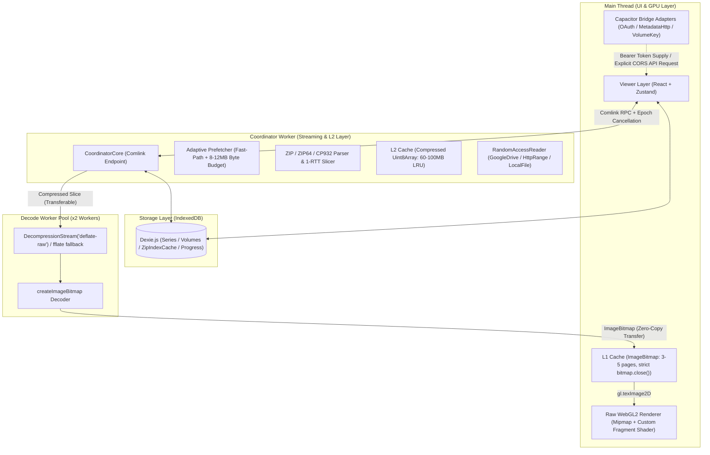

# ExLibris 4層＋マルチスレッドアーキテクチャと共通インターフェース契約

> [!NOTE]
> **Phase 2（コア仕様策定フェーズ）向け初期骨格（`Draft`）**:
> 本ドキュメントは `ex_libris_concept.md` §2〜§4 の技術検証結果を反映したアーキテクチャ正本の初期骨格です。Phase 2 にてインターフェース型定義を確定し、`Approved (Phase 2)` へ昇格させます。

---

## 1. 4層責務分離とスレッドモデル全体像

60fps の UI 応答性維持、高解像度/AVIF デコードによるメインスレッドブロック回避、および Android WebView の VRAM 枯渇（OOM）防止のため、システムを以下の **4層 × 3スレッド領域** に厳格分離します。



| レイヤー                                  | 主な配置先（予定）                                                | 責務と境界ルール                                                                                                                                                                                                                                                                                                 |
| :---------------------------------------- | :---------------------------------------------------------------- | :--------------------------------------------------------------------------------------------------------------------------------------------------------------------------------------------------------------------------------------------------------------------------------------------------------------- |
| **1. Streaming & Provider Layer**         | `src/engine/io/`, `src/providers/`                                | `RandomAccessReader`（Google Drive / HTTP Range / Local `File.slice`）、Drive `files.list` / `changes.list` 同期、自炊ファイル名パーサー、公開書誌 API クライアント。UI コンポーネントへの直接依存禁止。                                                                                                         |
| **2. Engine Worker Layer**                | `src/engine/zip/`, `src/engine/cache/`, `src/engine/workers/`     | ZIP/ZIP64 解析（末尾 128KB 取得＋不足分フォールバック、LFH 可変長 1 RTT 切り出し）、Fast-Path＋バイト予算先読み、L2 LRU キャッシュ、Decode Worker プール制御。**ビジネスロジックは純粋な `*Core.ts` に分離し、`*.worker.ts` は薄い `Comlink.expose` エントリのみとする。**                                       |
| **3. Storage Layer**                      | `src/storage/`                                                    | Dexie.js（IndexedDB）アダプタ。仮想本棚メタデータ、軽量表紙 WebP、ZIP Central Directory キャッシュ（`fileId + md5Checksum`）、読書進捗を管理。`resetTestDb()` で決定論的に初期化可能とする。                                                                                                                     |
| **4. Viewer, Diagnostics & Bridge Layer** | `src/features/`, `src/webgl/`, `src/bridges/`, `src/diagnostics/` | React UI、生 WebGL2 レンダラ（`WebGLRendererCore` と Canvas コンポーネントの分離）、L1 `ImageBitmap` キャッシュ（退避時 `bitmap.close()` 必須）、Capacitor ネイティブブリッジラッパー（`appId: com.highsoar.exlibris`）、および PC レス実機検証用のオンメモリ診断ログ（機密トークン自動マスク＋1タップコピー）。 |

---

## 2. Capacitor 通信・認証に関する最重要アーキテクチャ規約

### 2.1 `CapacitorHttp.enabled: false` の絶対維持（Zero-Copy 保護）

> [!CAUTION]
> **`capacitor.config.ts` で `plugins.CapacitorHttp.enabled: true` を絶対に有効化してはならない。**
> グローバルな `CapacitorHttp` パッチを有効化すると、WebView 内の `fetch` がネイティブブリッジ経由にフックされ、大容量バイナリ（`ArrayBuffer`）が Base64 文字列変換されてストリーミング性能が致命的に劣化する（また Web Worker 内 `fetch` との不整合を招く）。

- **ストリーミング通信（Google Drive `alt=media` / 自宅 HTTP Range）**:
  WebView / Web Worker 標準のネイティブ Chromium `fetch`（`Range: bytes=start-end` → `response.arrayBuffer()`）をそのまま使用する（Google Drive API は CORS ヘッダーを返すため `Authorization: Bearer <token>` 付き標準 `fetch` で直接高速取得できる）。
- **CORS 制限のある公開書誌 API（NDL サーチ / 楽天ブックス等）**:
  `src/bridges/http/MetadataHttpClient.ts` 内部でのみ、明示的に `CapacitorHttp.request()`（Web 開発時は Vite Proxy またはモック）を呼び出す。

### 2.2 Google OAuth スコープと Worker トークン供給契約

- **要求スコープ**:
  1. `https://www.googleapis.com/auth/drive.readonly`（ZIP 一覧スキャン・差分検知・Range ストリーミング読み取り専用）
  2. `https://www.googleapis.com/auth/drive.appdata`（アプリ専用隠し領域 `appDataFolder` への書誌・進捗バックアップ用）
- **トークン透過リフレッシュ（Single-Flight 制御）**:
  - ネイティブ Android 側プラグイン（`GoogleAuthPlugin`）が `AuthorizationClient` を用いてアクセストークン取得・失効時 `clearToken` 再取得を担う。
  - Worker 側で `401 Unauthorized` または有効期限直前（残り 5 分未満）を検知した場合、複数リクエストが同時にリフレッシュを走らせないよう **Single-Flight Promise** で1回だけトークンを更新し、保留中の Range リクエストを透過リトライする。

---

## 3. コアインターフェース骨格（Phase 2 詳細化対象）

### 3.1 `RandomAccessReader` 契約

```ts
export interface RandomAccessReader {
  readonly sourceId: string;
  readonly totalSize: number;
  readRange(
    offset: number,
    length: number,
    signal?: AbortSignal,
  ): Promise<Uint8Array>;
}
```

### 3.2 非同期処理の世代管理（Epoch / `AbortController`）規約

高速シーク・連続ページめくり・巻切り替え時のレースコンディションおよび無駄な帯域消費を防ぐため、以下を全非同期パイプラインに義務付けます。

1. **Epoch ID（世代カウンタ）**: 巻オープン・シーク操作のたびに `requestEpoch` をインクリメントし、古い世代の Range 取得結果やデコード完了 `ImageBitmap` が到着した場合は L1 キャッシュへ入れず即座に **`bitmap.close()` して破棄** する。
2. **優先度プリエンプション（閲覧最優先）**: リーダーで巻を開いている間、または Fast-Path 取得中は、バックグラウンドの表紙 WebP 抽出キューを即座に一時停止（プリエンプション）し、Google Drive API の 403 Rate Limit と回線帯域競合を回避する。
