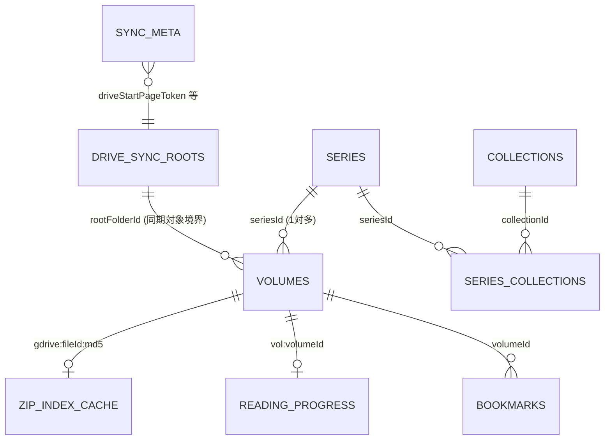

# ExLibris Dexie.js（IndexedDB）ローカルDBスキーマ定義

本ドキュメントは、ExLibris のローカルデータベース（`ExLibrisDB` / Dexie.js）における設計原則、名前空間識別規約、LWW（Last-Write-Wins）タイムスタンプ保護規約、および `v1.0` までを見据えた全 9 テーブル・インデックス定義の正本（Single Source of Truth）です。

---

## 1. データベース設計 5 原則

1. **物理ストレージ非依存のローカル完結検索（10ms 台応答）**:
   本棚一覧・五十音ソート・複合フィルタ・インクリメンタル検索は 100% IndexedDB（Dexie.js）上で完結させ、普段のブラウジングでは Google Drive API へ一切アクセスしない。
2. **指定ルートフォルダ配下限定同期と不変 `driveFileId` 管理**:
   `driveSyncRoots` テーブルに登録された「マンガ保管ルートフォルダ」の子孫にある `.zip` / `.cbz` のみを仮想本棚（`series` / `volumes`）へ取り込み、無関係な業務・バックアップ ZIP の混入を防ぐ。フォルダ移動・リネームが起きても不変である `driveFileId` と `changes.list` の `driveStartPageToken` で差分追従する。
3. **端末ローカル一時 ZIP の「本棚非汚染 ＋ 目次・進捗永続共有」設計**:
   ブラウザ / WebView の制約により再起動後に `File` 参照が失効する端末ローカル ZIP は、`series` / `volumes` には登録せず本棚を汚さない。一方、`zipIndexCache` と `readingProgress` の主キーには名前空間付き識別子（`local:${rawFileName}:${fileSize}`）を用い、同じローカル ZIP を再度開いた際は **0 RTT 目次キャッシュと前回ページの自動レジュームがそのまま機能する** 構造とする。
4. **LWW 端末間同期（`appDataFolder`）のためのタイムスタンプ完全分離**:
   ユーザーが明示的に編集・操作した論理更新時刻 `updatedAt`（UNIX ms）および論理削除時刻 `deletedAt`（Tombstone）と、バックグラウンド処理が更新する内部キャッシュ時刻（`coverUpdatedAt`, `cachedAt` 等）を別カラムへ完全分離する。表紙 WebP 生成や Drive ファイルスキャンでユーザーの `updatedAt` を汚染してはならない。
5. **加算的スキーマ進化と `resetTestDb()` によるテスト決定論性**:
   Milestone 進行に伴うテーブル新設・インデックス追加は Dexie の `this.version(N).stores(...)` を加算的に積み上げて既存データを保護し、UT / Storybook / Playwright IT では共通ヘルパー `resetTestDb()` で全テーブルを決定論的に初期化する。

---

## 2. ER 図とテーブル全体構成（全 9 テーブル）

|  #  | テーブル名              | 主キー・インデックス定義（Dexie `stores` 記法）                                                                                |    導入時期    |                   `appDataFolder` 同期対象                   |
| :-: | :---------------------- | :----------------------------------------------------------------------------------------------------------------------------- | :------------: | :----------------------------------------------------------: |
|  1  | **`syncMeta`**          | `"key"`                                                                                                                        | `Phase 1` (済) |                    ローカル固有（対象外）                    |
|  2  | **`zipIndexCache`**     | `"cacheKey, cachedAt"`                                                                                                         |     `v0.1`     |                     キャッシュ（対象外）                     |
|  3  | **`readingProgress`**   | `"targetKey, volumeId, readStatus, lastReadAt, updatedAt"`                                                                     |     `v0.1`     |        **`vol:*` のみ同期対象**（`local:*` は対象外）        |
|  4  | **`driveSyncRoots`**    | `"folderId, enabled, updatedAt, deletedAt"`                                                                                    |     `v0.2`     |                     **同期対象（LWW）**                      |
|  5  | **`series`**            | `"id, title, titleReading, *authors, publisher, label, *tags, publicationStatus, lastReadAt, addedAt, updatedAt, deletedAt"`   |     `v0.2`     |                     **同期対象（LWW）**                      |
|  6  | **`volumes`**           | `"id, seriesId, [seriesId+volumeNumber], &driveFileId, rootFolderId, md5Checksum, coverStatus, isTrashed, addedAt, updatedAt"` |     `v0.2`     | **メタ設定のみ同期対象**（`coverBlob` バイナリは各端末抽出） |
|  7  | **`collections`**       | `"id, kind, sortOrder, updatedAt, deletedAt"`                                                                                  |     `v0.3`     |                     **同期対象（LWW）**                      |
|  8  | **`seriesCollections`** | `"id, collectionId, seriesId, updatedAt, deletedAt"`                                                                           |     `v0.3`     |                     **同期対象（LWW）**                      |
|  9  | **`bookmarks`**         | `"id, volumeId, [volumeId+pageIndex], updatedAt, deletedAt"`                                                                   |     `v0.4`     |                     **同期対象（LWW）**                      |

---

## 3. 各テーブルの詳細カラム契約

### 3.1 `syncMeta`（同期トークン・端末ローカル制御メタ情報 / `Phase 1`〜）

| カラム名 | 型       | Indexed | 説明                                                                                                               |
| :------- | :------- | :-----: | :----------------------------------------------------------------------------------------------------------------- |
| `key`    | `string` | **PK**  | `'driveStartPageToken'` / `'lastDriveSyncAt'` / `'lastAppDataSyncAt'` / `'defaultReaderSettingsJson'` 等の識別キー |
| `value`  | `string` |    -    | JSON 文字列またはトークン文字列                                                                                    |

- **`'defaultReaderSettingsJson'` 保存・正規化契約（`ReaderSettingsRepository` / `v0.1`〜）**:
  - 保存形式は `{ version: 1, shader: ShaderCorrectionParams }` の JSON 文字列とする（将来の `v0.4` 拡張を見据えたバージョン付き構造）。
  - 取得時に未保存の場合は `DEFAULT_SHADER_CORRECTION_PARAMS`（`{ sharpness: 0, whitePoint: 1, blackPoint: 0, gamma: 1 }`）を返す。JSON パース失敗、ルート値が非プレーンオブジェクト（`null`・プリミティブ・配列）、または自前の `shader` プロパティ（`Object.prototype.hasOwnProperty.call` 判定）が存在するのに非プレーンオブジェクト（`null`・プリミティブ・配列）である場合は、破損レコードとして `syncMeta` から該当キーを削除して初期値へフォールバックし、プレーンオブジェクト内の部分欠落・範囲外数値は `normalizeShaderCorrectionParams` で許容範囲へクランプ・正規化する。

### 3.2 `zipIndexCache`（ZIP Central Directory 解析済み目次キャッシュ / `v0.1`〜）

| カラム名    | 型               | Indexed | 説明                                                                                                                 |
| :---------- | :--------------- | :-----: | :------------------------------------------------------------------------------------------------------------------- |
| `cacheKey`  | `string`         | **PK**  | Drive 巻: `gdrive:${driveFileId}:${md5Checksum ?? fileSize}` ローカル一時 ZIP: `local:${rawFileName}:${fileSize}` |
| `pageCount` | `number`         |    -    | ゴミ除外・自然順ソート後の総論理ページ数                                                                             |
| `entries`   | `ZipPageEntry[]` |    -    | 各ページのオフセット・圧縮方式・サイズ配列（2回目以降 0 RTT オープン用）                                             |
| `cachedAt`  | `number`         |   Yes   | キャッシュ保存・最終参照日時（UNIX ms、古いエントリの整理用）                                                        |

- **LRU 容量上限・整理ポリシー**: 最大保持件数は **500 件**（`ZIP_INDEX_CACHE_MAX_ENTRIES = 500`）。キャッシュヒット時（有効レコード検証後）に `cachedAt = Date.now()` を更新し、`put` 保存時に 500 件を超過した場合は `cachedAt` 昇順で最古の超過分を削除する。
- **破損／不整合キャッシュの自動修復**: 取得時に空配列・`pageCount !== entries.length`・必須フィールド欠落・非有限数値・`localHeaderOffset >= physicalEnd` 等の不整合を検出した場合は、該当レコードを即時削除して `null` を返し、`parseZipDirectory` へ透過フォールバックする。

### 3.3 `readingProgress`（読書進捗・レジューム位置・既読状態 / `v0.1`〜）

| カラム名           | 型                                     | Indexed | 説明                                                                               |
| :----------------- | :------------------------------------- | :-----: | :--------------------------------------------------------------------------------- |
| `targetKey`        | `string`                               | **PK**  | Drive 巻: `vol:${volumeId}` / ローカル一時 ZIP: `local:${rawFileName}:${fileSize}` |
| `volumeId`         | `string \| null`                       |   Yes   | Drive 巻の場合は `volumes.id`、ローカル一時 ZIP の場合は `null`                    |
| `currentPageIndex` | `number`                               |    -    | 0 始まりの現在ページ番号                                                           |
| `totalPageCount`   | `number`                               |    -    | 総ページ数                                                                         |
| `readStatus`       | `'unread' \| 'reading' \| 'completed'` |   Yes   | 未読・読書中・読了ステータス                                                       |
| `spreadPageOffset` | `0 \| 1`                               |    -    | 見開き「1ページずらし」補正状態                                                    |
| `lastReadAt`       | `number`                               |   Yes   | 最終閲覧日時（UNIX ms）                                                            |
| `updatedAt`        | `number`                               |   Yes   | LWW 同期調停用タイムスタンプ（UNIX ms）                                            |

- **非同期操作の FIFO 直列化契約（`ReadingProgressRepository`）**:
  - `TR-08`（`popstate` 同一コミット遷移を含む）で fire-and-forget 発行される `put(...)` と直後の `SCR-01` マウント時 `listRecentLocal(10)` や即座の再オープン時 `get(targetKey)`、および連続ページ送り時の `put(...)` が競合して古い値を返したり順序逆転したりしないよう、Dexie 実装内部で全メソッド（`put` / `delete` / `clearLocal` / `get` / `listRecentLocal`）を Promise キューにより **FIFO 直列実行** する。
- **`local:*` 識別子の解析・容量上限・抽出クエリポリシー**:
  - `local:${rawFileName}:${fileSize}` はファイル名自体に `:` が含まれるケースを安全に扱えるよう、接頭辞 `"local:"` と末尾の `lastIndexOf(":")` で `rawFileName`（非空文字列）と `fileSize`（0 以上の安全整数 `/^\d+$/`）へ分離する。
  - ローカル一時 ZIP の進捗レコード（`targetKey` が `"local:"` で始まるもの）の最大保持件数は **100 件**（`LOCAL_READING_PROGRESS_MAX_ENTRIES = 100`）とし、`put` 保存時に `where("targetKey").startsWith("local:")` 件数が上限を超過した場合は `lastReadAt` 昇順（同値時は `targetKey` 昇順）で最古の `local:*` レコードのみを削除する。**`vol:*`（Google Drive 永続巻）レコードは LRU 退避の対象外とし一切削除しない**。
  - `SCR-01` の「最近のローカル閲覧履歴」表示（`listRecentLocal(limit = 10)`）では、`where("targetKey").startsWith("local:")` から有効なレコードのみを抽出し、`lastReadAt` 降順（同値時は `targetKey` 昇順の決定論的タイブレーク）で最大 `limit` 件（`limit <= 0` 時は `[]`）を返す（`clearLocal()` 実行時も `local:*` のみを削除し `vol:*` は保護する）。
- **破損／不整合レコード検証と寸法確定ベースの `readStatus` 判定**:
  - レコード妥当性条件：`totalPageCount` が 1 以上の `Number.isSafeInteger`、`currentPageIndex` が `0 <= currentPageIndex < totalPageCount` の `Number.isSafeInteger`、`lastReadAt` / `updatedAt` が有限数（`Number.isFinite`）、`readStatus` が `'unread' | 'reading' | 'completed'`、`spreadPageOffset` が `0 | 1`、かつ `targetKey` が `local:*` の場合は `parseLocalProgressTargetKey(targetKey) !== null && volumeId === null`、`vol:${id}` の場合は `id.length > 0 && volumeId === id` を満たすこと。`get(targetKey)` 時に不整合レコードを検出した場合は即時削除して `null` を返す。
  - リーダー閲覧中の保存時は、見開き第 2 スロット（`currentPageIndex + 1`）は `currentPageIndex` と `currentPageIndex + 1` の双方が `knownDimensions` 上で非横長（`width <= height`）と寸法確定している場合のみ表示済みとみなし（寸法未確定の `moveToPage` 直後やデコード完了前離脱時は `currentPageIndex` 単独基準）、確定表示最大ページ `confirmedMaxDisplayedPageIndex >= totalPageCount - 1` であれば `'completed'`、それより手前であれば `'reading'` として記録する。再オープン時はステータスにかかわらず保存済み `currentPageIndex`（実ページ数でクランプ）と `spreadPageOffset`（1 ページ本 `pageCount <= 1` 時は `0` へ正規化）から忠実にレジュームする。

### 3.4 `driveSyncRoots`（Google Drive 同期対象ルートフォルダ / `v0.2`〜）

| カラム名     | 型               | Indexed | 説明                                                                       |
| :----------- | :--------------- | :-----: | :------------------------------------------------------------------------- |
| `folderId`   | `string`         | **PK**  | Google Drive フォルダの不変 `fileId`                                       |
| `folderName` | `string`         |    -    | 表示用フォルダ名（例: `"Comics"`, `"自炊マンガ"`）                         |
| `enabled`    | `0 \| 1`         |   Yes   | 同期有効フラグ（IndexedDB 複合検索互換のため数値 `0 \| 1` または boolean） |
| `addedAt`    | `number`         |    -    | 登録日時（UNIX ms）                                                        |
| `updatedAt`  | `number`         |   Yes   | ユーザー設定更新日時（UNIX ms、LWW 同期用）                                |
| `deletedAt`  | `number \| null` |   Yes   | 登録解除時の論理削除日時（UNIX ms、Tombstone）                             |

### 3.5 `series`（作品シリーズ / `v0.2`〜）

| カラム名                 | 型                                                               |   Indexed   | 説明                                                                              |
| :----------------------- | :--------------------------------------------------------------- | :---------: | :-------------------------------------------------------------------------------- |
| `id`                     | `string`                                                         |   **PK**    | シリーズ一意 ID（UUID v4、または名寄せ統合先 ID）                                 |
| `title`                  | `string`                                                         |     Yes     | 作品表示タイトル                                                                  |
| `titleReading`           | `string`                                                         |     Yes     | 五十音ソート・検索用の正規化読み仮名（ひらがな統一、未取得時は `title` から生成） |
| `authors`                | `string[]`                                                       | Multi (`*`) | 著者・原作・作画名配列                                                            |
| `publisher`              | `string`                                                         |     Yes     | 出版社名（未設定時は `""`）                                                       |
| `label`                  | `string`                                                         |     Yes     | レーベル名（未設定時は `""`）                                                     |
| `tags`                   | `string[]`                                                       | Multi (`*`) | ジャンル・自由タグ配列                                                            |
| `synopsis`               | `string`                                                         |      -      | あらすじ・作品紹介（Google Books 等から補完）                                     |
| `publicationStatus`      | `'ongoing' \| 'completed' \| 'unknown'`                          |     Yes     | 連載状況（AniList 等から補完）                                                    |
| `knownTotalVolumes`      | `number \| null`                                                 |      -      | 公開書誌上の既刊総巻数（`v1.0` 欠巻・新刊チェッカー用）                           |
| `externalIds`            | `{ ndlId?: string; anilistId?: string; googleBooksId?: string }` |      -      | 紐付け済み公開書誌データソース識別子                                              |
| `metadataLocked`         | `boolean`                                                        |      -      | 手動編集保護ロック（`true` の場合は自動書誌上書きを抑止）                         |
| `representativeVolumeId` | `string \| null`                                                 |      -      | シリーズカードの代表表紙に使用する `volumes.id`（`null` 時は最小巻）              |
| `readerPresetJson`       | `string \| null`                                                 |      -      | 作品別 WebGL2 画質補正・読み方向・オートクロップ設定 JSON（`v0.4`〜）             |
| `lastReadAt`             | `number \| null`                                                 |     Yes     | 所属巻の最新読書日時（本棚「最近読んだ順」高速ソート用）                          |
| `addedAt`                | `number`                                                         |     Yes     | 初回取り込み日時（UNIX ms）                                                       |
| `updatedAt`              | `number`                                                         |     Yes     | **ユーザー論理更新日時（UNIX ms、LWW 同期用）**                                   |
| `deletedAt`              | `number \| null`                                                 |     Yes     | 論理削除日時（UNIX ms、Tombstone）                                                |

### 3.6 `volumes`（巻・Google Drive アーカイブ参照 / `v0.2`〜）

| カラム名            | 型                                                |     Indexed      | 説明                                                                     |
| :------------------ | :------------------------------------------------ | :--------------: | :----------------------------------------------------------------------- |
| `id`                | `string`                                          |      **PK**      | 巻一意 ID（UUID v4）                                                     |
| `seriesId`          | `string`                                          |       Yes        | 所属する `series.id`（`[seriesId+volumeNumber]` 複合インデックス対象）   |
| `volumeNumber`      | `number \| null`                                  |     Compound     | 推定または手動設定された巻数（単巻・特装版・合本ソートおよび欠巻判定用） |
| `volumeLabel`       | `string`                                          |        -         | 巻表示ラベル（例: `"第01巻"`, `"第01-05巻 合本"`）                       |
| `rawFileName`       | `string`                                          |        -         | Google Drive 上の元ファイル名                                            |
| `driveFileId`       | `string`                                          | **Unique (`&`)** | Google Drive の不変ファイル ID                                           |
| `parentFolderId`    | `string \| null`                                  |        -         | Google Drive 上の直近親フォルダ ID                                       |
| `rootFolderId`      | `string`                                          |       Yes        | 帰属する `driveSyncRoots.folderId`                                       |
| `fileSize`          | `number`                                          |        -         | 正確なバイトサイズ（HEAD 通信省略・末尾 128KB Range 計算用）             |
| `md5Checksum`       | `string \| null`                                  |       Yes        | Drive 提供の MD5（`zipIndexCache` 無効化判定および `v1.0` 重複検出用）   |
| `driveModifiedTime` | `number`                                          |        -         | Drive 側のファイル更新時刻（UNIX ms）                                    |
| `coverBlob`         | `Blob \| null`                                    |        -         | 長辺約 350px の軽量表紙 WebP（約 15〜25KB/冊、端末ローカル保持）         |
| `coverStatus`       | `'pending' \| 'ready' \| 'error'`                 |       Yes        | 表紙抽出キュー状態                                                       |
| `coverCropMode`     | `'auto' \| 'full' \| 'left-half' \| 'right-half'` |        -         | 見開きカバー半裁クロップ指定（`v0.4`〜）                                 |
| `coverPageIndex`    | `number`                                          |        -         | 表紙に採用する論理ページ番号（デフォルト `0`、`v0.4`〜変更対応）         |
| `coverUpdatedAt`    | `number \| null`                                  |        -         | 表紙抽出完了日時（内部管理用・`updatedAt` とは分離）                     |
| `isTrashed`         | `0 \| 1`                                          |       Yes        | Drive 側ゴミ箱移動・削除・または対象ルートフォルダ外移動の検知フラグ     |
| `addedAt`           | `number`                                          |       Yes        | 初回同期取り込み日時（UNIX ms）                                          |
| `updatedAt`         | `number`                                          |       Yes        | ユーザーの巻番号・所属シリーズ・表紙設定変更日時（UNIX ms、LWW 同期用）  |

### 3.7 `collections` / `seriesCollections` / `bookmarks`（`v0.3`〜`v0.4`）

- **`collections`（カスタム棚・スマートコレクション定義 / `v0.3`〜）**:
  - `id` (PK), `name`, `kind` (`'manual' | 'smart'`), `smartFilterJson` (`string | null`), `sortOrder` (Indexed), `createdAt`, `updatedAt` (Indexed), `deletedAt` (Indexed)
- **`seriesCollections`（手動コレクションとシリーズの多対多中間テーブル / `v0.3`〜）**:
  - `id` (PK: `${collectionId}:${seriesId}`), `collectionId` (Indexed), `seriesId` (Indexed), `addedAt`, `updatedAt` (Indexed), `deletedAt` (Indexed)
- **`bookmarks`（一言メモ付きページしおり / `v0.4`〜）**:
  - `id` (PK: UUID v4), `volumeId` (Indexed), `pageIndex` (`[volumeId+pageIndex]` 複合インデックス), `note` (`string`), `createdAt`, `updatedAt` (Indexed), `deletedAt` (Indexed)

---

## 4. スキーマ進化・テスト初期化契約（`resetTestDb()`）

1. **段階的テーブル有効化ルール**:
   - `Phase 1` 時点では `version(1)`（`syncMeta`）が稼働中。
   - `v0.1` で `version(2)`（`zipIndexCache`, `readingProgress`）を先行定義し、`#19` で `ZipIndexCacheRepository` による `zipIndexCache` 読み書き・LRU 整理を有効化し、`#22` で `readingProgress` の Repository / UI 利用を有効化する。`v0.2` で `version(3)`（`driveSyncRoots`, `series`, `volumes`）、`v0.3` で `version(4)`（`collections`, `seriesCollections`）、`v0.4` で `version(5)`（`bookmarks`）を加算的に定義する。
2. **`resetTestDb()` の不変契約**:
   - `resetTestDb(targetDb = db)` は、その時点で `ExLibrisDatabase` に定義されている **`targetDb.tables` 全件に対して `table.clear()` をトランザクションまたは並列で実行** し、テスト間の状態汚染を完全にゼロにする。
