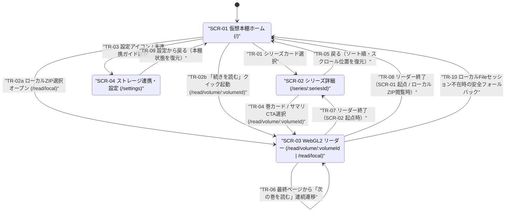

# ExLibris 主要画面一覧（`SCR-xx`）と画面遷移（`TR-xx`）

本ドキュメントは、ExLibris の UI シェル・テーマ原則、全 4 画面（`SCR-01`〜`SCR-04`）の URL ルーティング、画面遷移（`TR-xx`）、Android ハードウェア戻るボタン（Back Button）制御、および遷移時のリソース・進捗保護契約の正本（Single Source of Truth）です。

---

## 1. UI シェル・テーマ・ナビゲーション基本原則

1. **ダークテーマ標準（暗色基調統一）**:
   - 表紙アートの色彩を引き立て、暗所でのマンガ閲覧時の目の負担を抑えるため、アプリ全体をスレート系ダークカラー（`bg-slate-950` / `bg-slate-900` 基調）で統一する。ライトテーマ切替は初期スコープには含めない。
2. **下部タブバーなしのシンプル導線**:
   - 画面下部の常駐タブバーは配置せず、`SCR-01`（仮想本棚ホーム）で蔵書グリッドの表示領域を最大化する。
   - 手動同期トリガー、ソート・コレクション切替、「ローカル ZIP を開く」アクション、および設定画面（`SCR-04`）への導線は `SCR-01` の上部ヘッダー／ツールバー領域に集約する。
3. **`SCR-03`（リーダー）の完全フルスクリーン没入表示**:
   - 読書中は上下バーを含むすべての UI 装飾を非表示にし、画面全体を生 WebGL2 キャンバス（純黒 `#000000` 背景）に割り当てる。
   - **画面中央タップゾーン**（基本分割: `rtl` 時 左 30%＝次頁 / 中央 40%＝HUD 開閉 / 右 30%＝前頁、`ltr` 時 左右反転）のタップでのみ、上部オーバーレイ（戻る・ファイル名/巻タイトル・画質補正シート・`v0.4`〜しおり）および 3 段下部オーバーレイ（`rtl`/`ltr` 連動シークバー・ページ番号・次/前ボタン・表示モード循環［自動/見開き/単頁］・1ページずらし・右/左開き切替）を開閉する。
4. **Android Edge-to-Edge システムバー非重複・黒余白＆白アイコン統一**:
   - Android 15/16（`targetSdkVersion = 35` 以降の強制 Edge-to-Edge 環境）において WebView が OS ステータスバーおよびナビゲーションバー（3 ボタン / ジェスチャー）領域と重なってタッチ操作を奪われないよう、`capacitor.config.ts` で `backgroundColor: "#000000"` および `android: { backgroundColor: "#000000", adjustMarginsForEdgeToEdge: "auto" }` を設定してシステムバー／ディスプレイカットアウト分の WebView マージンを自動確保する。
   - `MainActivity.java` にて Window 背景色を `Color.BLACK` に統一し、`WindowCompat.getInsetsController` / `WindowInsetsControllerCompat` で `setAppearanceLightStatusBars(false)` および `setAppearanceLightNavigationBars(false)` を設定することで、黒余白上のシステムバーアイコンを白表示に固定する。
   - あわせて `SCR-01` / `SCR-02` / `SCR-04` 上部ヘッダー・ページ下部および `SCR-03` 上下オーバーレイ HUD・ボトムシートに `env(safe-area-inset-top, 0px)` / `env(safe-area-inset-bottom, 0px)` によるセーフエリアパディングを併用し、デスクトップ Web 環境（`0px`）でのレイアウトを維持しつつシステムバーとの非重複を二重に担保する。

---

## 2. 主要画面一覧（`SCR-01` 〜 `SCR-04`）とルート契約

未知・不正なパス（空パラメータ `/series/`・多段セグメント `/series/a/b`・不正パーセントエンコード等を含む）が指定された場合は、例外を発生させず安全に `/`（`SCR-01`）へフォールバックします。

|   画面 ID    | 画面名                                                  | ルートパス                                                                      | 段階的立ち上げと主な責務                                                                                                                                                                                                                                                                                                                                                                                                                                                                                                                                                                                                                                                                                                                                                                                                                                                                                                                                                                            |
| :----------: | :------------------------------------------------------ | :------------------------------------------------------------------------------ | :-------------------------------------------------------------------------------------------------------------------------------------------------------------------------------------------------------------------------------------------------------------------------------------------------------------------------------------------------------------------------------------------------------------------------------------------------------------------------------------------------------------------------------------------------------------------------------------------------------------------------------------------------------------------------------------------------------------------------------------------------------------------------------------------------------------------------------------------------------------------------------------------------------------------------------------------------------------------------------------------------- |
| **`SCR-01`** | **仮想本棚ホーム** (Virtual Bookshelf)               | `/`                                                                             | ・`Phase 3`: ローカル ZIP オープン導線（ヘッダー＆メインカード＋Web D&D）＋診断ログコピーを備えた初期ホームとして機能 ・`v0.1`: 直近ローカル閲覧履歴（`local:*` 1件以上時に最新10件表示・進捗バー・ステータスバッジ・再選択ピッカー導線・個別削除・一括クリア）を追加 ・`v0.2`〜: 設定画面導線・段階別 Google Drive セットアップバナー（`#23`）、手動 Drive 同期トリガー・4軸基本ソート・シリーズ束ねカードグリッド・「続きを読む」クイック起動（`#25`）、ビューポート優先の表紙 WebP 自動抽出連携（`#26`） ・`v0.3`〜: インクリメンタル複合検索、五十音/多軸ソート、カスタム・スマートコレクション切替、1,000シリーズ規模対応の本棚アクセス UX（五十音インデックスジャンプ・作者/レーベル別グルーピング・Virtual Grid） ・`v1.0`: 欠巻・新刊・重複バッジ絞り込み                                                                                                                                                                                                                       |
| **`SCR-02`** | **シリーズ詳細・巻一覧** (Series Detail)             | `/series/:seriesId`                                                             | ・`v0.2`〜: 作品サマリ（代表表紙・著者・巻数・続きを読む CTA）、単巻＋合本混在の所属有効巻一覧、巻別の既読/読書中進捗バー、巻選択によるリーダー起動、未存在/有効巻0件時の案内ビュー（`#25`） ・`v0.3`〜: 書誌メタデータ（出版社・タグ・あらすじ）表示、公開書誌 API 再検索・候補切替・手動編集・ロックモーダル ・`v0.4`〜: 作品別画質/綴じ方向プリセット、表紙半裁クロップ・表紙ページ変更                                                                                                                                                                                                                                                                                                                                                                                                                                                                                                                                                                                                    |
| **`SCR-03`** | **WebGL2 ストリーミングリーダー** (Streaming Reader) | Drive 巻: `/read/volume/:volumeId`  ローカル一時 ZIP: `/read/local` | ・`Phase 3`: 生 WebGL2 単ページ Mipmap 描画＋右開き（`rtl`）固定前後ページ移動（タップ 30/40/30%・スワイプ・矢印キー/`Escape`）・最小 HUD（`/read/local`、常に先頭 `pageIndex = 0` から開始） ・`v0.1`〜: インテリジェント見開き（`auto`/`single`/`spread`）・「1ページずらし」・右/左開き切替・`MAX_TEXTURE_SIZE` 分割/縮小ガード・片側エラー半面表示（`#21`）、1パス画質補正シェーダー＆調整ボトムシート（優先度2戻る制御・`syncMeta` デフォルト保存）・`rtl`/`ltr` 連動シークバー・`readingProgress` 自動レジューム（`#22`） ・`v0.2`〜: Google Drive ストリーミング閲覧（`/read/volume/:volumeId`：`vol:*` ＆ `series.lastReadAt` 更新、HUD「作品名 巻ラベル」、`TR-07`/`TR-08` 起点別戻り、未存在/ゴミ箱/無効ルート/未認証エラー導線：`#25`） ・`v0.4`〜: オートクロップ、ピンチ/ダブルタップ/ルーペ拡大、音量キーめくり、サムネイルシーク＆Undo Jump、次巻シームレス遷移、メモ付きしおり ※`/read/local` でメモリ上の `File` セッションが不在の場合は即時 `/` へフォールバックする |
| **`SCR-04`** | **ストレージ連携・設定** (Settings & Sync)           | `/settings`                                                                     | ・`v0.2`〜: Google アカウント連携（OAuth `drive.readonly`）、**マンガ保管ルートフォルダ（複数可：アプリ内階層選択モーダル＋URL/ID登録・有効化切替・論理削除）管理**、オンメモリ診断ログ一覧確認＆1タップコピー＆クリア（`#23`）、手動 Drive 差分同期／強制フルスキャン実行 UI（`#25`）、表紙抽出キュー進捗表示（`#26`） ・`v0.4`〜: デフォルト画質補正・タップ領域・音量キー操作設定 ・`v1.0`: Google Drive `appDataFolder` 自動バックアップ・手動復元・端末間同期ステータス                                                                                                                                                                                                                                                                                                                                                                                                                                                                                                                  |

---

## 3. 画面遷移図と遷移契約一覧（`TR-01` 〜 `TR-10`）

|   遷移 ID    | 遷移元 → 遷移先     | トリガーと必須副作用（状態・リソース契約）                                                                                                                                                                                                                                                                                                                                                                                                                                                                                                                                        |
| :----------: | :------------------ | :-------------------------------------------------------------------------------------------------------------------------------------------------------------------------------------------------------------------------------------------------------------------------------------------------------------------------------------------------------------------------------------------------------------------------------------------------------------------------------------------------------------------------------------------------------------------------------- |
| **`TR-01`**  | `SCR-01` → `SCR-02` | シリーズカード本体選択時。遷移前の `SCR-01` ソート順・スクロール位置（`v0.3`〜検索クエリ・選択コレクション含む）を `bookshelfUiStateStore` に保持して `/series/:seriesId` を表示する。                                                                                                                                                                                                                                                                                                                                                                                            |
| **`TR-02a`** | `SCR-01` → `SCR-03` | 「ローカル ZIP を開く」（または閲覧履歴行からのピッカー起動）・D&D で `.zip` / `.cbz` の `File` が選択された時。メモリ上のアクティブローカルセッションへ保持し、`coverExtractionScheduler.pause("reader")` で表紙抽出キューを同期一時停止（進行中通信 `abort()`）した上で `/read/local` へ遷移する（`local:${name}:${size}` に既存 `readingProgress` があれば保存済み `currentPageIndex` と `spreadPageOffset` を忠実に復元してレジュームする）。                                                                                                                                 |
| **`TR-02b`** | `SCR-01` → `SCR-03` | 本棚シリーズカード上のクイック起動アクション選択時。`SCR-01` スクロール位置を保存し、`window.history.state` に `readerOrigin: "bookshelf"`（および `seriesId`）を記録、`coverExtractionScheduler.pause("reader")` で表紙抽出キューを同期一時停止して `/read/volume/:volumeId` をレジューム位置から開く。                                                                                                                                                                                                                                                                          |
| **`TR-03`**  | `SCR-01` → `SCR-04` | ヘッダー設定ボタンまたは段階別 Google Drive セットアップバナー（未連携／フォルダ未登録）選択時。現在の `SCR-01` 状態（ソート順・スクロール位置）を保持して `/settings` へ遷移する。                                                                                                                                                                                                                                                                                                                                                                                               |
| **`TR-04`**  | `SCR-02` → `SCR-03` | シリーズ詳細内の作品サマリ CTA または巻行選択時。`SCR-02` の現在スクロール位置（`seriesId` 紐付け）を保持し、`window.history.state` に `readerOrigin: "series-detail"` および `seriesId` を記録、`coverExtractionScheduler.pause("reader")` で表紙抽出キューを同期一時停止して `/read/volume/:volumeId` を開く。                                                                                                                                                                                                                                                                  |
| **`TR-05`**  | `SCR-02` → `SCR-01` | ヘッダー戻るボタン・未存在案内戻るボタン・ブラウザ `popstate`・またはハードウェア戻る（優先度 4）操作時。保持していた `SCR-01` のソート順・スクロール位置（`v0.3`〜検索・棚条件含む）をそのまま復元して `/` へ戻る。                                                                                                                                                                                                                                                                                                                                                              |
| **`TR-06`**  | `SCR-03` → `SCR-03` | 同一シリーズの次巻が存在する状態で最終ページから「次の巻を読む」実行時（`v0.4`〜）。前巻の読了進捗を保存し、`requestEpoch` を進めて進行中通信を中断、前巻の L1 `ImageBitmap` と WebGL2 テクスチャを全解放した上で次巻 `/read/volume/:nextVolumeId` へ `replace` 遷移する。                                                                                                                                                                                                                                                                                                        |
| **`TR-07`**  | `SCR-03` → `SCR-02` | `TR-04`（`readerOrigin === "series-detail"`）起点のリーダー終了時（または直接 URL アクセスで実在巻の `seriesId` が判明している場合のフォールバック）。現在ページ進捗を `readingProgress`（`vol:${volumeId}`）および `series.lastReadAt` へフラッシュ保存し、Coordinator/Decode Worker の未完了ジョブ中断・L1 `ImageBitmap.close()` ＆ WebGL2 全解放を実行して `/series/:seriesId` へ戻り、`AppShell` で `coverExtractionScheduler.resume("reader")` により表紙抽出キューを再開しつつ `SCR-02` スクロール位置を復元する。                                                          |
| **`TR-08`**  | `SCR-03` → `SCR-01` | `TR-02a`（`/read/local`）または `TR-02b`（`readerOrigin === "bookshelf"`）起点のリーダー終了時（および未存在 `volumeId` への直接 URL アクセス時のフォールバック）。現在ページ進捗・`spreadPageOffset` の `readingProgress`（Drive 巻時は `series.lastReadAt` も含む）フラッシュ保存（`pagehide` / `visibilitychange(hidden)` 時も同様保護）・Coordinator/Decode Worker の未完了ジョブ中断・L1 `ImageBitmap.close()` ＆ WebGL2 全解放・ローカル `File` 参照クリアを実行して `/` へ戻り、`AppShell` で `coverExtractionScheduler.resume("reader")` により表紙抽出キューを再開する。 |
| **`TR-09`**  | `SCR-04` → `SCR-01` | 設定画面から戻る操作（ヘッダー戻るボタン・ブラウザ `popstate`・Android ハードウェア戻る優先度 4）時。保持していた `SCR-01` の状態（ソート順・スクロール位置）を復元して `/` へ戻る（Drive 同期実行中およびバックグラウンド表紙抽出実行中の場合も共有ストア／スケジューラで継続される）。                                                                                                                                                                                                                                                                                          |
| **`TR-10`**  | `SCR-03` → `SCR-01` | `/read/local` へ直接アクセスまたはリロードされ、メモリ上に `File` セッションが存在しない場合。エラー画面で停止せず `/` へ即時リダイレクトし、`AppShell` で `coverExtractionScheduler.resume("reader")` を実行する。                                                                                                                                                                                                                                                                                                                                                               |

---

## 4. Android ハードウェア戻るボタン（Back Button）優先制御契約

`@capacitor/app` の `backButton` イベント（およびブラウザ `popstate`）に対し、以下の優先順位で決定論的に応答します。

1. **優先度 1（非同期クリティカル処理中のブロック）**:
   - `SCR-04` の Google OAuth `signIn` / `signOut` 実行中・フォルダ登録確定保存中、書誌保存・`appDataFolder` 同期復元・確認ダイアログ処理中など `useRouter().isBackBlocked === true`（`setBackBlocked` で設定）の間は、戻る操作を無視して状態・データ破損を防ぐ（Drive 蔵書同期実行中 `isSyncing === true` は画面間共有ストアで安全に継続されるため優先度 1 ブロック対象外）。
2. **優先度 2（モーダル・ドロワー・ボトムシートの閉鎖）**:
   - `SCR-04` のアプリ内 Drive フォルダ選択モーダル（`DriveFolderPickerModal`）、書誌再検索モーダル、コレクション編集ダイアログ、または `SCR-03`（`/read/local`・`/read/volume/:volumeId` 双方）の画質補正ボトムシート（`ReaderShaderSheet`、致命的エラー未発生時）等が開いている場合は、画面遷移を行わず最前面のシート/モーダルのみを閉じる（Web キーボードの `Escape` キーおよびシート外バックドロップタップも同じ優先度 2 でモーダル/シートのみを閉じる）。
3. **優先度 3（`SCR-03` リーダーからの安全な退場）**:
   - `SCR-03`（`/read/local` または `/read/volume/:volumeId`）表示中（モーダル/ボトムシートが閉じている状態、上下オーバーレイの表示有無や致命的エラー表示中かを問わず）は `TR-07` または `TR-08` の終了シーケンス（進捗フラッシュ保存 ＋ L1 `bitmap.close()` 全解放）を実行して遷移元画面へ戻る。
4. **優先度 4（サブ画面から `SCR-01` への復帰）**:
   - `SCR-02`（`/series/:seriesId`）または `SCR-04`（`/settings`）表示中は、`TR-05` / `TR-09` に従い `SCR-01`（`/`）へ戻る。
5. **優先度 5（ルート画面 `SCR-01` でのアプリ最小化）**:
   - `SCR-01` で開いているモーダルが無い場合は、`App.minimizeApp()` を呼び出して Android ホームへ最小化する。

---

## 5. 結合テストシナリオ（`SCN-xx`）トレーサビリティ対応表

Playwright 結合テスト（`test/it/*.spec.ts`、SwiftShader WebGL2 ＋ 実 Web Worker ＋ `resetTestDatabase` 初期化）の恒久シナリオ定義と、画面（`SCR-xx`）・遷移（`TR-xx`）・受け入れ条件（`AC-xx` / `NFR-xx`）の対応正本です。機能追加・変更時は本対応表を基準に `SCN-xx` を更新します。

| シナリオ ID  | 実装ファイル                             | 対象画面 / 遷移                                                                                                                        | 対応要件 (`AC-xx` / `NFR-xx`)                                                                                                                                                                                                                                                                                                                                                                                                                                                                                    | 検証内容（結合テスト保証範囲）                                                                                                                                                                                                                                                                                                                                                                                                                                                                                                                                                                                                                                                                                                                                                                                                                                                                                                                                                                                                                                                                                                                                                                                                                                                                                                                                                                                                                                                                                                                                                                                                                                                                                                                                                                                                                                                                                                                                                                                                                                                                                                                                                                                                                                                                                                                                                                                                                                                                                                                                                                                                                                                                                                                                                                                                                                                                                                                                                           |
| :----------: | :--------------------------------------- | :------------------------------------------------------------------------------------------------------------------------------------- | :--------------------------------------------------------------------------------------------------------------------------------------------------------------------------------------------------------------------------------------------------------------------------------------------------------------------------------------------------------------------------------------------------------------------------------------------------------------------------------------------------------------- | :--------------------------------------------------------------------------------------------------------------------------------------------------------------------------------------------------------------------------------------------------------------------------------------------------------------------------------------------------------------------------------------------------------------------------------------------------------------------------------------------------------------------------------------------------------------------------------------------------------------------------------------------------------------------------------------------------------------------------------------------------------------------------------------------------------------------------------------------------------------------------------------------------------------------------------------------------------------------------------------------------------------------------------------------------------------------------------------------------------------------------------------------------------------------------------------------------------------------------------------------------------------------------------------------------------------------------------------------------------------------------------------------------------------------------------------------------------------------------------------------------------------------------------------------------------------------------------------------------------------------------------------------------------------------------------------------------------------------------------------------------------------------------------------------------------------------------------------------------------------------------------------------------------------------------------------------------------------------------------------------------------------------------------------------------------------------------------------------------------------------------------------------------------------------------------------------------------------------------------------------------------------------------------------------------------------------------------------------------------------------------------------------------------------------------------------------------------------------------------------------------------------------------------------------------------------------------------------------------------------------------------------------------------------------------------------------------------------------------------------------------------------------------------------------------------------------------------------------------------------------------------------------------------------------------------------------------------------------------------------- |
| **`SCN-01`** | `test/it/smoke.spec.ts`                  | `SCR-01`（`/` ＆ 未知パスフォールバック） `TR-02a`                                                                                  | `AC-BS-01`〜`AC-BS-06` `AC-GD-02` `NFR-05`                                                                                                                                                                                                                                                                                                                                                                                                                                                                 | 1. ゼロコンフィグ起動（`data-app-ready="true"`）、`APP_VERSION` 動的連動バージョン表示（`v${APP_VERSION}`）、WebGL2 コンテキスト利用可能確認、初期履歴 0 件時の `recent-local-history-section` 非表示確認、初期未連携時の段階別 Drive セットアップバナー表示確認 2. 診断ログコピー（`navigator.clipboard.readText()` に `# ExLibris Diagnostic Report` と `[INFO] [app] ExLibris shell initialized` を含む） 3. ヘッダー CTA `filechooser` による非対応拡張子（`unsupported.pdf`）警告（`role="alert"`）および再コピー時の `[WARN] [bookshelf] Unsupported archive extension` / `unsupported.pdf` 出力検証 4. メインカード CTA `filechooser` による有効 `.zip` 起動（`TR-02a`） 5. `<main>` D&D `dragover` ハイライト・非対応 `.txt` 警告・有効 `.cbz` 起動（`TR-02a`） 6. 未知パス（`/unknown-route`）直接アクセス時の例外なし `SCR-01`（`bookshelf-empty`）フォールバック表示                                                                                                                                                                                                                                                                                                                                                                                                                                                                                                                                                                                                                                                                                                                                                                                                                                                                                                                                                                                                                                                                                                                                                                                                                                                                                                                                                                                                                                                                                                                                                                                                                                                                                                                                                                                                                                                                                                                                                                                                                                                                                           |
| **`SCN-02`** | `test/it/local-reader.spec.ts`           | `SCR-01` ↔ `SCR-03`（`/read/local`） `TR-02a`, `TR-08`, `TR-10`                                                                     | `AC-BS-06` `AC-ENG-01, 02, 03, 04, 05, 06, 07, 09, 10, 11, 12, 13, 14` `AC-GL-01, 02, 03, 04`（`ResizeObserver`）, `05, 07`（タイル分割）, `08, 09` `AC-RD-01, 02, 03, 04, 05, 06, 07, 08, 10, 11, 12, 13, 14, 15` `NFR-01`（ローカル TTFP）, `NFR-02` （注: `AC-ENG-08` / `AC-GL-06` / `AC-RD-09` は Vitest 100% カバレッジで担保、`AC-GL-04` の `DPR`・`MAX_VIEWPORT_DIMS` クランプ／`AC-GL-07` の縮小フォールバック／`WEBGL_UNSUPPORTED` 等環境依存異常系は UT 補完、実機観点は `HO-xx` 補完） | 1. 合成 `.cbz`/`.zip`（`__MACOSX` / `Thumbs.db` 除外・セグメント自然順ソート・Store/Deflate 混在・ZIP64 Locator/EOCD/`0x0001`・CP932 Shift_JIS 日本語ファイル名）選択 → 実 Web Worker 解凍 → SwiftShader 生 WebGL2 Mipmap 描画（`data-rendered-page`/`data-rendered-pages`/`data-rendered-slots`・描画ピクセル RGB 検証） 2. 同一ローカルアーカイブの再オープン時に Dexie `zipIndexCache` 経由で `fromIndexCache: true`（0 RTT）オープンが動作し、リロード／再遷移後も永続化されることを検証、あわせて初回（`fromIndexCache: false`）・2 回目（`fromIndexCache: true`）の `performance.now()` TTFP 計測・CI 健全性上限（`< 5000ms`）および診断ログタイムスタンプ出力を検証（`NFR-01`） 3. 7 ページ以上（`L1_MAX_PAGES = 5` 超過）の合成アーカイブにおける連続順送り（先頭ページの L1 退避）→ 連続逆戻り（実 `coordinator.worker.ts` ＋ `Comlink.transfer` 越しの `L2ByteCache` 再デコードで `HO-03` バッファデタッチ破壊なく元ピクセル色が描画されること）および高速連続めくり（`requestEpoch` キャンセル追従）の検証 4. タブレット横幅（`1280×800` `auto` 見開き：表紙単独→2頁背表紙密着見開き→`width > height` 横長単独化→次頁自動再ペアリング→最終頁全入力 no-op→`spreadHistory` 逆戻り）、スマホ縦幅（`375×667` `auto` 単ページ自動切替・`1ページずらし` `disabled`・表示モード循環・リロードなし動的リサイズ回転追従）、1ページずらし、`rtl` ↔ `ltr` 全操作の検証 5. 実 SwiftShader `gl.MAX_TEXTURE_SIZE` を超える合成 PNG のタイル分割描画（黒画面ゼロ・左右色/第2タイルピクセル正常描画・診断 WARN 記録）、見開き片側デコードエラー時の正常側半面 WebGL2 描画継続・両側エラー時の中央代表エラー表示、および `WEBGL_lose_context` による `loseContext()`（`data-webgl-status="context-lost"` ＆警告ログ）→ `restoreContext()`（`data-webgl-status="ready"` ＆元ページピクセル自動再描画）の復帰を検証（`AC-GL-05`） 6. 1パス画質補正シェーダー（黄ばみ/薄墨/エッジ合成 PNG に対する `whitePoint`・`blackPoint`・`gamma`・`sharpness` 変更前後の実 SwiftShader 描画ピクセル RGB 変化検証、ワンタップリセット、`syncMeta['defaultReaderSettingsJson']` デフォルト保存＆再オープン維持）の検証 7. `rtl` / `ltr` 連動シークバー（ドラッグ中のページ番号プレビュー表示＆Worker未通信、リリース確定時の `requestEpoch` ジャンプ描画）の検証 8. `readingProgress` 自動保存・レジューム、`visibilitychange(hidden)` / `pagehide` 発火時の `readingProgress` 即時 IndexedDB フラッシュ保存（`AC-RD-15`）、および `SCR-01`「最近のローカル閲覧履歴」（`AC-BS-06`：途中ページ＋`spreadPageOffset` 保存→`SCR-01` 履歴表示［`読書中`・進捗バー］→再選択オープン時の保存位置＆ずらし復元→最終ページ到達時の `読了` 更新と再オープン時忠実復元→履歴個別削除・一括クリア）の検証 9. `Escape` キー・HUD「戻る」・`page.goBack()`・セッション不在 `TR-10`・破損アーカイブ/個別ページエラー、および Android ハードウェア戻るボタン優先度制御（画質補正ボトムシート表示中は優先度 2 でシートのみ閉鎖→再押下で優先度 3 `TR-08` 終了→`SCR-01` で優先度 5 `minimizeApp()`）の検証 |
| **`SCN-03`** | `test/it/settings-oauth.spec.ts`         | `SCR-01` ↔ `SCR-04`（`/settings`） `TR-03`, `TR-09`                                                                                 | `AC-BS-07` `AC-GD-02, 03, 04, 05, 06, 07` `AC-ST-01, 02, 03, 04, 05, 06` `NFR-05` （注: `#23` Step 4 IT で実装。`AC-GD-08` / `AC-ST-07` は Vitest 100%・VRT で担保、`AC-GD-01` 実機 OAuth は `HO-09`、`AC-ENG-15`/`16` Range Reader ＆ Worker 統合は UT ＋ `#25` IT/`HO-10` で担保）                                                                                                                                                                                                                 | 1. `SCR-01` 段階別ガイドバナーおよびヘッダー「設定」ボタンからの `/settings` 遷移（`TR-03`）と、戻り時（ヘッダー戻る・`page.goBack()` → `page.goForward()`・ハードウェア戻る優先度 4 `TR-09`）の `SCR-01` スクロール位置復元検証 2. `SCR-04` での Google ログイン（`MockGoogleAuthAdapter` 連携メール表示・`SCR-01` バナーの「フォルダ未設定」段階遷移）および処理中の戻る優先度 1 ブロック検証 3. アプリ内 Drive フォルダ選択モーダル（マイドライブ階層ドリルダウン・`nextPageToken` 追加読込・モーダル表示中の `Escape` / バックドロップ / ハードウェア戻る優先度 2 閉鎖・フォルダ選択追加）の検証 4. フォルダ URL / ID 直接登録（有効フォルダ追加による `SCR-01` バナー非表示化、不正入力・非フォルダエラー `role="alert"` 表示）、登録済みルートフォルダの有効/無効切替（全件無効化時の `SCR-01` バナー再表示）・論理削除・削除後同一 ID 再登録復活、およびログアウト時の `driveSyncRoots` 保持＆追加導線非活性化の検証 5. `SCR-04` 診断ログ一覧表示・`Bearer` / `ya29.*` トークン文字列の `[REDACTED]` マスク検証・1タップクリップボードコピー・ログクリアの検証                                                                                                                                                                                                                                                                                                                                                                                                                                                                                                                                                                                                                                                                                                                                                                                                                                                                                                                                                                                                                                                                                                                                                                                                                                                                                                                                                                                                                                                                                                                                                                                                                                                                                                                                                                                                                                                                                                        |
| **`SCN-04`** | `test/it/drive-sync.spec.ts`             | `SCR-04`（ルート設定）＋ 実ブラウザ IndexedDB 同期パイプライン                                                                         | `AC-FP-01`〜`AC-FP-05` `AC-GD-09`〜`AC-GD-14` `NFR-05` （注: `#24` Step 4 IT で実装。`AC-FP-06` は Vitest 100% カバレッジで担保、実 Drive アカウントでの総合動作確認は `HO-12` にて親 Issue `#25` 完了前に実施）                                                                                                                                                                                                                                                                                        | 1. `SCR-04` でルートフォルダを登録した実ブラウザ IndexedDB 上で `ServiceProvider` 公開テストフック経由で `DriveSyncEngine.sync()` を実行し、多段サブフォルダ配下の `.zip`/`.cbz` のみが取り込まれ対象外 ZIP が除外されること、および単巻＋合本・親フォルダ補完が同一 `series` へ束ねられることを検証 2. 2 回目同期で `changes.list` 増分差分同期（`mode: "incremental"`）が動作し、新規巻追加・未手動編集時のリネーム追従・ゴミ箱/ルート外移動時の `isTrashed = 1`・MD5 変化時の旧 `zipIndexCache` 削除＆`coverStatus = "pending"` リセット・`updatedAt` 非汚染、および `410 TOKEN_EXPIRED` 時の自動フルスキャン復帰を検証 3. `SCR-04` でのルート一時無効化→再有効化時に既存 `volumes`・`coverBlob` が破壊されず有効ルートクエリフィルタで表示切替されること、およびリロード後も IndexedDB の `series` / `volumes` / `syncMeta` が永続化されていることを検証                                                                                                                                                                                                                                                                                                                                                                                                                                                                                                                                                                                                                                                                                                                                                                                                                                                                                                                                                                                                                                                                                                                                                                                                                                                                                                                                                                                                                                                                                                                                                                                                                                                                                                                                                                                                                                                                                                                                                                                                                                                                                                                       |
| **`SCN-05`** | `test/it/bookshelf-drive-reader.spec.ts` | `SCR-01` ↔ `SCR-02` ↔ `SCR-03`（`/read/volume/:volumeId`）↔ `SCR-04` `TR-01`, `TR-02b`, `TR-04`, `TR-05`, `TR-07`, `TR-08`, `TR-09` | `AC-BS-08`〜`AC-BS-12` `AC-SD-01`〜`AC-SD-05` `AC-RD-16`〜`AC-RD-19` `AC-ST-08` `AC-ENG-15, 16` `NFR-01`（Drive Range 経路・CI モック TTFP 計測/健全性上限）, `NFR-03`（通信ゼロ観点のみ）, `NFR-05` （注: `#25` Step 4 IT で実装・`#112` で拡充。`AC-SD-06` は Vitest 100%・VRT で担保、実 Google Drive 回線上の TTFP・スキャン実機検証は `HO-10`・`HO-12` で補完、`NFR-03` 5,000 冊・50ms ベンチマークは `HO-14` で `v0.3` へ追跡）                                                          | 1. 連携＆ルート登録済み・未同期時の `SCR-01` `drive-sync-empty-state` 表示と、`SCR-04`（「今すぐ同期」「強制フルスキャン」）および `SCR-01` ヘッダー「同期」ボタンによる手動同期・画面間ステータス共有・起動時/遷移時の自動 Drive API 未発火（`NFR-03` 通信ゼロ観点）、ならびに手動同期失敗時の `role="alert"` 表示（`SCR-04` `drive-sync-error`・`SCR-01` `bookshelf-sync-error` 双方）、同期実行中の排他 `disabled`（ログアウト・ルート変更操作抑止）＆ `TR-09` 帰還後の継続完了（`AC-ST-08`）を検証 2. `SCR-01` シリーズカードグリッド表示（初期空カードの自動折りたたみ、D&D 非対応拡張子エラー継続動作）、4軸ソート切替（`最終読書順`・`追加順`・`タイトル順`・`巻数順`）、および `SCR-02` / `SCR-04` 往復（`TR-05` / `TR-09`、`page.goBack()` → `page.goForward()`・ハードウェア戻る優先度 4）でのソート順・スクロール位置復元を検証 3. `SCR-01` クイック起動ボタン（`TR-02b`）から `/read/volume/:volumeId` を開き、Playwright `context.route` による実 Worker `GoogleDriveRangeReader` `206 Partial Content` 応答・`401` Single-Flight 透過リフレッシュ・WebGL2 描画・HUD「作品名 巻ラベル」・`/read/volume/:volumeId` でのブラウザ履歴往復（`page.goBack()` → `page.goForward()` による `vol:${volumeId}` 進捗＆`series.lastReadAt` 保存および保存位置レジューム再表示）・終了時 `TR-08`（`/` 復帰）を検証 4. `SCR-01` カード本体タップ（`TR-01`）で `SCR-02`（作品サマリ・単巻/合本バッジ・進捗バー）を表示し、巻選択（`TR-04`）→ 初回（`fromIndexCache: false`）および 2 回目オープン時の `zipIndexCache` ヒット（CD Range 通信ゼロ `fromIndexCache: true`, 0 RTT）＆保存ページ自動レジュームについて `performance.now()` TTFP 計測・CI 健全性上限（`< 5000ms`）・`test.info().annotations` 記録・診断ログタイムスタンプ出力（`NFR-01`）を検証 → 終了時 `TR-07`（`/series/:seriesId` 復帰＆`SCR-02` スクロール位置復元）およびハードウェア戻る優先度 2/3/4 連携を検証 5. 異常系・境界検証：未存在 `seriesId`・ルート無効化による有効巻 0 件時の `SCR-02` `series-detail-empty` 案内＆戻り導線、および `/read/volume/:volumeId` の未存在 `VOLUME_NOT_FOUND`・ゴミ箱/無効ルート `VOLUME_UNAVAILABLE`・未連携 `AUTH_REQUIRED`・直接 URL フォールバック・不正パス `/` フォールバックを検証                                                                                                                                                                                                                                                                                                                                                                                                                                                                                                                                                                                                                                                                                                                                                                            |
| **`SCN-06`** | `test/it/cover-extraction.spec.ts`       | `SCR-01` ↔ `SCR-02` ↔ `SCR-03` ↔ `SCR-04` `TR-02a`, `TR-02b`, `TR-04`, `TR-07`, `TR-08`                                             | `AC-COV-01`〜`AC-COV-07` `AC-BS-13` `AC-SD-07` `AC-RD-20` `AC-ST-09` `NFR-04`, `NFR-05` （注: `#26` Step 4 IT で新規追加・`#112` で拡充。`AC-COV-08` は Vitest 100% カバレッジで担保、実 Google Drive 回線上の連続スクロール＆プリエンプション実機検証は `HO-13` で補完）                                                                                                                                                                                                                      | 1. `setTestCoverExtractionAutoRun(true)`（`SCN-01`〜`SCN-05` の既定 `test-harness` 停止と分離し `sessionStorage` 経由で `page.reload()` 後も自動稼働維持）＋ Playwright `context.route` 下で手動 Drive 同期を実行し、実 `cover.worker.ts` により長辺上限 `350px` の軽量 WebP `Blob` が生成され、`IntersectionObserver` により画面内の代表表紙が `viewport-high` で最優先表示（``）され、画面外の巻も `background-low`（最大 2 冊/秒：同一セッション内の全連続遷移ペア `>= 420ms` を厳格検証）で順次抽出されて `volumes.updatedAt` / `series.updatedAt` が汚染されないこと（およびリロード後の残 `pending` 自動再開）を検証 2. 表紙抽出が完了した巻を `SCR-03`（`/read/volume/:volumeId`）で開いた際、表紙抽出時に保存された `zipIndexCache` により初回閲覧時から Central Directory Range 通信ゼロ（`fromIndexCache: true`, 0 RTT）で即座に開けることを検証 3. 表紙抽出進行中に `SCR-01` / `SCR-02` から `SCR-03`（`/read/volume/:volumeId` および `/read/local`）へ遷移した瞬間（`TR-02a` / `TR-02b` / `TR-04`）に加え、UI クリックを介さないブラウザ履歴 `page.goForward()`（`popstate`）遷移による `AppShell` `useLayoutEffect` 単体経路（`AC-COV-07`）でも新規・進行中の表紙 Range リクエストが即座に停止（プリエンプション）してリーダー閲覧を阻害せず、`TR-07` / `TR-08` / `page.goBack()` で非リーダー画面へ復帰すると残りの `pending` 巻の表紙抽出が自動再開して完了することを検証 4. `429` / Rate Limit `403` 応答からの指数バックオフ自動回復、および破損／`404` による `coverStatus === "error"`（「`取得失敗`」バッジ表示）からの `SCR-01`・`SCR-02`・`SCR-04`「再試行」ボタン操作（`"pending"` インプレース復帰＆可視昇格）による正常回復を検証                                                                                                                                                                                                                                                                                                                                                                                                                                                                                                                                                                                                                                                                                                                                                                                                                                                                                                                                                                                                                                                                                                                                                                                                                                                                                                 |
