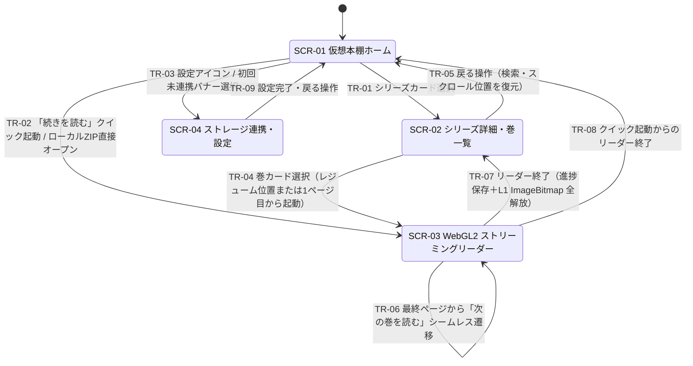

# ExLibris 主要画面一覧（`SCR-xx`）と画面遷移（`TR-xx`）

> [!NOTE]
> **Phase 2（コア仕様策定フェーズ）向け初期骨格（`Draft`）**:
> 本ドキュメントは Phase 2 にて URL ルーティング・ドロワー/モーダル構成・Android ハードウェア戻るボタン（Back Button）挙動を確定するための初期骨格です。

---

## 1. 主要画面一覧（`SCR-xx`）

|   画面 ID    | 画面名                                      | 想定ルート / 表示形態 | 主な役割                                                                                                                                                                                                                                 |
| :----------: | :------------------------------------------ | :-------------------- | :--------------------------------------------------------------------------------------------------------------------------------------------------------------------------------------------------------------------------------------- |
| **`SCR-01`** | **仮想本棚ホーム（Virtual Bookshelf）**     | `/`                   | シリーズ束ねカードグリッド、0.01秒インクリメンタル複合検索、五十音/最終読書順ソート、コレクションタブ切替、ビューポート優先の表紙 WebP 表示、Drive 差分同期ステータス表示                                                                |
| **`SCR-02`** | **シリーズ詳細・巻一覧（Series Detail）**   | `/series/:seriesId`   | 作品メタデータ（著者・出版社・タグ・あらすじ・欠巻バッジ）表示、公開書誌 API 再検索・候補切替・手動編集モーダル、所属巻（`Volume`）一覧と読書進捗表示                                                                                    |
| **`SCR-03`** | **WebGL2 ストリーミングリーダー（Reader）** | `/read/:volumeId`     | フルスクリーン生 WebGL2 ページ描画、見開き/単ページ制御、「1ページずらし」ワンタップ補正、画質補正シェーダー調整シート、サムネイル付き高速シークバー＆Undo Jump、次巻シームレス遷移                                                      |
| **`SCR-04`** | **ストレージ連携・設定（Settings & Sync）** | `/settings`           | Google アカウント連携（OAuth）、Drive フルスキャン/差分同期実行、表紙抽出バックグラウンドキュー状況、自宅 HTTP サーバー登録、`appDataFolder` バックアップ・復元、デフォルト画質・キーバインド設定、オンメモリ診断ログ表示＆1タップコピー |

---

## 2. 画面遷移図（`TR-xx`）

---

## 3. 遷移時のリソース・状態管理ルール（初期契約）

1. **`TR-04` / `TR-02`（リーダー起動時）**:
   - バックグラウンドの表紙 WebP 抽出キューを即座に一時停止（プリエンプション）し、Coordinator Worker の Fast-Path 帯域を最優先確保する。
2. **`TR-06`（連続巻またぎ遷移時）**:
   - `requestEpoch` を更新して前巻の未完了 Range リクエストを `AbortController` で中断し、前巻の L1 `ImageBitmap` をすべて `bitmap.close()` した上で次巻をオープンする。
3. **`TR-07` / `TR-08`（リーダー終了時）**:
   - 現在の `currentPageIndex` を Dexie.js（`readingProgress`）へ確実にフラッシュ保存し、L1 キャッシュおよび WebGL2 テクスチャリソースを解放してから遷移元画面へ戻る（遷移元 `SCR-01` の検索条件・スクロール位置は維持する）。
