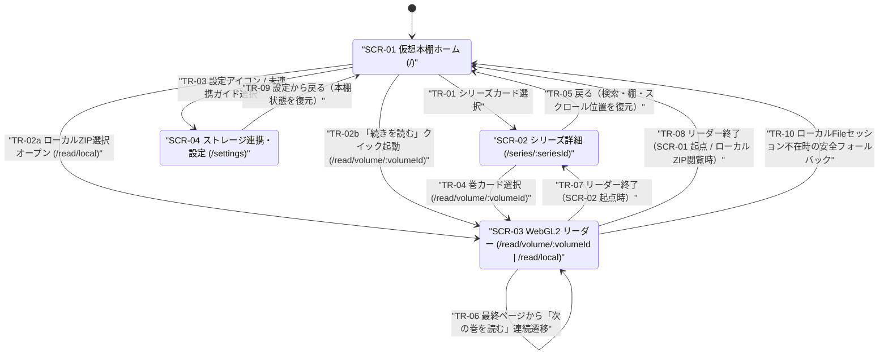

# ExLibris 主要画面一覧（`SCR-xx`）と画面遷移（`TR-xx`）

本ドキュメントは、ExLibris の UI シェル・テーマ原則、全 4 画面（`SCR-01`〜`SCR-04`）の URL ルーティング、画面遷移（`TR-xx`）、Android ハードウェア戻るボタン（Back Button）制御、および遷移時のリソース・進捗保護契約の正本（Single Source of Truth）です。

---

## 1. UI シェル・テーマ・ナビゲーション基本原則

1. **ダークテーマ標準（暗色基調統一）**:
   - 表紙アートの色彩を引き立て、暗所でのマンガ閲覧時の目の負担を抑えるため、アプリ全体をスレート系ダークカラー（`bg-slate-950` / `bg-slate-900` 基調）で統一する。ライトテーマ切替は初期スコープには含めない。
2. **下部タブバーなしのシンプル導線**:
   - 画面下部の常駐タブバーは配置せず、`SCR-01`（仮想本棚ホーム）で蔵書グリッドの表示領域を最大化する。
   - 検索バー、ソート・コレクション切替、「ローカル ZIP を開く」アクション、および設定画面（`SCR-04`）への導線は `SCR-01` の上部ヘッダー領域に集約する。
3. **`SCR-03`（リーダー）の完全フルスクリーン没入表示**:
   - 読書中は上下バーを含むすべての UI 装飾を非表示にし、画面全体を生 WebGL2 キャンバス（純黒 `#000000` 背景）に割り当てる。
   - **画面中央タップゾーン**（Phase 3 基本分割: 左 30%＝次頁 / 中央 40%＝HUD 開閉 / 右 30%＝前頁、右開き `rtl` 固定）のタップでのみ、上部オーバーレイ（戻る・ファイル名/巻タイトル・画質補正シート・しおり）および下部オーバーレイ（ページ番号・次/前ボタン・シークバー・見開き/1ページずらし・右/左開き切替）を開閉する。
4. **Android Edge-to-Edge システムバー非重複・黒余白＆白アイコン統一**:
   - Android 15/16（`targetSdkVersion = 35` 以降の強制 Edge-to-Edge 環境）において WebView が OS ステータスバーおよびナビゲーションバー（3 ボタン / ジェスチャー）領域と重なってタッチ操作を奪われないよう、`capacitor.config.ts` で `backgroundColor: "#000000"` および `android: { backgroundColor: "#000000", adjustMarginsForEdgeToEdge: "auto" }` を設定してシステムバー／ディスプレイカットアウト分の WebView マージンを自動確保する。
   - `MainActivity.java` にて Window 背景色を `Color.BLACK` に統一し、`WindowCompat.getInsetsController` / `WindowInsetsControllerCompat` で `setAppearanceLightStatusBars(false)` および `setAppearanceLightNavigationBars(false)` を設定することで、黒余白上のシステムバーアイコンを白表示に固定する。
   - あわせて `SCR-01` 上部ヘッダーおよび `SCR-03` 上下オーバーレイ HUD に `env(safe-area-inset-top, 0px)` / `env(safe-area-inset-bottom, 0px)` によるセーフエリアパディングを併用し、デスクトップ Web 環境（`0px`）でのレイアウトを維持しつつシステムバーとの非重複を二重に担保する。

---

## 2. 主要画面一覧（`SCR-01` 〜 `SCR-04`）とルート契約

未知・不正なパスが指定された場合は、例外を発生させず安全に `/`（`SCR-01`）へフォールバックします。

|   画面 ID    | 画面名                                                  | ルートパス                                                                      | 段階的立ち上げと主な責務                                                                                                                                                                                                                                                                                                                                                                                                                                                                                                                                                                                                                                                           |
| :----------: | :------------------------------------------------------ | :------------------------------------------------------------------------------ | :--------------------------------------------------------------------------------------------------------------------------------------------------------------------------------------------------------------------------------------------------------------------------------------------------------------------------------------------------------------------------------------------------------------------------------------------------------------------------------------------------------------------------------------------------------------------------------------------------------------------------------------------------------------------------------- |
| **`SCR-01`** | **仮想本棚ホーム** (Virtual Bookshelf)               | `/`                                                                             | ・`Phase 3`: ローカル ZIP オープン導線（ヘッダー＆メインカード＋Web D&D）＋診断ログコピーを備えた初期ホームとして機能 ・`v0.1`: 直近ローカル閲覧履歴・レジューム情報表示を追加 ・`v0.2`〜: シリーズ束ねカードグリッド、Drive 差分同期ステータス、ビューポート優先の表紙 WebP 表示、「続きを読む」クイック起動 ・`v0.3`〜: インクリメンタル複合検索、五十音/多軸ソート、カスタム・スマートコレクション切替 ・`v1.0`: 欠巻・新刊・重複バッジ絞り込み                                                                                                                                                                                                                     |
| **`SCR-02`** | **シリーズ詳細・巻一覧** (Series Detail)             | `/series/:seriesId`                                                             | ・`v0.2`〜: 所属巻（`Volume`）一覧、巻別の既読/読書中進捗バー、巻選択によるリーダー起動 ・`v0.3`〜: 書誌メタデータ（著者・出版社・タグ・あらすじ）表示、公開書誌 API 再検索・候補切替・手動編集・ロックモーダル ・`v0.4`〜: 作品別画質/綴じ方向プリセット、表紙半裁クロップ・表紙ページ変更                                                                                                                                                                                                                                                                                                                                                                                  |
| **`SCR-03`** | **WebGL2 ストリーミングリーダー** (Streaming Reader) | Drive 巻: `/read/volume/:volumeId`  ローカル一時 ZIP: `/read/local` | ・`Phase 3`: 生 WebGL2 単ページ Mipmap 描画＋右開き（`rtl`）固定前後ページ移動（タップ 30/40/30%・スワイプ・矢印キー/`Escape`）・最小 HUD（`/read/local`、常に先頭 `pageIndex = 0` から開始） ・`v0.1`〜: 見開き/単ページ制御、「1ページずらし」、右/左開き切替、シャープネス・白黒レベル補正シート、シークバー、自動レジューム ・`v0.2`〜: Google Drive ストリーミング閲覧（`/read/volume/:volumeId`） ・`v0.4`〜: オートクロップ、ピンチ/ダブルタップ/ルーペ拡大、音量キーめくり、サムネイルシーク＆Undo Jump、次巻シームレス遷移、メモ付きしおり ※`/read/local` でメモリ上の `File` セッションが不在（ブラウザリロード後など）の場合は即時 `/` へフォールバックする |
| **`SCR-04`** | **ストレージ連携・設定** (Settings & Sync)           | `/settings`                                                                     | ・`v0.2`〜: Google アカウント連携（OAuth）、**マンガ保管ルートフォルダ（複数可）の選択・管理**、Drive フルスキャン/差分同期実行、表紙抽出キュー進捗表示、オンメモリ診断ログ確認＆1タップコピー ・`v0.4`〜: デフォルト画質補正・タップ領域・音量キー操作設定 ・`v1.0`: Google Drive `appDataFolder` 自動バックアップ・手動復元・端末間同期ステータス                                                                                                                                                                                                                                                                                                                          |

---

## 3. 画面遷移図と遷移契約一覧（`TR-01` 〜 `TR-10`）

|   遷移 ID    | 遷移元 → 遷移先     | トリガーと必須副作用（状態・リソース契約）                                                                                                                                                                                                                                                                            |
| :----------: | :------------------ | :-------------------------------------------------------------------------------------------------------------------------------------------------------------------------------------------------------------------------------------------------------------------------------------------------------------------- |
| **`TR-01`**  | `SCR-01` → `SCR-02` | シリーズカード選択時。遷移前の `SCR-01` 検索クエリ・選択コレクション・ソート順・スクロール位置を保持して `/series/:seriesId` を表示する。                                                                                                                                                                             |
| **`TR-02a`** | `SCR-01` → `SCR-03` | 「ローカル ZIP を開く」または D&D で `.zip` / `.cbz` の `File` が選択された時。メモリ上のアクティブローカルセッションへ保持し、表紙抽出キューを一時停止した上で `/read/local` へ遷移する（Phase 3 は先頭 `pageIndex = 0` から開始、`v0.1` 以降は `local:${name}:${size}` に既存進捗があればレジューム位置から開く）。 |
| **`TR-02b`** | `SCR-01` → `SCR-03` | 本棚上の「続きを読む」アクション選択時。起点情報を `bookshelf` として記録し、表紙抽出キューを一時停止して `/read/volume/:volumeId` をレジューム位置から開く。                                                                                                                                                         |
| **`TR-03`**  | `SCR-01` → `SCR-04` | ヘッダー設定ボタンまたは初回 Google Drive 未連携バナー選択時。`/settings` へ遷移する。                                                                                                                                                                                                                                |
| **`TR-04`**  | `SCR-02` → `SCR-03` | シリーズ詳細内の巻カード選択時。起点情報を `series-detail` として記録し、表紙抽出キューを一時停止して `/read/volume/:volumeId` を開く。                                                                                                                                                                               |
| **`TR-05`**  | `SCR-02` → `SCR-01` | 画面内戻るボタンまたはハードウェア戻る操作時。保持していた `SCR-01` の検索条件・選択棚・スクロール位置をそのまま復元する。                                                                                                                                                                                            |
| **`TR-06`**  | `SCR-03` → `SCR-03` | 同一シリーズの次巻が存在する状態で最終ページから「次の巻を読む」実行時（`v0.4`〜）。前巻の読了進捗を保存し、`requestEpoch` を進めて進行中通信を中断、前巻の L1 `ImageBitmap` と WebGL2 テクスチャを全解放した上で次巻 `/read/volume/:nextVolumeId` へ `replace` 遷移する。                                            |
| **`TR-07`**  | `SCR-03` → `SCR-02` | `TR-04` 起点のリーダー終了時。現在ページ進捗を `readingProgress`（および `series.lastReadAt`）へ確実にフラッシュ保存し、Coordinator/Decode Worker の未完了ジョブ中断・L1 `ImageBitmap.close()` 全解放・表紙抽出キュー再開を実行して `/series/:seriesId` へ戻る。                                                      |
| **`TR-08`**  | `SCR-03` → `SCR-01` | `TR-02a`（ローカル ZIP）または `TR-02b`（クイック起動）起点のリーダー終了時。Coordinator/Decode Worker の未完了ジョブ中断・L1 `ImageBitmap.close()` ＆ WebGL2 全解放・ローカル `File` 参照クリア・（`v0.1`〜進捗フラッシュ、`v0.2`〜表紙抽出キュー再開）を実行して `/` へ戻る。                                       |
| **`TR-09`**  | `SCR-04` → `SCR-01` | 設定画面から戻る操作時。保持していた `SCR-01` の状態を復元して `/` へ戻る。                                                                                                                                                                                                                                           |
| **`TR-10`**  | `SCR-03` → `SCR-01` | `/read/local` へ直接アクセスまたはリロードされ、メモリ上に `File` セッションが存在しない場合。エラー画面で停止せず `/` へ即時リダイレクトする。                                                                                                                                                                       |

---

## 4. Android ハードウェア戻るボタン（Back Button）優先制御契約

`@capacitor/app` の `backButton` イベント（およびブラウザ `popstate`）に対し、以下の優先順位で決定論的に応答します。

1. **優先度 1（非同期クリティカル処理中のブロック）**:
   - 書誌保存・`appDataFolder` 同期復元・確認ダイアログ処理中など `isBackNavigationBlocked() === true` の間は、戻る操作を無視してデータ破損を防ぐ。
2. **優先度 2（モーダル・ドロワー・ボトムシートの閉鎖）**:
   - 書誌再検索モーダル、コレクション編集ダイアログ、または `SCR-03` の画質補正ボトムシート等が開いている場合は、画面遷移を行わず最前面のシート/モーダルのみを閉じる。
3. **優先度 3（`SCR-03` リーダーからの安全な退場）**:
   - `SCR-03` 表示中は（上下オーバーレイの表示有無にかかわらず）`TR-07` または `TR-08` の終了シーケンス（進捗フラッシュ保存 ＋ L1 `bitmap.close()` 全解放）を実行して遷移元画面へ戻る。
4. **優先度 4（サブ画面から `SCR-01` への復帰）**:
   - `SCR-02` または `SCR-04` 表示中は、`TR-05` / `TR-09` に従い `SCR-01`（`/`）へ戻る。
5. **優先度 5（ルート画面 `SCR-01` でのアプリ最小化）**:
   - `SCR-01` で開いているモーダルが無い場合は、`App.minimizeApp()` を呼び出して Android ホームへ最小化する。
