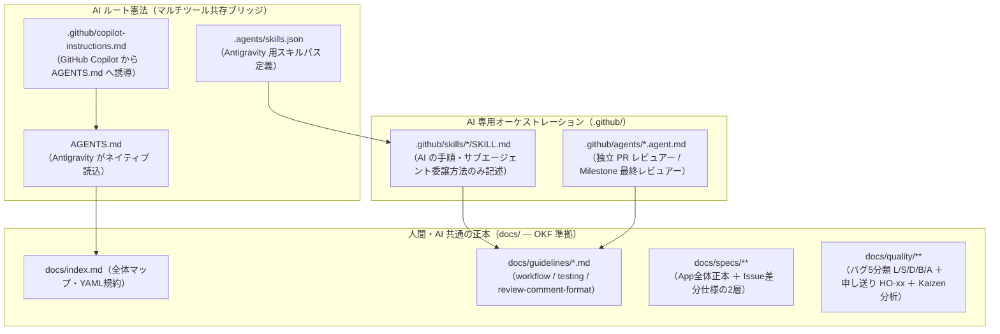
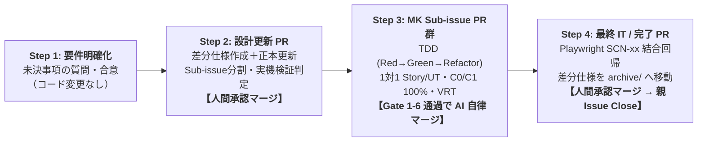

# 01. Yommy 流「AI駆動開発フレームワーク」完全引き継ぎプレイブック

本ガイドは、Web 小説リーダー **Yommy (`v1.2.0`)** において実践・改善を重ね、**本番コード約 2.4 万行 / テストコード約 8.7 万行、単体テスト C0/C1/Functions カバレッジ 100% 維持、全 12 マイルストーンの横断レビュー欠陥除去率（Milestone DRE）100%、中間 PR の AI 自律マージ率 50〜57%** を達成した AI 駆動開発手法のエッセンスを、新プロジェクト **ExLibris (`ex-libris`)** 向けに体系化した解説書です。

> [!TIP]
> 実際の設定ファイル・ガイドライン・AI スキル一式は、そのまま新リポジトリのルートへ配置できるよう `../02_starter_template/` に `ExLibris` 向け適応済みで同梱しています。

---

## 1. AI ガバナンスと SSOT（Single Source of Truth）設計

AI 駆動開発がスケールすると最も起きやすい失敗は、**「人間向け仕様書」「AI 向けプロンプト」「Copilot 用と Antigravity 用の指示」が二重・三重管理になって食い違うこと** です。本フレームワークでは以下の通り責務を 1 箇所ずつに完全分離します。

### 1.1 なぜこの構成が効くのか
1. **Google Antigravity と GitHub Copilot の完全同居**:
   - ルートの `AGENTS.md` を唯一の AI 憲法とし、`.github/copilot-instructions.md` は薄いポインタファイルにします。
   - スキル実体は `.github/skills/<name>/SKILL.md` の 1 箇所だけに置き、`.agents/skills.json` で Antigravity にマッピングします（詳細は `.github/skills/repo-config-management/SKILL.md` で統制）。
2. **「共通ルール」を AI スキルに閉じ込めない**:
   - ワークフロー・TDD 基準・カバレッジ 100% 規律・レビュー優先度定義（`[P0]`〜`[P3]`）はすべて `docs/guidelines/*.md` に置きます。人間も AI も同じ正本を読むため認識ズレが起きません。

---

## 2. OKF 2層 Living Documentation と機械的バリデーション

仕様書の「作りっぱなし・腐敗」を防ぐため、`docs/` は **OKF（Open Knowledge Format）** 準拠の YAML フロントマターを持ち、**「App 全体正本」と「Issue 差分仕様」の 2 層** で運用します。

| 層 | 配置先 | 役割 | ライフサイクル |
| :--- | :--- | :--- | :--- |
| **第1層：App 全体正本** （Canonical Specs） | `docs/specs/*.md` `docs/specs/features/*.md` `docs/specs/engine/*.md` `docs/specs/providers/*.md` | **「今この瞬間のシステム全体の仕様」** のみを記述（移行手順やタスク分割は書かない）。 | Phase 2 で骨格作成 → 各機能の設計 PR で常に最新へ更新 → Milestone 完了時に `Approved` 化 |
| **第2層：差分仕様** （Delta Specs） | `docs/specs/changes/issue-XX-<slug>.md` | **「親 Issue `#XX` で何をどう変えるか」**、テスト観点、Sub-issue 分割計画、実機検証計画を記述。 | Step 2 設計 PR で作成 → Step 4 親 Issue 完了 PR で **`changes/archive/` へ `git mv`** |

- **ゼロ依存の機械検証スクリプト（`validate-okf.mjs`）**:
  `node .github/skills/sdd/scripts/validate-okf.mjs` を CI およびローカルゲートで毎回実行し、以下を自動検査します。
  - 全ファイルの YAML フロントマター必須項目・未クォートのコロン（`: `）構文罠の検出
  - `ExLibris` 向け **全 11 種タクソノミー**（`spec-engine` / `spec-provider` を含む）と配置ディレクトリの整合性
  - `changes/` と `changes/archive/` のステータス整合性、および `docs/`・`AGENTS.md`・`.github/` 内の相対リンク切れゼロ保証

---

## 3. ハイブリッド進行モデルと「4ステップ Issue 駆動マイクロウォーターフォール」

立ち上げ初期のスピードと、機能開発期の厳格な品質統制を両立するため、フェーズに応じて運用を切り替えます。

### 3.1 フェーズ進行の切り替え
- **Phase 1（AI 開発基盤構築）＆ Phase 2（コア仕様策定）**:
  - ユーザーと対話しながら `main`（または初期セットアップ PR）で高速にハーネス（Vite / Vitest / Storybook / Playwright / CI）と初期骨格仕様（`Draft` → `Approved (Phase 2)`）を固める。
- **Phase 3（Walking Skeleton / PoC）＆ Phase 4+（反復機能開発）**:
  - **いきなりプロダクションコードを書くことを厳禁（No Premature Coding）** とし、すべての親 Issue（要望）を以下の **4 ステップ** で進行する。

### 3.2 親 Issue ごとの 4 ステップ進行フロー

1. **Step 1（Open Questions 明確化）**: 曖昧な仕様やトレードオフを先にユーザーへ質問して確定する。
2. **Step 2（設計更新 PR — `Refs #ParentIssue`）**:
   - `docs/specs/changes/issue-XX-*.md` の作成と、影響する `docs/specs/` 正本の同時更新（`status: "Review (#XX)"`）。
   - Sub-issue の作成と、**Android 実機検証を「親 Issue 完了時」に行うか「Milestone 完了時」にまとめるかの判定**（後者の場合は `HO-xx` として台帳へ登録）。
   - **人間が設計をレビュー・マージ** して合意を確定させる。
3. **Step 3（MK Sub-issue PRs — `Closes #SubIssue`）**:
   - 分割された Sub-issue を **1 つずつ順番に** TDD で実装。後述の **Task Completion Gate 1〜6** をすべて通過し、エスカレーション条件に該当しなければ **オーケストレーター AI が自律的に Squash Merge** して次の Sub-issue へ進む。
4. **Step 4（最終 IT / 親 Issue クローズ PR — `Closes #ParentIssue`）**:
   - Playwright 結合テスト（`SCN-xx`）追加・全回帰確認、申し送り（`HO-xx`）消化、差分仕様の `changes/archive/` 移動を実施。
   - 親 Issue 単位の Android 実機検証が必要な場合は Gate 1〜6 通過後に定型テスト表を提示し、**人間が最終確認・マージ** して親 Issue を閉じる。

---

## 4. オーケストレーター vs. サブエージェント分離戦略（コンテキスト枯渇防止）

長大な TDD ループやテスト出力をメイン会話で直接回すと、コンテキストウィンドウが肥大化して Compaction（要約圧縮）が発生し、AI の判断精度や規約遵守率が低下します。

- **メインエージェント ＝ オーケストレーター（監督）**:
  - 要件整理、設計方針策定、Issue/PR 管理、サブエージェントへの明確な指示出し、Task Completion Gate の証跡確認に専念する。
- **`research` サブエージェント（Read-Only 調査員）**:
  - 広範なコードベース調査や既存パターンの洗い出しを担当し、構造化された調査結果のみをメインへ返す。
- **`self` サブエージェント（実装ワーカー — 直列実行）**:
  - 各 Sub-issue の TDD（Red → Green → Refactor）、カバレッジ 100% 達成、VRT 更新、レビュー指摘修正を担当する。
  - **必ず `.github/skills/c-ut-workflow/SKILL.md` を読むよう明示指示** し、ファイル競合・DB/ポート競合を防ぐため **1 タスクずつ直列（Sequential）** に起動する。
- **独立レビュアー（`.github/agents/pr-reviewer.agent.md`）**:
  - 実装者とは別のクリーンなコンテキストで PR 差分・仕様整合性・テスト妥当性を監査する。AI による自己承認（`gh pr review --approve`）や Issue 直接クローズ（`gh issue close`）は厳禁。

---

## 5. Task Completion Gate（全 PR 共通・7つの完了条件）

「PR を作成した時点」で完了報告することは禁止されており、すべての PR が以下の **7 ゲート** を通過します。

| Gate | 完了条件 | 検証コマンド・証跡 |
| :---: | :--- | :--- |
| **Gate 1** | **静的解析・単体テスト・カバレッジ 100% PASS** | `typecheck`, `lint`, `format:check`, `okf:check`, `test:coverage`（C0/C1/Functions **100%**） |
| **Gate 2** | **Storybook VRT PASS**（UI 変更時） | 1280px（タブレット横・見開き）/ 375px（スマホ縦）のスナップショット検証 PASS |
| **Gate 3** | **PR 作成・品質ミニテーブル・Issue リンク記載** | PR 本文にバグ記録・申し送りミニテーブルと `Closes #N` / `Refs #N` を明記 |
| **Gate 4** | **GitHub Actions (`quality-gate`) 全ジョブ PASS** | リモート CI（Static / UT 100% / VRT / Playwright IT / Build）の緑確認 |
| **Gate 5** | **独立 AI レビュー（`pr-reviewer`）の実施** | `[P0]`〜`[P3]` ＋ 4要素（事象・根拠・影響・修正案）フォーマットでの独立監査 |
| **Gate 6** | **レビュー指摘修正 ＆ Round 2+ 再レビュー収束確認** | 指摘があった場合、修正後に再度 `pr-reviewer` を起動して全スレッド解決を確認 |
| **Gate 7** | **マージ実行（人間承認ゲート vs. AI 自律マージ）** | 下記 5 つのエスカレーション条件がゼロの中間 MK PR のみ AI 自律マージ可 |

### AI 自律マージを停止して人間へエスカレーションする 5 条件
中間 MK PR であっても、以下のいずれかに該当する場合は AI 自律マージを停止し人間の判断を仰ぎます。
1. 外部仕様（`AC-xx`）・画面遷移・Dexie.js スキーマの変更を伴う場合（原因 `D` の設計同期修正が発生した場合を含む）
2. `package.json` の新規ランタイム依存追加、Android パーミッション変更、外部通信先ドメイン追加、または `capacitor.config.ts` / ネイティブ Java コードの変更を伴う場合
3. `AGENTS.md`・`docs/guidelines/`・`.github/`（CI やスキル）等のガバナンス変更を伴う場合
4. リリースバージョン更新（`package.json` の `version` 変更）を伴う場合
5. レビューで仕様解釈のトレードオフや未解決スレッドが残っている場合

---

## 6. バグ記録（5分類）・原因 `D` の設計同期・3ステップ Milestone Kaizen

### 6.1 バグ原因 5 分類と「原因 `D` 単独コード修正の禁止」
TDD の Green/Refactor 後、VRT/IT、AI レビュー、実機検証で見つかった不具合はすべて `docs/quality/bug-and-handover-log.md` に記録します。
- **`L` (Logic)** / **`S` (State / Async Race)** / **`D` (Design / Spec Mismatch)** / **`B` (Boundary / Binary Edge Case)** / **`A` (AI Hallucination / Context Miss)**
- **鉄則**: 原因が **`D`（仕様の考慮漏れ・不整合）** の場合、コードだけを直して PR を通すことは厳禁です。**必ず同一 PR 内で `docs/specs/` の該当仕様書もセットで更新** し、仕様と実装の乖離をゼロに保ちます。

### 6.2 ミニリリース Milestone ごとの 3 ステップ横断レビュー＆リリース自動化
機能群が一区切りつく Milestone（`Phase 3`, `v0.1`, `v0.2`...）ごとに `.github/skills/phase-final-review/SKILL.md` を実行します。
1. **Step 1（マルチモデル横断レビュー）**: `phase-final-reviewer` を用い、複数 LLM モデルでコード・仕様・テスト・実機境界を総点検。並列実行時の `R1-xx` ID 衝突を防ぐため、**投稿直前のコメント取得採番 ＋ 投稿直後の再取得・`PATCH` 自動振り直し** を行う。
2. **Step 2（是正 PR ＆ Android 実機検証）**: `R1-xx` 指摘を Sub-issue PR で修正後、Milestone 全体の構造化 Android 実機テスト項目表をユーザーへ提示し、実機バグがあれば同様に TDD で解消する。
3. **Step 3（最終承認・Kaizen 分析・自動リリース PR）**:
   - バグ傾向分析（Production vs. Support、原因 `L/S/D/B/A`、Milestone DRE）レポートを `docs/quality/reports/` に作成し、再発防止策をガイドラインやスキルへ還流（Kaizen）する。
   - 台帳を `docs/quality/archive/` へアーカイブし、仕様書を `Approved` に更新し、`package.json` の `version` を `X.Y.0` へ更新する。
   - 人間がこの最終 PR を `main` へマージすると、`.github/workflows/release.yml` が `package.json` のバージョン変更を検知し、全テスト通過後に **`vX.Y.0` Git タグと署名検証用 APK 付き GitHub Release を自動発行** する。
