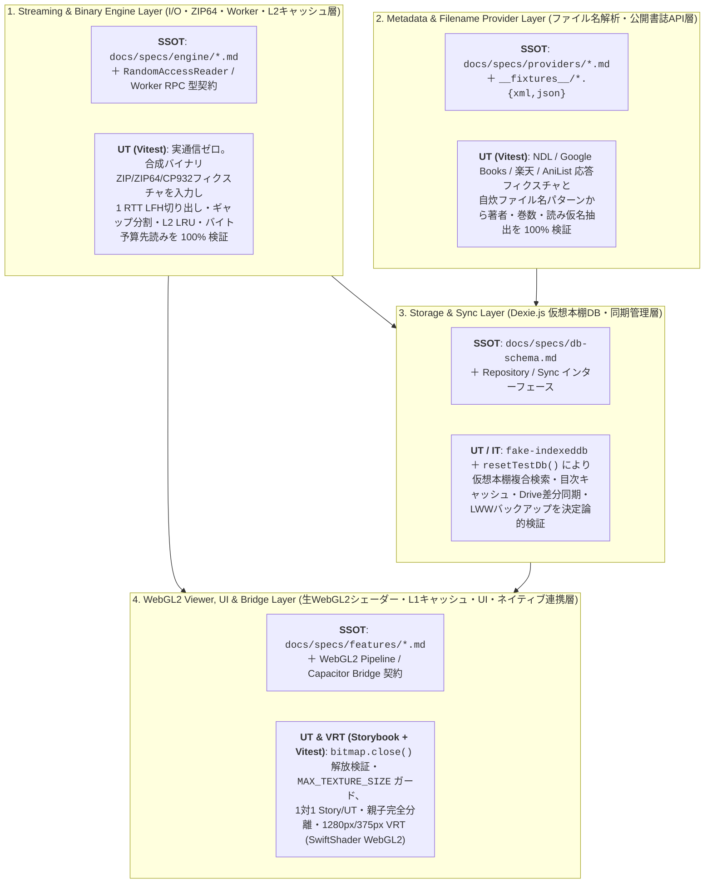

# テスト・実装規律の正本（SSOT）

本ドキュメントは、ExLibris（React + TypeScript + Vite + Capacitor + Web Workers + Raw WebGL2 + Dexie.js）における TDD（テスト駆動開発）、4層アーキテクチャのテスト責務境界、Storybook / Portable Stories / VRT 規約、カバレッジ基準、および前身プロジェクト（Yommy `v1.2`）から継承した再発防止（Kaizen）ルールの正本（Single Source of Truth）です。

---

## 1. 基本原則（9つの鉄則）

1. **仕様・設計正本（SSOT）準拠**:
   `docs/specs/` 配下の設計書（`architecture.md`, `db-schema.md`, `features/*.md`, `engine/*.md`, `providers/*.md`）に定義された契約・受け入れ条件（`AC-xx`）を忠実に実装する。未定義の仕様を推測で実装してはならない。
2. **テストファースト（TDD）の徹底**:
   すべての機能実装・バグ修正は、単体テストを先に書く **Red（失敗確認） → Green（最小実装） → Refactor（構造改善）** のサイクルで進め、各ステップで個別にコミットを刻む。
3. **4層アーキテクチャ・Worker コア・Capacitor Bridge の抽象化分離**:
   `Streaming & Binary Engine Layer`、`Metadata & Filename Provider Layer`、`Storage & Sync Layer`、`WebGL2 Viewer, UI & Bridge Layer` の責務を明確に分離し、Web Worker エントリー・WebGL2 コンテキスト・Capacitor ネイティブ機能（`CapacitorHttp`, Google OAuth, VolumeKey 等）は薄いアダプター層で抽象化して、Vitest / Storybook / Playwright 上で 100% 決定論的にテスト可能にする。
4. **テスト配置の統一（Co-location）**:
   単体テスト（`*.test.ts`, `*.test.tsx`）および Storybook ファイル（`*.stories.tsx`）は、対象ソースファイルと同一ディレクトリに配置する。
5. **例外なしの 1 対 1 対応原則**:
   - 全 `*.tsx` ファイル（初期マウント `src/main.tsx` を除く）に対して、同階層に **`*.stories.tsx`（必須）** と **`*.test.tsx`（Portable Stories `composeStories` 全件実行 ＋ ロジック補完）** を 1 対 1 で作成する。
   - 全 `*.ts` ファイル（型定義専用ファイル `types.ts` / `*.d.ts` および静的フィクスチャ `src/**/__fixtures__/*.ts` を除く）に対して、同階層に **`*.test.ts`** を 1 対 1 で作成する（実行時定数ファイル `constants/*.ts`、バレルエクスポート `index.ts`、GLSL シェーダー定数モジュールも対象）。
6. **親子コンポーネント完全分離原則（`vi.spyOn(...).mockImplementation(() => null)` 徹底）**:
   Container / Page 等の親テストでは、直下の子コンポーネントに `vi.spyOn(...).mockImplementation(() => null)` を適用して子・孫の DOM 描画やタイマー/WebGL 初期化の巻き込みを根絶し、「状態管理・Loading/Error/Ready の切り替え・子への Props ＆ コールバック配線」のみを決定論的に検証する。`describe` 先頭には必ず `afterEach(() => { vi.restoreAllMocks(); })` を配置する。
7. **C0 / C1 / Functions 100% カバレッジ原則**:
   `src/` 配下の全対象ファイルにおいて、ステートメント（C0）・分岐（C1）・関数（Functions）・行（Lines）カバレッジ **100%** を必須基準とする。
8. **Storybook VRT（1280px タブレット横 / 375px スマホ縦）の一本化**:
   視覚的回帰テスト（VRT）は Storybook の全 Story を対象として **1280px×800px（タブレット見開き想定）および 375px×667px（スマホ単ページ想定）** の2系統で実施する（非表示モーダル `isOpen: false` のみ `tags: ["skip-vrt"]` 許可）。Playwright IT では VRT を行わず画面遷移と機能結合の振る舞い検証に専念する。
9. **不備記録と原因分類 `D`（設計不備）の即時設計同期義務**:
   実装・テスト・AIレビュー中に検出された不備は製品コードと支援成果物を分離して記録する。原因が `D`（設計・仕様の誤認や不備）である場合、**コードのみを修正して設計書を放置することは厳禁**とし、必ず同一 PR 内で `docs/specs/` の設計書（App 全体正本および進行中の差分仕様）も同時修正する。

---

## 2. ExLibris 4層アーキテクチャ別の SSOT とテスト規律

### 2.1 Streaming & Binary Engine Layer（ZIP/ZIP64解析・Coordinator/Decode Worker・L2キャッシュ層）

- **バイナリフィクスチャによる実通信ゼロ TDD**:
  - 単体テストでは外部ネットワーク通信を一切行わない。テスト用の合成 ZIP / ZIP64 バイナリビルダー（`__fixtures__/zipBuilder.ts`）を用意し、以下の全境界ケースを `Uint8Array` 上で決定論的に生成・検証する：
    1. CDH と LFH で `extraFieldLength` が異なるケースの **1 RTT ゼロコピー切り出し**、および Bit 3（Data Descriptor）有効時に LFH `compressedSize=0` ではなく CDH 側サイズを採用すること。
    2. 論理ページ順と物理オフセット順が不一致／64KB 超のギャップがある場合に、無駄な中間領域をダウンロードせず Range リクエストを分割すること。
    3. 4GB 超・数千ページの **ZIP64 EOCD Locator / EOCD**、初回末尾 128KB に収まらない場合の追加 1 RTT フォールバック、および `0x0001` Extra Field の飽和項目のみ読み進める厳密パース。
    4. UTF-8 フラグ（Bit 11）未設定時の `TextDecoder('utf-8', { fatal: true })` → `TextDecoder('shift-jis')`（CP932）フォールバック、`__MACOSX/`・`._*`・`Thumbs.db` 除外、および `Intl.Collator('ja', { numeric: true, sensitivity: 'base' })` セグメント自然順ソート。
    5. Fast-Path（初回・シーク直後の最小 1〜2 ページ単独取得）とバイト予算制（8〜12MB 上限）Warm Prefetch、およびシーク時の `AbortController` キャンセルと L2 キャッシュ（60〜100MB `Uint8Array`）LRU 退避。
- **Worker コアとエントリーポイントの分離**:
  - `CoordinatorCore` や `DecodePoolCore` は Worker グローバル（`self`）に直接依存しない純粋な TypeScript クラスとして実装し、Vitest で C0/C1/Functions 100% を直接検証する。`*.worker.ts` は `Comlink.expose(...)` を呼ぶ最小ブートストラップに留める。

### 2.2 Metadata & Filename Provider Layer（ファイル名解析・公開書誌API層）

- **`CapacitorHttp` のグローバルパッチ禁止鉄則**:
  - `capacitor.config.ts` の `CapacitorHttp.enabled` は必ず **`false`** とする（`true` にすると `window.fetch` がネイティブブリッジ経由の Base64 変換に置き換わり、大容量 ZIP の高速バイナリストリーミングが阻害されるため）。
  - Google Drive Range ストリーミングは Chromium 標準 `fetch`（`ArrayBuffer` 直接取得）を使用し、CORS 制限がある公開書誌 API（NDL OpenSearch / 楽天 / Google Books / AniList）のみ `MetadataHttpClient` アダプター内部で明示的に `CapacitorHttp.request()` を呼び出す。

### 2.3 Storage & Sync Layer（Dexie.js 仮想本棚DB・同期層）

- **`fake-indexeddb` と `resetTestDb()` によるテスト独立性**:
  - `src/test/setup.ts` で `fake-indexeddb/auto` を読み込み、各テストの `beforeEach` / `afterEach`（および Playwright IT の各テスト開始前）で必ず `resetTestDb()` を実行してテーブルデータを完全初期化する。
- **新規フィールド追加時の全層伝播チェック（原因 `D` 再発防止）**:
  - Dexie スキーマ定義（バージョンアップ・マイグレーション含む）→ 型定義 → Repository → Store/Hook → Container/Page → View → Storybook/UT/IT の全層伝播を確認する。
- **LWW 同期タイムスタンプ保護規律**:
  - `appDataFolder` 端末間バックアップ・同期の競合調停用 `updatedAt` は、ユーザーの明示的な書誌編集・コレクション変更時のみ更新し、表紙 WebP 抽出や `ZipIndexCache` 保存などの定常バックグラウンド処理で更新してはならない。

### 2.4 WebGL2 Viewer, UI & Bridge Layer（生WebGL2描画・L1キャッシュ・UI・Bridge層）

- **L1 `ImageBitmap` の即時 `bitmap.close()` 検証義務**:
  - 高解像度スキャン画像による VRAM 枯渇（OOM クラッシュ）を防ぐため、L1 キャッシュ（`N-1`〜`N+2` の 3〜5 ページ制限）から外れた瞬間、巻クローズ時、およびリーダーアンマウント時に **`bitmap.close()` が漏れなく呼ばれること** を単体テストのスパイで必ずアサートする。
- **生 WebGL2 パイプラインのテストとヘッドレス SwiftShader VRT/IT**:
  - WebGL2 レンダラー（Mipmap 生成、シャープネス/白黒レベル補正シェーダー Uniform、`gl.MAX_TEXTURE_SIZE` 上限検知時の分割/リサイズフォールバック、コンテキストロスト `webglcontextlost` ハンドリング）は、注入可能な `WebGL2RenderingContext` モックによる単体テスト（C0/C1 100%）と、Playwright Chromium（`--use-gl=angle --use-angle=swiftshader`）による実シェーダー描画テストの双方で保証する。
- **Android ネイティブプラグイン ＆ UI ジェスチャー検証規律**:
  - Java ネイティブプラグイン（Google OAuth / VolumeKey 等）では、`ActivityResultContracts.StartIntentSenderForResult` ＋ `saveCall`/`getSavedCall`/`freeSavedCall`、401 時の `clearToken` 先行呼び出し、`HttpURLConnection` での `POST` + `X-HTTP-Method-Override: PATCH`、`load()` / `handleOnDestroy()` での `static volatile` 状態リセットを徹底し、`scripts/android-build-config.test.ts` と CI `android-compile` ジョブで機械検証する。
  - Web 側でネイティブイベントを購読する際は `add*Listener` を先行登録してから有効化し、Promise には `.catch(() => {})` を付与する。
  - タッチジェスチャーでは `pointerStartRef` と `touchStartRef` を分離管理し（`pointercancel` による Touch 座標誤破棄防止）、複数の画面タップゾーンは幾何学的に排他配置して境界座標テストを行う。

### 2.5 Worktree 運用・環境変数非依存と DI モック分離規律

1. **ゼロコンフィグ PASS 保証**: `.env.local` が存在しない初期状態でも、全検査・テスト・本番ビルド（`typecheck`, `lint`, `test:coverage`, `test:vrt`, `test:it`, `build`）が 100% エラーなく決定論的に PASS するよう、`ServiceProvider` で未設定外部連携をモックアダプターまたは非活性モードへ安全にフォールバックさせる。
2. **`tsconfig.app.json` への `"test"` 常時包含**: `"include": ["src", "test"]` を維持し、E2E テストやモックの型乖離を `npm run typecheck` で即時検知する。
3. **Playwright ワークツリー固有ポート分離**: `playwright.it.config.ts` / `playwright.vrt.config.ts` では `process.cwd()` の FNV-1a ハッシュ（`computeWorkspacePort`）と `reuseExistingServer: false` を使用し、並行ワークツリー実行時のポート衝突を防ぐ。

---

## 3. 単体テスト・VRT・結合テスト（IT）の衛生・非同期規律（継承 Kaizen）

1. **非同期スケジューラ・Hook の世代管理と `AbortSignal` 伝播**:
   - 表紙抽出 2 段キュー（ビューポート優先 `high` ＋ バックグラウンド低速 `low`）やプリフェッチ・検索 Hook では、複数 `await` を跨ぐ処理に世代カウンタ（エポック）を導入し、各 `await` 直後に `isMountedRef.current`・エポック一致・`signal.aborted` を再検証する。また優先度跨ぎのレート制限では全体の最終通信完了時刻を基準にスロットリングを行う。
2. **VRT 孤児スナップショット検知ガードと全件更新**:
   - `test/vrt/vrt.spec.ts` にて `storybook-static/index.json` の対象ストーリー一覧と `test/vrt/snapshots/*.png` が 1対1 で完全一致すること（0件空振り防止＋孤児 PNG 0件）を検証し、`maxDiffPixelRatio: 0.001` を維持する。
3. **Playwright IT の確定的初期化待機・固定待機禁止・仮想時計**:
   - 全 `page.goto(...)` / `page.reload()` の直後には、DOM 探索より先に必ず `waitForServicesReady(page)`（`window.__exLibrisServices?.isReady === true`）を待機する。
   - 条件分岐（`if (await el.isVisible())`）による暗黙スキップや `page.waitForTimeout`、固定カレンダー日付（Time-bomb）は禁止し、`expect.poll` および `window.Date` `Proxy` 仮想時計（または `Date.now()` 相対オフセット）に統一する。
4. **モーダル・非同期永続化ロールバック**:
   - 非同期保存失敗時は直前の state へロールバックして `role="alert"` で通知する。確認・競合モーダルは処理中の Escape/背景タップ閉鎖を抑止し、背面 `inert` 化とフォーカストラップを行う。

---

## 4. TDD サイクルとコミット規約

### 4.1 Red → Green → Refactor の手順とコミット証跡

| ステップ        | コミットメッセージ例                                                      | コミット時点の状態と検証内容                                                                 |
| :-------------- | :------------------------------------------------------------------------ | :------------------------------------------------------------------------------------------- |
| **1. Red**      | `test(engine): ZIP64 Extra Field飽和判定テストを追加（Red）`              | テストコード・フィクスチャのみ追加。対象 UT が**未実装により期待通り失敗する**ことを確認     |
| **2. Green**    | `feat(engine): ZIP64 Extra Field飽和判定パーサーを実装（Green）`          | 最小限の実装を追加（YAGNI 原則）。対象 UT が**全件 PASS する**ことを確認                     |
| **3. Refactor** | `refactor(engine): 64bitオフセット読み取り処理を共通関数へ抽出（Refactor）` | 振る舞いを変えずに可読性・型安全性を改善。対象 UT が**引き続き PASS する**ことを確認         |

### 4.2 テスト名・Storybook の日本語記述規約

- **Vitest テスト名（`it`）**: 自然な日本語で記述し、対応する受け入れ条件（`AC-xx`）があれば付記する（例: `it("ウィンドウ外に出たページの ImageBitmap.close() を即座に呼び出す (AC-ENG-05)", ...)`）。
- **Storybook ストーリー定義**: PascalCase 英語エクスポート名 ＋ 直前の日本語 JSDoc ＋ 明示的な日本語 `name` プロパティ ＋ 同階層 `.test.tsx` での `composeStories` 全件実行を必須とする。

---

## 5. カバレッジ基準と除外ルール

- **必須基準**: **C0（Statements / Lines）100% / C1（Branches）100% / Functions 100%**
- **安易な `/* v8 ignore next */` は厳禁**。`vite.config.ts` の `coverage.exclude` から除外してよいのは以下の 6 点のみとする：
  1. 純粋な型定義ファイル（`types.ts`, `*.d.ts`）
  2. Storybook のストーリー定義ファイル自体（`*.stories.tsx`）
  3. テスト環境セットアップおよび静的テストフィクスチャ（`src/test/**`, `src/**/__fixtures__/**`）
  4. ブラウザ初期マウントエントリーポイント（`src/main.tsx`。結合テスト `smoke.spec.ts` で検証）
  5. `Comlink.expose(...)` のみを呼ぶ数行の Web Worker エントリーラッパー（`src/**/*.worker.ts`。ロジック本体は分離した `*Core.ts` で 100% 単体テスト必須）
  6. TypeScript の網羅性チェック用の到達不能分岐（`default: const _exhaustiveCheck: never = value;` 等、理由コメント明記時のみ）

---

## 6. バグ記録と原因分類 `D`（設計不備）の即時同期ルール

TDD 初回 Red 以降（Green/Refactor、VRT/IT、独立 AI レビュー、横断レビュー、実機確認）で検出された不備は、[docs/quality/bug-and-handover-log.md](../quality/bug-and-handover-log.md)（Step 2 設計 PR レビュー指摘を含む）および PR 本文に記録します。

- **成果物区分**: `製品コード`（`src/` 配下の本番コード） / `支援成果物`（テスト、Storybook、フィクスチャ、モック、設計書単体記述、CI/設定）
- **原因 5 分類**: `L` (Logic) / `S` (State) / `D` (Design) / `B` (Boundary) / `A` (Async)
- **原因分類 `D` の設計書即時同期義務**: 原因が `D` の場合、必ず同一 PR 内で `docs/specs/`（App 全体正本＋進行中の差分仕様）を同時修正し、コード修正コミットと設計同期コミットの双方を台帳へ明記する（Markdown 表セル内ではパイプ記号 `|` を使用せず `/` 区切り等を用いること）。
