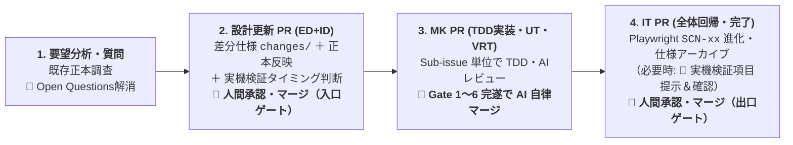

# 開発プロセス・ワークフロー標準（SSOT）

本ドキュメントは、ExLibris（`ex-libris`）プロジェクトにおける開発フェーズ進行、Issue 駆動マイクロ・ウォーターフォール、OKF フロントマターによる成果物ステータス管理、および完了ゲート（Task Completion Gate）の正本（Single Source of Truth）です。

---

## 1. 全体進行モデル（ハイブリッド進行）

プロジェクトのフェーズに応じて、スピードと品質ガバナンスのバランスを最適化したハイブリッド進行を採用します。

| フェーズ      | 名称・目的                                                                                               | 進行・コミット方式                                                                                         |
| :------------ | :------------------------------------------------------------------------------------------------------- | :--------------------------------------------------------------------------------------------------------- |
| **Phase 1**   | **AI開発基盤構築** （`docs/guidelines/`, `AGENTS.md`, Skills, Agents 整備）                           | 人間と対話しながら `main` ブランチ等へ**直接コミット**で迅速に構築                                         |
| **Phase 2**   | **新要求仕様の深掘り・全体骨格設計** （`docs/specs/` 初期正本4冊の策定・合意）                        | 人間と対話しながら**直接コミット**でスピーディに合意形成（合意後 `Approved` 化）                           |
| **Phase 3**   | **PoC（Walking Skeleton）** （Vite+React+Capacitor+Worker+WebGL2+Dexie+CI 構築、技術リスクの縦貫通）   | **GitHub Issue ＋ PR ＋ 独立AIレビュー（`pr-reviewer`）＋ Task Completion Gate（7条件）** を実地検証       |
| **Phase 4〜** | **本開発（イテレーティブ開発）** （PoC基盤を進化継承し、要望単位で機能開発）                          | 要望（親Issue）単位の **Issue駆動マイクロ・ウォーターフォール** ＋ **ミニリリース Milestone 横断レビュー** |

---

## 2. Issue駆動マイクロ・ウォーターフォール（Phase 4 以降の標準サイクル）

要望（親 Issue）に対して、いきなりプロダクションコードを実装してはなりません。1つの要望（Feature / User Story）ごとに、以下の段階的詳細化パイプラインを小刻みに回します。

### 2.1 各ステップの進行規律

1. **Step 1: 要望分析と未確定事項（Open Questions）の確認**:
   - 親 Issue の背景・目的を確認し、既存の App 全体正本（`docs/specs/*.md`, `features/*.md`, `engine/*.md`, `providers/*.md`）とコードベースを調査する。
   - エッジケース、エラー時の振る舞い、メモリ予算・境界値、UI 状態などで未確定事項があれば、推測で決め打ちせず人間に質問して合意を得る。
2. **Step 2: 設計更新 PR（「差分仕様の作成」＋「App 全体正本への反映」＋「実機検証計画の策定」のセット実施）【👤 人間承認・マージ】**:
   - **① 差分仕様ファイルの作成**: `docs/specs/changes/issue-XX-<slug>.md` を YAML フロントマター `type: spec-delta`, `status: "Review (#親Issue番号)"` で新規作成し、今回の変更目的、仕様・契約の差分、UT/VRT/IT テスト計画、実装 Sub-issue 分割リスト、および後続への申し送り事項（`HO-xx`）・実機検証計画を明記する。
   - **② App 全体正本の同時更新**: 同じ設計 PR 内で、影響を受ける App 全体正本（`requirements.md`, `architecture.md`, `db-schema.md`, `screen-transitions.md`, `features/*.md`, `engine/*.md`, `providers/*.md`）も最新仕様へ反映し、YAML フロントマターの `status` を `"Review (#親Issue番号)"` とする。
   - **③ Android 実機検証の実施粒度（親 Issue 単位 vs. Milestone 一括）の判断と記載**:
     - §2.2 の基準に従い、当該要望の実機検証を **「親 Issue 完了時に実施するか」** または **「Milestone 最終レビュー後にまとめて実施するか」** を判断する。
     - 判断結果と実機検証観点を ①差分仕様書、②親 Issue 本文の進行チェックリスト、③`docs/quality/bug-and-handover-log.md` の `HO-xx` 完了ゲート欄の **3 箇所** に記載する。
   - **人間が設計 PR をレビュー・マージした時点で、差分仕様および更新された App 全体正本は `Approved`（局所的再承認）とみなす**（仕様の入口ゲート）。
3. **Step 3: MK（TDD実装・単体テスト・VRT）【🤖 Gate 1〜6 完遂で AI 自律マージ】**:
   - 分割された Sub-issue ごとに、[docs/guidelines/testing.md](testing.md) に従い TDD（Red → Green → Refactor）で実装する。
   - Sub-issue の推奨粒度は 1 PR あたり 200〜400 行程度（①Engine/Provider/Storage/Bridge ロジック層、②WebGL2・UI 子コンポーネント＋Storybook/VRT 層、③Page 結合層など）。ごく小さな機能は 1 PR に統合可。
   - 実装中に設計の不備・矛盾（原因分類 `D`）を発見した場合は、コードのみを修正せず、**同一 PR 内で差分仕様（`changes/issue-XX-*.md`）と App 全体正本の両方を同時修正** する。
   - MK Sub-issue PR（`Closes #Sub-issue番号`）において、§4 の Task Completion Gate 条件 1〜6 をすべて満たし、かつ **§4.1 の人間エスカレーション条件に該当しない場合、メインエージェント（Orchestrator）は `gh pr merge --squash --delete-branch` で PR を自律マージし、人間のマージを待たずに次の Sub-issue へ進んでよい**。
4. **Step 4: IT（結合テスト・全体回帰保証）・実機検証（対象時）・申し送り精算・差分仕様のアーカイブ【👤 人間承認・マージ】**:
   - Playwright 実ブラウザ結合テスト（`SCN-01`〜）を最新仕様に合わせて更新・追加し、過去機能を含め全シナリオ 100% PASS を確認する（小規模改修では MK PR に同梱可）。
   - `docs/quality/bug-and-handover-log.md` のバグ記録および該当 Issue の申し送り事項（`HO-xx`）がすべて消化（または Milestone 完了前ゲート分として明確に引き継ぎ）されていることを確認する。
   - 親 Issue を完了させる最終 PR（`Closes #親Issue番号`）において、完了した差分仕様ファイルの YAML フロントマター `status` を `"Completed (Archived)"` に更新した上で **`docs/specs/changes/archive/issue-XX-<slug>.md` へ移動（`git mv`）** し、`changes/` 直下には進行中の差分仕様のみが存在する状態を保つ。
   - **📱 親 Issue 単位での実機検証を実施する場合**:
     - 最終 PR（`Closes #親Issue番号`）を作成し、Gate 1〜6 をすべて通過した段階で、AI は人間に **構造化された「Android 実機検証試験項目表」** を提示する。
   - **親 Issue をクローズする最終 PR（`Closes #親Issue番号`）は必ず人間の最終確認・マージを待つ（親 Issue の出口ゲート）**。

### 2.2 Android 実機検証の実施判断基準と試験項目表フォーマット

| 区分                                                  | 判断基準（Step 2 設計時に判定）                                                                                                                                                                                                                                                                                                                                                                                         | `HO-xx` 完了ゲート      | 試験項目表の提示タイミング                                                                                             |
| :---------------------------------------------------- | :---------------------------------------------------------------------------------------------------------------------------------------------------------------------------------------------------------------------------------------------------------------------------------------------------------------------------------------------------------------------------------------------------------------------- | :---------------------- | :--------------------------------------------------------------------------------------------------------------------- |
| **A. 親 Issue 単位で実機検証を実施**                  | 以下の **いずれか 1 つ以上** に該当し、実機での検証観点が複数見込まれる場合： 1. Android ネイティブ層（Java / Capacitor Plugin / Google OAuth / OS 権限・インテント）の新設・変更 2. WebGL2 シェーダー描画（モアレ・`MAX_TEXTURE_SIZE`）、高解像度画像 VRAM 制御（`ImageBitmap.close()`）、または 60fps スワイプ・ピンチズーム・音量キー等の物理操作を伴う変更 3. 実機検証項目が目安 **3 項目以上** 発生する場合 | `親 Issue #XX 完了前`   | **親 Issue の最終 PR（`Closes #親Issue`）が Gate 1〜6 を通過した直後**（人間の最終マージ前）                           |
| **B. Milestone 最終レビュー後に一括で実機検証を実施** | 上記 A に該当しない場合（純粋な ZIP/ファイル名/書誌パーサーロジック、Dexie.js クエリ、標準的な本棚 Web UI コンポーネント変更など、UT / Storybook VRT / Playwright IT で十分に担保でき、実機確認が軽微なスモーク確認に留まる場合）                                                                                                                                                                                       | `Milestone v0.X 完了前` | **Milestone Step 2（横断レビュー指摘是正 PR）を AI が自律マージした直後**（Milestone Step 3 品質分析・最終承認 PR 前） |

- **実機検証試験項目表の提示ルール**:
  1. **検証対象の `HO-xx` / Issue 番号とビルド対象ブランチ（または SHA）**
  2. **カテゴリ別の試験項目表**（`項番` / `確認項目` / `具体的な操作手順` / `期待される結果（OK条件）`）
  3. **効率的な一筆書き確認ルート**（最短手数で全項目を通し確認できる操作順ガイド）

---

## 3. 成果物ステータス管理（OKF YAML フロントマター `status`）

`docs/specs/` 配下の設計ドキュメントの状態は、各ファイル先頭の YAML フロントマター内の `status` フィールドで管理します（詳細は [docs/index.md](../index.md#4-okfopen-knowledge-formatyaml-フロントマター規約) 参照）。

| 状態            | `status` 表記例                         | 意味・遷移条件                                                                                                                                                               |
| :-------------- | :-------------------------------------- | :--------------------------------------------------------------------------------------------------------------------------------------------------------------------------- |
| **`Draft`**     | `Draft`                                 | 初期作成中・対話検討中（Phase 2 の初期ドラフト等）                                                                                                                           |
| **`Review`**    | `"Review (#12)"`                        | PR 提出済み・レビュー待ち。個別作業 PR では必ず `Review` 状態とし、AI が勝手に `Approved` に書き換えてはならない                                                             |
| **`Approved`**  | `"Approved (Phase 2)"` / `Approved`     | 人間レビュアーによる合意・承認完了                                                                                                                                           |
| **`Completed`** | `"Completed (Archived)"`                | 親 Issue の全工程が完了し `docs/specs/changes/archive/` へアーカイブされた差分仕様、または Milestone 完了（Step 3）に伴い `docs/quality/archive/` へアーカイブされた品質記録 |

---

## 4. Task Completion Gate（7つの完了条件）

Phase 3 以降のすべての PR 作業において、**PR を作成しただけで作業完了と報告してはなりません**。以下の7条件を順番に完遂します。

1. **静的検査・自動テスト PASS**:
   - `npm run lint:okf`, `npm run typecheck`, `npm run lint`, `npm run format:check` および対象フェーズの自動テスト（`npm run test:unit`, `npm run test:coverage` で C0/C1/Functions 100%）がすべて PASS していること。
2. **VRT 整合性 PASS**:
   - UI コンポーネント（`*.tsx` / `*.stories.tsx`）を追加・変更した場合、`npm run test:vrt:update` でスナップショット（1280px / 375px）を更新し、`npm run test:vrt` が PASS していること。
3. **PR 作成と Issue 連動設定**:
   - PR 本文に目的・変更内容・検証結果・バグ記録＆申し送りミニテーブルを記載し、原則として `Closes #N` を設定すること（複数 PR に分割する途中段階のみ `Refs #N` を使用）。
   - **AI による Issue の直接クローズ（`gh issue close` 等）や `gh pr review --approve` による自己承認は厳禁**。
4. **GitHub Actions PASS**:
   - リモート上の必須 CI ワークフロー（`quality-gate`）が PASS していること。
5. **独立 AI レビューの実施**:
   - 実装担当とは独立したレビュアー（`.github/agents/pr-reviewer.agent.md`）によるコード・設計照合レビューを実施し、[docs/guidelines/review-comment-format.md](review-comment-format.md) 準拠のコメントが PR に記録されていること。
6. **指摘是正 ＆ 独立レビュアー（`pr-reviewer`）による再レビュー解消確認（Resolve 収束）**:
   - 指摘事項（`[P0]`〜`[P3]`）がある場合、①修正コミット＆再検証、②PR 返信、③`pr-reviewer` Round 2+ 再レビュー依頼、④レビュアーによる解消確認（Resolved）投稿の 4 ステップを完遂すること（**実装側単独での自己完了判定は厳禁**）。
7. **PR 種別に応じたマージ完了（👤 人間承認・マージ待機 または 🤖 AI 自律マージ）**:

| PR 種別                                                                                                          |        マージ権限         | 完了アクション                                                                                                                                                                                                                    |
| :--------------------------------------------------------------------------------------------------------------- | :-----------------------: | :-------------------------------------------------------------------------------------------------------------------------------------------------------------------------------------------------------------------------------- |
| **① Step 2: 設計更新 PR**（`Refs #親Issue`）                                                                     |        **👤 人間**        | Gate 1〜6 完了を人間に報告し、人間の最終確認・マージを待つ（入口ゲート）。                                                                                                                                                        |
| **② Step 3: MK Sub-issue PR**（`Closes #Sub-issue`）                                                             | **🤖 AI（Orchestrator）** | §4.1 のエスカレーション条件に該当しないことを確認の上、`gh pr merge --squash --delete-branch` で自律マージし、直ちに次の Sub-issue（または Step 4）へ進む。                                                                       |
| **③ Step 4: 最終 IT PR / 親 Issue 完了 PR**（`Closes #親Issue`）                                                 |        **👤 人間**        | Gate 1〜6 完了を人間に報告（親 Issue 実機検証対象時は「Android 実機検証試験項目表」を併せて提示）し、人間の最終確認・マージを待つ（出口ゲート）。                                                                                 |
| **④ Milestone Step 2: 横断レビュー指摘是正 PR**（`Closes #Sub-issue` / 実機不具合追加是正 PR 含む）              | **🤖 AI（Orchestrator）** | §4.1 のエスカレーション条件に該当しないことを確認の上、自律マージし、直ちに「Android 実機検証試験項目表」を提示して実機検証フェーズへ進む。                                                                                       |
| **⑤ Milestone Step 3: 品質分析 Kaizen・ログアーカイブ・バージョン更新・最終承認 PR**（`Closes #MilestoneIssue`） |        **👤 人間**        | 横断レビュー是正と実機検証の完全収束後、品質分析レポート・再発防止 Kaizen・バグ＆HO アーカイブ・正本一括 `Approved` 化・`package.json` の `version` 更新（`X.Y.0`）を行い、Gate 1〜6 完了を報告して人間の最終承認・マージを待つ。 |

### 4.1 AI 自律マージの停止（人間エスカレーション）条件

以下のいずれか 1 つ以上に該当する場合は自律マージを停止し、人間に報告して承認・マージを仰がなければなりません：

1. **承認済み外部仕様・契約の変更を伴う原因 `D` の発生**（`AC-xx`, `TR-xx`, Dexie テーブル/インデックス定義、ユーザー向け UI/UX 挙動の変更）。
2. **新規パッケージ・ネイティブ権限・外部通信先の追加**（`package.json`、Gradle、`AndroidManifest.xml`、未承認ドメインの追加）。
3. **ワークフロー・ガバナンス・CI 定義・リリースバージョンの変更**（`AGENTS.md`, `docs/guidelines/*.md`, `.github/workflows/*.yml`, `package.json` の `version` 更新）。
4. **独立 AI レビューの未収束**（3 ラウンド以上収束しない、またはトレードオフ判断が割れた場合）。
5. **親 Issue クローズを兼ねる統合 PR**（`Closes #親Issue番号` を含む PR）。

---

## 5. ミニリリース Milestone と品質改善（Kaizen）ループ

Phase 4 以降は、直近の要望（親 Issue）を 3〜5 件程度束ねた **「ミニリリース Milestone（`v0.1`, `v0.2` 等）」** を設定し、節目に以下の **3段階ゲート** で全体横断レビュー・実機検証・品質分析（Kaizen）・完了承認を実施します。

1. **Step 1: 全体横断レビュー（`phase-final-review`）【👤 人間が各モデルでキック】**:
   - 複数の読み取り専用サブエージェントを用いて、`docs/specs/`、`src/`、`test/`、および `docs/quality/bug-and-handover-log.md` の整合性をアンカリングなしで横断検証し、Milestone 承認 Issue に Round 1 レビュー結果をコメント記録する。
   - マルチモデル並行起動時は、レビュー開始時の既存コメント閲覧を禁止し、**投稿直前のフェッチ採番＋投稿直後の衝突検知 PATCH リナンバー**（[review-comment-format.md §5.1](review-comment-format.md#5-節目横断レビューphase--ミニmilestone-完了レビューの集約形式)）を厳守する。
2. **Step 2: 横断レビュー指摘是正 PR ＆ Android 実機検証【🤖 指摘是正 PR は AI 自律マージ → 📱 人間による実機検証】**:
   - Sub-issue を起票して全 `R1-xx` を是正・台帳記録し、Gate 1〜6 完遂後に AI が自律マージする。
   - 直後に「Android 実機検証試験項目表」を提示し、実機不具合があれば追加是正 PR（AI 自律マージ）で未解決 `HO-xx` が 0 件となるまで収束させる。
3. **Step 3: 品質分析レポート（Kaizen）・バグ記録アーカイブ・正本仕様一括 `Approved` 化・バージョン更新と Milestone 最終承認【👤 人間承認・マージ】**:
   - 最終 PR（`Closes #Milestone承認Issue`）で、①品質分析レポート（`docs/quality/reports/<milestone>.md`）作成とサマリー追記、②`docs/guidelines/testing.md` や `.github/skills/*/SKILL.md` への Kaizen 反映、③完了バグ・解決済み `HO-xx` の `docs/quality/archive/<milestone>-log.md` アーカイブ化、④正本仕様の一括 `Approved` 化、⑤`package.json` の `version` 更新（`X.Y.0`）を一括実施し、人間のマージをもって完了する。

### 5.1 バージョン採番（SemVer）と Git Tag / GitHub Release 自動化ルール

1. **Milestone（`vX.Y`）とリリースバージョン（`X.Y.Z`）の連動**:
   - `MINOR`（`X.Y.0`）は Milestone（`vX.Y`）完了と 1対1 で連動させ、Milestone Step 3 最終承認 PR でのみ更新する（初期開発中は `0.0.0` → `v0.1` 完了時に `0.1.0`）。
   - `PATCH`（`X.Y.Z`）は Milestone 間の緊急 Hotfix 専用とする（人間マージ必須）。
   - メタデータ値（`package.json` `version` / `APP_VERSION` / Android `versionName`）は `v` なし（例: `0.1.0`）、UI 表示（`ExLibris v0.1.0`）・Git Tag・GitHub Release は `v` あり（例: `v0.1.0`）とする。
2. **`package.json` への SSOT 一本化**:
   - アプリバージョンの正本は `package.json` の `"version"` 1箇所のみとし、Web 定数（`src/shared/constants/app.ts`）および Android Gradle（`android/app/build.gradle`）が動的参照する。
3. **Git Tag / GitHub Release の自動発行**:
   - `.github/workflows/release.yml` により、`main` ブランチへ `package.json` の変更がマージされた際、対応するタグ `vX.Y.Z` と GitHub Release（品質レポートへのリンクおよび `--generate-notes` 付き）を自動発行する。
