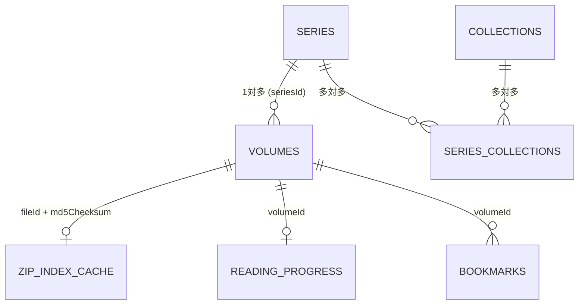

# ExLibris Dexie.js（IndexedDB）ローカルDBスキーマ定義

> [!NOTE]
> **Phase 2（コア仕様策定フェーズ）向け初期骨格（`Draft`）**:
> 本ドキュメントは `ex_libris_concept.md` §3.2・§4・§6.3 に基づく Dexie.js スキーマの初期骨格です。Phase 2 にて複合インデックスおよびマイグレーション規約を確定し、`Approved (Phase 2)` へ昇格させます。

---

## 1. 設計方針

1. **物理ストレージ非依存のローカル完結検索**:
   普段の本棚表示・五十音ソート・タグ絞り込み・インクリメンタル検索は 100% IndexedDB（Dexie.js）上で完結させ、ネットワークアクセスゼロ（目標 10ms 以内）で応答する。
2. **不変ファイル参照（`driveFileId`）によるリンク切れ防止**:
   Google Drive 側でフォルダ移動・リネームが行われても不変である `driveFileId` を保持し、`changes.list` の差分トークン（`driveStartPageToken`）で高速同期する。
3. **テスト決定論性（`resetTestDb()`）**:
   Vitest（`fake-indexeddb`）・Storybook・Playwright IT のすべてで、共通ヘルパー `resetTestDb()` によりクリーンな初期状態を再構築できる構造とする。
4. **端末間同期（LWW）を見据えたタイムスタンプ規律**:
   将来の Google Drive `appDataFolder` 同期（Last-Write-Wins）に備え、ユーザー編集可能なエンティティには論理削除フラグまたは更新時刻 `updatedAt`（UNIX ms）を保持し、システム内部のキャッシュ更新（表紙抽出完了や目次キャッシュ保存）ではユーザーの論理 `updatedAt` を汚染しないようカラム責務を分離する。

---

## 2. 主要テーブル一覧（Draft スケルトン）

### 2.1 `series`（作品シリーズ）

| カラム名 | 型 | インデックス | 説明 |
| :--- | :--- | :---: | :--- |
| `id` | `string` (UUID) | PK | シリーズ一意 ID |
| `title` | `string` | Indexed | 作品タイトル（表示名） |
| `titleReading` | `string` | Indexed | 五十音ソート・検索用の読み仮名（ひらがな/カタカナ正規化） |
| `authors` | `string[]` | MultiEntry (`*authors`) | 著者・原作・作画名リスト |
| `publisher` | `string` | Indexed | 出版社名 |
| `label` | `string` | Indexed | レーベル名 |
| `tags` | `string[]` | MultiEntry (`*tags`) | ジャンル・自由タグ |
| `publicationStatus` | `'ongoing' \| 'completed' \| 'unknown'` | Indexed | 連載状況 |
| `knownTotalVolumes` | `number \| null` | - | 公開書誌上の既刊巻数（欠巻・新刊判定用） |
| `metadataLocked` | `boolean` | - | 手動編集保護ロックフラグ |
| `representativeVolumeId` | `string \| null` | - | シリーズ代表表紙として使用する `volumes.id` |
| `shaderPresetJson` | `string \| null` | - | 作品別の WebGL2 画質補正・綴じ方向プリセット |
| `createdAt` | `number` | Indexed | 作成日時（UNIX ms） |
| `updatedAt` | `number` | Indexed | ユーザー論理更新日時（UNIX ms） |

### 2.2 `volumes`（巻・実アーカイブ参照）

| カラム名 | 型 | インデックス | 説明 |
| :--- | :--- | :---: | :--- |
| `id` | `string` (UUID) | PK | 巻一意 ID |
| `seriesId` | `string` | Indexed | 所属する `series.id` |
| `volumeNumber` | `number \| null` | Indexed | 推定または手動設定された巻数（ソート・欠巻判定用） |
| `rawFileName` | `string` | - | ストレージ上の元ファイル名 |
| `storageType` | `'gdrive' \| 'http' \| 'local'` | Indexed | ストレージ種別 |
| `driveFileId` | `string \| null` | Unique/Indexed | Google Drive の不変 `fileId`（`http` 時は URL 識別子） |
| `fileSize` | `number` | - | 正確なバイトサイズ（HEAD リクエスト省略・末尾 Range 計算用） |
| `md5Checksum` | `string \| null` | Indexed | 重複検出および目次キャッシュ無効化判定用ハッシュ |
| `coverBlob` | `Blob \| null` | - | 長辺約 350px の軽量表紙 WebP（約 15〜25KB/冊） |
| `coverStatus` | `'pending' \| 'ready' \| 'error'` | Indexed | 表紙抽出キュー状態 |
| `coverCropMode` | `'full' \| 'left-half' \| 'right-half'` | - | 見開きカバー半裁クロップ設定 |
| `coverPageIndex` | `number` | - | 表紙として採用する論理ページ番号（デフォルト `0`） |
| `isTrashed` | `boolean` | Indexed | Drive 側削除検知フラグ |
| `addedAt` | `number` | Indexed | 取り込み日時（UNIX ms） |

### 2.3 `zipIndexCache`（ZIP Central Directory 目次キャッシュ）

| カラム名 | 型 | インデックス | 説明 |
| :--- | :--- | :---: | :--- |
| `cacheKey` | `string` | PK | `${sourceId}:${md5Checksum ?? fileSize}`（2回目以降 0 RTT オープン用） |
| `pageCount` | `number` | - | ゴミ除外・自然順ソート後の総論理ページ数 |
| `entries` | `ZipPageEntry[]` | - | 各ページの `fileName`, `compressionMethod`, `compressedSize`, `uncompressedSize`, `localHeaderOffset`, `physicalEnd` |
| `cachedAt` | `number` | Indexed | キャッシュ保存日時（LRU 整理用） |

### 2.4 `readingProgress` / `bookmarks` / `collections` / `syncMeta`

- **`readingProgress`**: `volumeId` (PK), `currentPageIndex`, `totalPageCount`, `readStatus` (`'unread' | 'reading' | 'completed'`), `spreadPageOffset` (`0 | 1`), `lastReadAt`, `updatedAt`
- **`bookmarks`**: `id` (PK), `volumeId` (Indexed), `pageIndex`, `note`, `createdAt`, `updatedAt`
- **`collections` / `seriesCollections`**: カスタム棚定義・スマートコレクション条件 JSON・シリーズ多対多紐付け
- **`syncMeta`**: `key` (PK: `'driveStartPageToken'`, `'lastAppDataSyncAt'` 等), `value`
